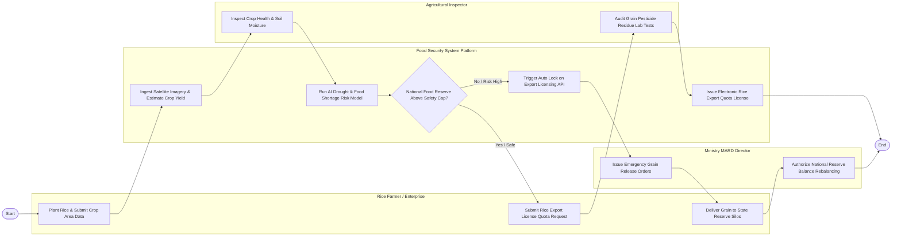

# Swimlane Diagram — National Food Security Management System

## Mermaid Code

## Flow Description | Mô tả luồng

| Lane | Actor | Role in Flow |
|------|-------|-------------|
| 1 | Rice Farmer / Enterprise | Gieo trồng lúa, nộp số liệu diện tích, nộp đơn xin hạn ngạch xuất khẩu gạo và giao lúa vào kho dự trữ. |
| 2 | Food Security System Platform | Thu thập ảnh vệ tinh dự báo sản lượng lúa, chạy AI dự báo thiếu hụt lương thực và tự động khóa cấp quota khi nguy cơ cao. |
| 3 | Agricultural Inspector | Kiểm tra thực địa tình hình dịch bệnh lúa và kiểm nghiệm dư lượng thuốc BVTV đối với các lô hàng lúa gạo. |
| 4 | Ministry MARD Director | Ban hành Quyết định xuất kho gạo dự trữ cứu trợ khẩn cấp và phê duyệt điều chỉnh hạn ngạch xuất khẩu gạo. |
