# Action Tree — National Food Security Management System

## Mermaid Code

```mermaid
graph TD
    Root["National Food Security Management System"]

    Root --> M1["Grain Reserve Warehousing & Silo Inventory"]
    Root --> M2["Satellite Crop Harvest & Drought Prediction AI"]
    Root --> M3["Emergency Grain Dispatch & Relief Distribution"]
    Root --> M4["Rice Export Licensing & Quota Control"]
    Root --> M5["Food Safety Inspection & Quality Standards"]
    Root --> M6["MARD Food BI & National Analytics"]

    M1 --> A11["Monitor National Grain Reserve Inventory"]
    M1 --> A12["Manage National Reserve Silo Warehouses"]
    M1 --> A13["Monitor Silo IoT Temperature Humidity"]
    M1 --> A14["Rotate Grain Storage Expiry Stocks"]

    M2 --> A21["Track Rice Crop Harvest Yield Satellite"]
    M2 --> A22["Predict Food Shortage Drought AI"]
    M2 --> A23["Calculate NDVI Satellite Vegetation Indices"]
    M2 --> A24["Map Salinity Intrusion Risk Heatmaps"]

    M3 --> A31["Issue Emergency Grain Release Orders"]
    M3 --> A32["Allocate Emergency Food Relief Grain"]
    M3 --> A33["Inspect Cold Storage Logistics Facilities"]
    M3 --> A34["Dispatch Commodity Transport Fleets"]

    M4 --> A41["Permit Rice Export License Quotas"]
    M4 --> A42["Track Cereal Price Inflation Index FAO"]
    M4 --> A43["Auto-Lock Export Licensing On Crisis"]
    M4 --> A44["Dispute Grain Purchase Contracts"]

    M5 --> A51["Audit Food Safety Contamination Tests"]
    M5 --> A52["Audit Food Quality Standards Certs"]
    M5 --> A53["Monitor Fertilizer Crop Supply Chains"]
    M5 --> A54["Verify Organic Rice Product Origins"]

    M6 --> A61["Export National Food Reserve Analytics"]
    M6 --> A62["Calculate 3-Month Reserve Balance Index"]
    M6 --> A63["Log System Immutable Food Audits"]
    M6 --> A64["Archive Grain Stock Control Ledgers"]
```

## Module Description | Mô tả Module

| # | Module | Description | Actions |
|---|--------|-------------|---------|
| 1 | Grain Reserve Warehousing & Silo Inventory | Giám sát tồn kho gạo dự trữ quốc gia thời gian thực tại các kho Silo, cảm biến IoT nhiệt độ độ ẩm và xoay vòng lúa gạo | Monitor National Grain Reserve Inventory, Manage National Reserve Silo Warehouses, Monitor Silo IoT Temperature Humidity, Rotate Grain Storage Expiry Stocks |
| 2 | Satellite Crop Harvest & Drought Prediction AI | Dự báo sản lượng lúa bằng ảnh vệ tinh Sentinel-2/NDVI, thuật toán AI dự báo nguy cơ hạn hán xâm nhập mặn thiếu hụt | Track Rice Crop Harvest Yield Satellite, Predict Food Shortage Drought AI, Calculate NDVI Satellite Vegetation Indices, Map Salinity Intrusion Risk Heatmaps |
| 3 | Emergency Grain Dispatch & Relief Distribution | Ban hành lệnh xuất kho gạo dự trữ cứu trợ khẩn cấp thiên tai bão lũ, phân bổ gạo cứu trợ nhân đạo và điều động vận tải | Issue Emergency Grain Release Orders, Allocate Emergency Food Relief Grain, Inspect Cold Storage Logistics Facilities, Dispatch Commodity Transport Fleets |
| 4 | Rice Export Licensing & Quota Control | Cấp phép hạn ngạch xuất khẩu gạo quốc tế, theo dõi chỉ số giá FAO, tự động khóa quota khi biến động và giải quyết khiếu nại | Permit Rice Export License Quotas, Track Cereal Price Inflation Index FAO, Auto-Lock Export Licensing On Crisis, Dispute Grain Purchase Contracts |
| 5 | Food Safety Inspection & Quality Standards | Thẩm định chứng nhận kiểm nghiệm dư lượng thuốc BVTV trong gạo, kiểm tra tiêu chuẩn chất lượng VietGAP và nguồn phân bón | Audit Food Safety Contamination Tests, Audit Food Quality Standards Certs, Monitor Fertilizer Crop Supply Chains, Verify Organic Rice Product Origins |
| 6 | MARD Food BI & National Analytics | Trích xuất báo cáo cân đối an ninh lương thực quốc gia nộp Thủ tướng Chính phủ, tính chỉ số dự trữ 3 tháng và lưu trữ sổ sách | Export National Food Reserve Analytics, Calculate 3-Month Reserve Balance Index, Log System Immutable Food Audits, Archive Grain Stock Control Ledgers |
