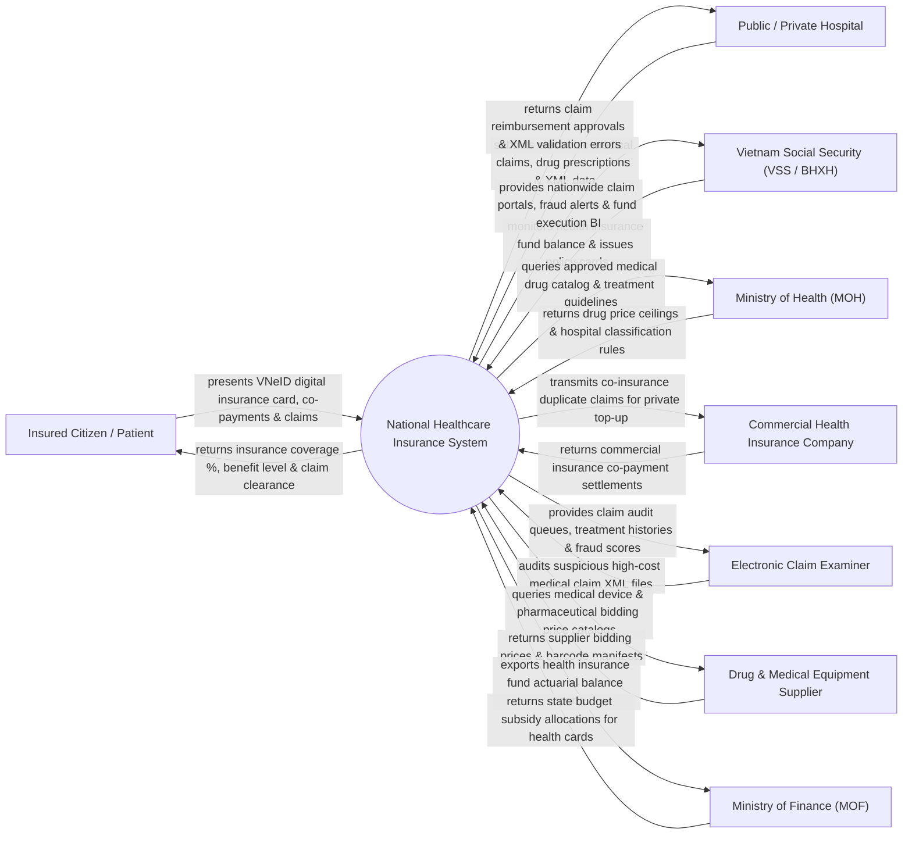

# Context Diagram — National Healthcare Insurance System

## Mermaid Code

## Actor & Interaction Table | Bảng Actor & Tương tác

| # | Actor | Actor Type | Data Sent TO System | Data Received FROM System | Notes |
|---|-------|------------|---------------------|---------------------------|-------|
| 1 | Insured Citizen / Patient | Primary | VNeID digital health insurance card QR, co-payment money, direct claim files | Coverage percentage (80-100%), benefit level, claim clearance | Người dân tham gia Bảo hiểm Y tế (BHYT) khám chữa bệnh |
| 2 | Public / Private Hospital | Primary | Electronic medical claim XML files, ICD-10 diagnostic codes, prescriptions | Claim reimbursement approvals, XML validation errors, capitation funds | Các cơ sở khám chữa bệnh BHYT công lập và tư nhân |
| 3 | Vietnam Social Security (VSS / BHXH) | Primary | Health insurance policy rules, contribution rates, fund allocations | Nationwide claim portals, fraud alerts, fund execution BI dashboards | Bảo hiểm Xã hội Việt Nam quản lý Quỹ BHYT quốc gia |
| 4 | Ministry of Health (MOH) | Regulatory | Approved medical drug catalog, treatment guidelines, hospital ranks | Health insurance fund utilization statistics, drug spending BI | Bộ Y tế quy định danh mục thuốc, kỹ thuật y tế được BHYT chi trả |
| 5 | Commercial Health Insurance Company | Supporting | Commercial insurance co-payment settlements, policy links | Co-insurance duplicate claims for private top-up insurance | Các công ty bảo hiểm thương mại kết nối chi trả phần đồng chi trả |
| 6 | Electronic Claim Examiner | Supporting | Claim audit decisions, price adjustments, rejection reasons | Claim audit queues, treatment histories, AI fraud risk scores | Giám định viên BHYT thuộc BHXH Việt Nam kiểm tra hồ sơ |
| 7 | Drug & Medical Equipment Supplier | Supporting | Supplier bidding prices, pharmaceutical barcode manifests | Drug catalog query requests | Doanh nghiệp dược phẩm và thiết bị y tế trúng thầu |
| 8 | Ministry of Finance (MOF) | Regulatory | State budget subsidy allocations for poor/under-6 children cards | Health insurance fund actuarial balance reports, financial stats | Bộ Tài chính cấp ngân sách hỗ trợ đóng BHYT cho đối tượng yếu thế |

## System Boundary Description | Mô tả Phạm vi Hệ thống

Hệ thống National Healthcare Insurance System (Hệ thống Bảo hiểm Y tế Quốc gia / VSS Health Insurance System) chịu trách nhiệm tự động hóa quy trình quản lý và chi trả Quỹ BHYT toàn quốc: Xác thực thẻ BHYT điện tử qua ứng dụng VNeID / CCCD gắn chíp, tiếp nhận và giám định tự động Cổng tiếp nhận dữ liệu XML khám chữa bệnh BHYT từ các bệnh viện, tự động tính tỷ lệ đồng chi trả (80%, 95%, 100%), sử dụng thuật toán AI phát hiện lạm dụng/trục lợi quỹ BHYT (như chỉ định dịch vụ quá mức, lập hồ sơ khống), quản lý chuyển tuyến KCB và thanh toán trực tiếp. Tuy nhiên, hệ thống KHÔNG trực tiếp khám bệnh/kê đơn cho bệnh nhân và KHÔNG thay thế việc chẩn đoán chuyên môn của bác sĩ.
