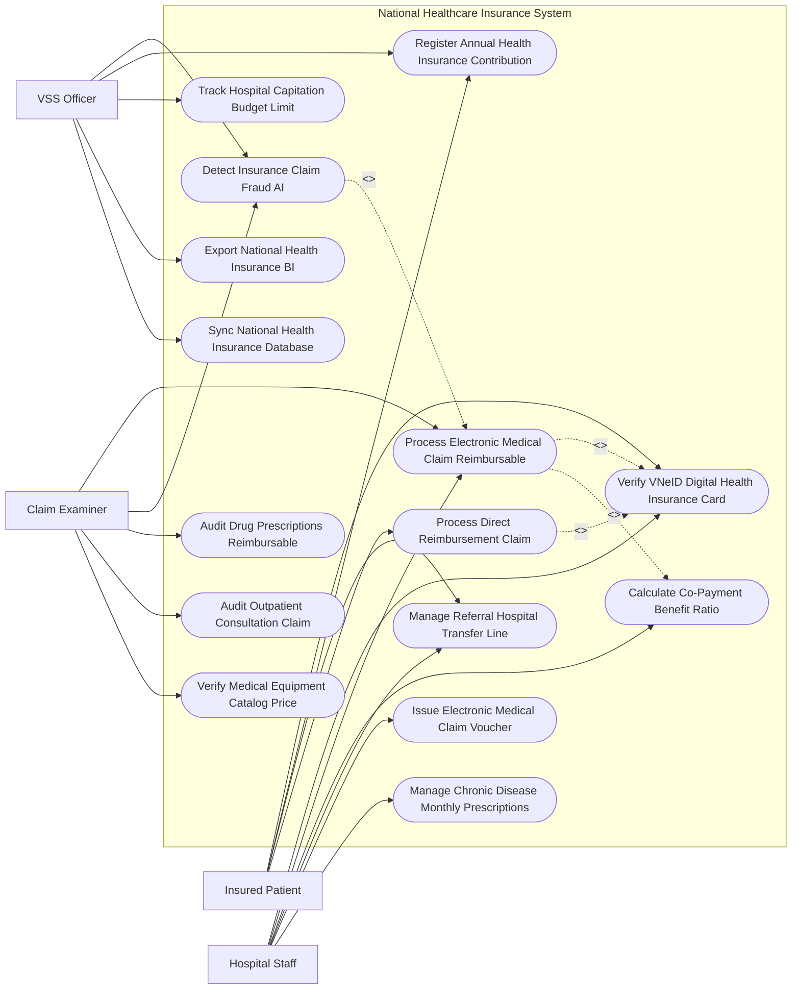

# Use Case Diagram — National Healthcare Insurance System

## Mermaid Code

## Actor Table | Bảng Actor

| # | Actor | Actor Type | Role Description | Related Use Cases |
|---|-------|------------|------------------|-------------------|
| 1 | Insured Patient | Primary | Bệnh nhân xuất trình thẻ BHYT VNeID, thanh toán tiền đồng chi trả, xin chuyển tuyến và xin thanh toán trực tiếp | UC01, UC05, UC07, UC13 |
| 2 | Hospital Staff | Primary | Nhân viên y tế/kế toán bệnh viện xác thực thẻ BHYT, đẩy dữ liệu XML chi phí KCB và in phiếu thanh toán | UC01, UC02, UC04, UC07, UC08, UC11 |
| 3 | Claim Examiner | Primary | Giám định viên BHYT kiểm tra hồ sơ XML, thẩm định tính hợp lý của đơn thuốc, xét nghiệm và xuất cảnh báo | UC02, UC03, UC06, UC10, UC12 |
| 4 | VSS Officer | Primary | Cán bộ BHXH quản lý thu BHYT, theo dõi quỹ định suất bệnh viện, quét AI chống trục lợi và xuất báo cáo BI | UC03, UC05, UC09, UC14, UC15 |

## Use Case Table | Bảng Use Case

| # | UC ID | Use Case Name | Primary Actor | Secondary Actor | Description | Priority |
|---|-------|---------------|---------------|-----------------|-------------|----------|
| 1 | UC01 | Verify VNeID Digital Health Insurance Card | Patient, Hospital | VNeID | Xác thực thẻ BHYT điện tử qua VNeID/CCCD gắn chíp, kiểm tra thời hạn và quyền lợi KCB | High |
| 2 | UC02 | Process Electronic Medical Claim Reimbursable | Hospital, Examiner | VSS | Tiếp nhận và giám định tự động tệp dữ liệu XML chi phí KCB BHYT từ các bệnh viện | High |
| 3 | UC03 | Detect Insurance Claim Fraud AI | Examiner, VSS | AI Engine | Thuật toán AI quét phát hiện hành vi lạm dụng/trục lợi quỹ BHYT (chỉ định trùng, khống dịch vụ) | High |
| 4 | UC04 | Calculate Co-Payment Benefit Ratio | Hospital | Patient | Tự động tính tỷ lệ BHYT chi trả (100%, 95%, 80%) và số tiền bệnh nhân phải đồng chi trả | High |
| 5 | UC05 | Register Annual Health Insurance Contribution | Patient, VSS | MOF | Đăng ký mua và gia hạn BHYT hộ gia đình, BHYT học sinh sinh viên trực tuyến | High |
| 6 | UC06 | Audit Drug Prescriptions Reimbursable | Examiner | MOH | Thẩm định tính hợp lý của chỉ định thuốc BHYT so với Danh mục thuốc quy định của Bộ Y tế | High |
| 7 | UC07 | Manage Referral Hospital Transfer Line | Patient, Hospital | - | Quản lý Giấy chuyển tuyến KCB BHYT điện tử giữa các tuyến bệnh viện (Tuyến xã đến Trung ương) | High |
| 8 | UC08 | Issue Electronic Medical Claim Voucher | Hospital | Patient | In Giấy thanh toán chi phí KCB BHYT (Mẫu 01/BV) kèm bảng kê chi tiết dịch vụ | High |
| 9 | UC09 | Track Hospital Capitation Budget Limit | VSS | Hospital | Quản lý quỹ định suất và trần chi phí KCB giao cho từng cơ sở y tế | High |
| 10 | UC10 | Audit Outpatient Consultation Claim | Examiner | Hospital | Giám định chi tiết các hồ sơ KCB ngoại trú, chi phí tiền khám và xét nghiệm máu/X-quang | Medium |
| 11 | UC11 | Manage Chronic Disease Monthly Prescriptions | Hospital | Patient | Cấp phát thuốc BHYT định kỳ hàng tháng cho bệnh nhân mắc bệnh mãn tính (Tăng huyết áp, Đái tháo đường) | Medium |
| 12 | UC12 | Verify Medical Equipment Catalog Price | Examiner | MOH | Kiểm tra giá trúng thầu và tính hợp lệ của vật tư y tế, thủy tinh thể, stent tim mạch | High |
| 13 | UC13 | Process Direct Reimbursement Claim | Patient | VSS | Giải quyết hồ sơ đề nghị BHXH thanh toán trực tiếp chi phí KCB cho bệnh nhân mua thuốc ngoài | Medium |
| 14 | UC14 | Export National Health Insurance BI | VSS | Executive | Trích xuất báo cáo cân đối Quỹ BHYT toàn quốc nộp Tổng Giám đốc BHXH Việt Nam | Low |
| 15 | UC15 | Sync National Health Insurance Database | System | VSSDB | Đồng bộ dữ liệu lịch sử KCB thời gian thực về CSDL Giám định BHYT Tập trung Quốc gia | High |

## Use Case Specification | Đặc tả Use Case

---

### UC01 — Verify VNeID Digital Health Insurance Card

| Field | Detail |
|-------|--------|
| **UC ID** | UC01 |
| **Use Case Name** | Verify VNeID Digital Health Insurance Card |
| **Actor(s)** | Primary: Insured Patient, Hospital Staff / Secondary: VNeID System |
| **Description** | Bệnh viện quét mã QR thẻ BHYT trên VNeID hoặc CCCD gắn chíp để kiểm tra thông tin hợp lệ của thẻ BHYT và mức hưởng. |
| **Precondition** | 1. Bệnh nhân đến khám chữa bệnh tại cơ sở y tế có ký hợp đồng KCB BHYT. |
| **Main Flow** | 1. Patient xuất trình mã QR Thẻ BHYT trên ứng dụng VNeID (hoặc đưa thẻ CCCD gắn chíp) tại quầy Đón tiếp bệnh viện.   2. HospitalStaff quét mã QR bằng máy quét đầu đọc.   3. System kết nối CSDL Giám định BHYT Tập trung Quốc gia (VSS) xác thực thông tin thẻ.   4. System trả về thông tin thẻ: Số thẻ BHYT, Họ tên bệnh nhân, Ngày sinh, Địa chỉ KCB ban đầu, Mã mức hưởng (Mức 1: 100%, Mức 2: 100% không cùng chi trả, Mức 3: 95%, Mức 4: 80%).   5. System kiểm tra Ngày thời gian 05 năm liên tục: If Đạt 05 năm liên tục $\rightarrow$ Đánh dấu miễn cùng chi trả nếu chi phí trong năm $> 6$ tháng lương cơ sở.   6. HospitalStaff xác nhận bệnh nhân đủ điều kiện KCB BHYT và làm thủ tục vào phòng khám.   7. System tự động mở Bệnh án BHYT điện tử của bệnh nhân. |
| **Alternative Flow** | **AF1** — Thẻ BHYT hết hạn sử dụng: HospitalStaff thông báo cho bệnh nhân, hỗ trợ hướng dẫn gia hạn BHYT trực tuyến ngay trên ứng dụng VNeID (UC05). |
| **Exception Flow** | **EX1** — Thông tin trên thẻ BHYT mâu thuẫn với VNeID (Trùng mã thẻ nhưng khác họ tên): System báo động Đỏ "Thẻ nghi vấn mượn của người khác", yêu cầu bệnh nhân xuất trình giấy tờ tùy thân có ảnh để đối soát. |
| **Postcondition** | Thẻ BHYT được xác thực hợp lệ, mở luồng chi trả chi phí KCB tự động cho bệnh nhân (UC02). |
| **Business Rule** | **BR1**: 100% các cơ sở KCB BHYT bắt buộc phải chấp nhận xác thực thẻ BHYT điện tử qua VNeID và CCCD gắn chíp. |

---

### UC02 — Process Electronic Medical Claim Reimbursable

| Field | Detail |
|-------|--------|
| **UC ID** | UC02 |
| **Use Case Name** | Process Electronic Medical Claim Reimbursable |
| **Actor(s)** | Primary: Hospital Staff, Electronic Claim Examiner / Secondary: VSS |
| **Description** | Bệnh viện đẩy tệp dữ liệu XML chi phí KCB lên Cổng Giám định BHYT, hệ thống tự động giám định và từ chối các khoản chi sai quy định. |
| **Precondition** | 1. Bệnh nhân hoàn thành đợt khám ngoại trú hoặc đợt điều trị nội trú ra viện. |
| **Main Flow** | 1. Kế toán bệnh viện trích xuất tệp XML dữ liệu chi phí KCB (gồm 5 file XML chuẩn do Bộ Y tế quy định: XML1-Tổng hợp KCB, XML2-Thuốc, XML3-Dịch vụ kỹ thuật/VTYT, XML4-Cận lâm sàng, XML5-Diễn biến bệnh án).   2. HospitalStaff bấm "Gửi dữ liệu lên Cổng Giám định BHYT".   3. Cổng Giám định BHYT tiếp nhận và kích hoạt Tiến trình Giám định Tự động (Auto-Audit Rules Engine).   4. System kiểm tra các quy tắc giám định tự động ($> 200$ quy tắc):   - Kiểm tra giá dịch vụ KCB, đơn giá thuốc, vật tư y tế vs Danh mục giá được phê duyệt.   - Kiểm tra tần suất chỉ định xét nghiệm/X-quang (Chống chỉ định lặp lại trong ngày).   - Kiểm tra tương tác thuốc và liều dùng theo hướng dẫn của Bộ Y tế (UC06).   - Kiểm tra điều kiện chi trả của mã bệnh ICD-10 vs Dịch vụ kỹ thuật.   5. System tự động tính toán tổng số tiền Quỹ BHYT chấp nhận thanh toán và số tiền xuất toán từ chối (nếu có lỗi).   6. System phát hành Thông báo kết quả giám định điện tử gửi lại cho bệnh viện.   7. ClaimExaminer thực hiện giám định tập trung các hồ sơ bị cảnh báo lỗi trước khi chuyển tiền quyết toán. |
| **Alternative Flow** | **AF1** — Bệnh viện giải trình hồ sơ bị xuất toán: Kế toán bệnh viện gửi tệp XML giải trình đính kèm văn bản chuyên môn, ClaimExaminer xem xét chấp nhận thanh toán lại. |
| **Exception Flow** | **EX1** — Tệp XML gửi lên bị sai định dạng chuẩn của Bộ Y tế: System tự động trả về lỗi "XML Format Invalid", yêu cầu bệnh viện chuẩn hóa lại dữ liệu. |
| **Postcondition** | Hồ sơ KCB BHYT được giám định minh bạch, Quỹ BHYT thực hiện quyết toán chuyển tiền cho bệnh viện. |
| **Business Rule** | **BR1**: Tệp dữ liệu XML chi phí KCB phải được bệnh viện gửi lên Cổng Giám định BHYT trong vòng 07 ngày kể từ khi người bệnh ra viện. |

---

### UC03 — Detect Insurance Claim Fraud AI

| Field | Detail |
|-------|--------|
| **UC ID** | UC03 |
| **Use Case Name** | Detect Insurance Claim Fraud AI |
| **Actor(s)** | Primary: Electronic Claim Examiner, VSS Officer / Secondary: AI Engine |
| **Description** | Thuật toán AI Machine Learning phân tích chuỗi dữ liệu XML KCB toàn quốc để phát hiện các hành vi lạm dụng, trục lợi Quỹ BHYT. |
| **Precondition** | 1. Dữ liệu XML KCB BHYT từ tất cả các bệnh viện toàn quốc được đẩy về CSDL Giám định Tập trung (UC02, UC15). |
| **Main Flow** | 1. AI Machine Learning Engine chạy thuật toán phân tích phát hiện bất thường (Anomaly Detection).   2. AI quét các mô hình trục lợi Quỹ BHYT phổ biến:   - Lạm dụng thẻ BHYT đi khám nhiều lần trong ngày/tuần tại các bệnh viện khác nhau (Doctor Shopping / Hospital Hopping).   - Chỉ định dịch vụ kỹ thuật cao (MRI, CT-Scanner) quá mức trung bình của các bệnh viện cùng hạng ($> 30\%$).   - Kê đơn thuốc BHYT số lượng lớn rồi thu gom bán ra ngoài (Kê khống đơn thuốc).   - Lập hồ sơ bệnh án khống (Bệnh nhân không nằm viện nhưng vẫn có chi phí thanh toán BHYT).   3. If Phát hiện điểm bất thường ($Risk\_Score > 80\%$): AI bật cảnh báo Đỏ "Nghi vấn trục lợi Quỹ BHYT".   4. System tự động khoanh vùng hồ sơ, hiển thị chi tiết các chỉ số bất thường và xếp hạng rủi ro của cơ sở KCB.   5. ClaimExaminer lập tức thành lập Đoàn giám định đột xuất đến kiểm tra thực tế tại bệnh viện.   6. ClaimExaminer lập biên bản tạm dừng thanh toán các khoản chi vi phạm và chuyển cơ quan Công an xử lý nếu có dấu hiệu tội phạm hình sự. |
| **Alternative Flow** | **AF1** — Cảnh báo do đợt dịch bệnh bùng phát tại địa phương: ClaimExaminer cập nhật thông tin dịch bệnh, System điều chỉnh lại ngưỡng cảnh báo AI cho vùng dịch. |
| **Exception Flow** | **EX1** — Cảnh báo nhầm (False Positive): ClaimExaminer xác minh bệnh nhân mắc bệnh hiểm nghèo cần điều trị tần suất cao, bấm "Xác nhận hồ sơ hợp lệ". |
| **Postcondition** | Quỹ BHYT được bảo vệ an toàn, ngăn chặn hàng ngàn tỷ đồng bị lãng phí và trục lợi bất hợp pháp. |
| **Business Rule** | **BR1**: Các cơ sở KCB có tỷ lệ cảnh báo trục lợi AI cao sẽ bị đưa vào danh sách giám sát trọng điểm và kiểm tra 100% hồ sơ. |

---

### UC04 — Calculate Co-Payment Benefit Ratio

| Field | Detail |
|-------|--------|
| **UC ID** | UC04 |
| **Use Case Name** | Calculate Co-Payment Benefit Ratio |
| **Actor(s)** | Primary: Hospital Staff / Secondary: Insured Patient |
| **Description** | Tự động tính toán tỷ lệ Quỹ BHYT chi trả và số tiền đồng chi trả bệnh nhân phải nộp dựa trên mức hưởng, tuyến KCB và tổng chi phí. |
| **Precondition** | 1. Bệnh nhân đã được xác thực thẻ BHYT hợp lệ (UC01) và có bảng kê chi phí KCB. |
| **Main Flow** | 1. HospitalStaff nạp danh mục chi phí KCB của bệnh nhân (Tiền khám, tiền thuốc, tiền xét nghiệm, tiền giường).   2. System kiểm tra Mã mức hưởng BHYT của bệnh nhân (Mức 1: 100%, Mức 3: 95%, Mức 4: 80%).   3. System kiểm tra Tuyến khám chữa bệnh:   - Đúng tuyến (hoặc Có giấy chuyển tuyến UC07): Quỹ BHYT chi trả 100% theo mức hưởng.   - Trái tuyến nội trú tuyến Tỉnh: Quỹ BHYT chi trả 100% chi phí điều trị nội trú.   - Trái tuyến nội trú tuyến Trung ương: Quỹ BHYT chi trả 40% chi phí điều trị nội trú.   4. System kiểm tra điều kiện Tổng chi phí 01 lần KCB $< 15\%$ tháng lương cơ sở: If Thỏa mãn $\rightarrow$ Quỹ BHYT chi trả 100% chi phí.   5. System tự động tính toán hai dòng tiền:   - $Số\_tiền\_BHYT\_chi\_trả = Tổng\_chi\_phí \times Tỷ\_lệ\_hưởng$.   - $Số\_tiền\_bệnh\_nhân\_đồng\_chi\_trả = Tổng\_chi\_phí - Số\_tiền\_BHYT\_chi\_trả$.   6. System xuất Bảng kê chi phí KCB BHYT (Mẫu 01/BV) cho bệnh nhân kiểm tra và nộp tiền đồng chi trả tại quầy viện phí. |
| **Alternative Flow** | **AF1** — Bệnh nhân có Thẻ Bảo hiểm Thương mại bổ sung: System tự động kết nối API xuất dữ liệu sang Công ty Bảo hiểm tư nhân chi trả phần tiền đồng chi trả. |
| **Exception Flow** | **EX1** — Bệnh nhân sử dụng thuốc/dịch vụ ngoài danh mục BHYT chi trả: System bóc tách riêng khoản chi này thành "Chi phí tự túc 100%", bệnh nhân phải tự thanh toán. |
| **Postcondition** | Số tiền đồng chi trả được tính toán minh bạch, đúng chính sách pháp luật, đảm bảo quyền lợi tối đa cho người bệnh. |
| **Business Rule** | **BR1**: Mọi công thức tính toán mức hưởng BHYT phải cập nhật chính xác theo Luật Bảo hiểm Y tế sửa đổi hiện hành. |

---

### UC07 — Manage Referral Hospital Transfer Line

| Field | Detail |
|-------|--------|
| **UC ID** | UC07 |
| **Use Case Name** | Manage Referral Hospital Transfer Line |
| **Actor(s)** | Primary: Insured Patient, Hospital Staff / Secondary: None |
| **Description** | Quản lý và cấp Giấy chuyển tuyến KCB BHYT điện tử cho bệnh nhân khi vượt quá khả năng chuyên môn của bệnh viện tuyến dưới. |
| **Precondition** | 1. Bác sĩ điều trị chẩn đoán tình trạng bệnh nhân vượt quá khả năng kỹ thuật của bệnh viện hiện tại. |
| **Main Flow** | 1. Doctor mở Phân hệ Chuyển tuyến KCB BHYT trên phần mềm bệnh viện (HIS).   2. Doctor nhập Tóm tắt bệnh án, kết quả xét nghiệm, lý do chuyển tuyến (Vượt khả năng chuyên môn / Theo yêu cầu điều trị chuyên sâu).   3. Doctor chọn Bệnh viện tuyến trên tiếp nhận (Bệnh viện tuyến Tỉnh hoặc Bệnh viện tuyến Trung ương).   4. Giám đốc bệnh viện ký số phê duyệt Giấy chuyển tuyến KCB BHYT điện tử.   5. System tự động đẩy Giấy chuyển tuyến điện tử lên CSDL Giám định BHYT Quốc gia.   6. System tự động liên kết Giấy chuyển tuyến vào Thẻ BHYT VNeID của Patient.   7. When Patient đến Bệnh viện tuyến trên: Bệnh viện tuyến trên quét mã QR VNeID (UC01), System tự động nhận diện Giấy chuyển tuyến hợp lệ và áp dụng Mức hưởng Đúng tuyến (100% mức hưởng - UC04). |
| **Alternative Flow** | **AF1** — Chuyển tuyến cấp cứu khẩn cấp: Bác sĩ phát hành Giấy chuyển tuyến cấp cứu ngay lập tức, bệnh nhân được hưởng 100% mức hưởng KCB đúng tuyến tại bất kỳ bệnh viện nào toàn quốc. |
| **Exception Flow** | **EX1** — Giấy chuyển tuyến hết hạn sử dụng (Quá 10 ngày làm việc kể từ ngày ký): System báo "Giấy chuyển tuyến hết hạn", bệnh nhân phải làm lại thủ tục hoặc chấp nhận KCB trái tuyến. |
| **Postcondition** | Giấy chuyển tuyến điện tử liên thông toàn quốc, loại bỏ hoàn toàn tình trạng xin - cho giấy chuyển tuyến bản giấy. |
| **Business Rule** | **BR1**: Giấy chuyển tuyến KCB BHYT điện tử có giá trị sử dụng trong vòng 10 ngày làm việc kể từ ngày ký phát hành. |
