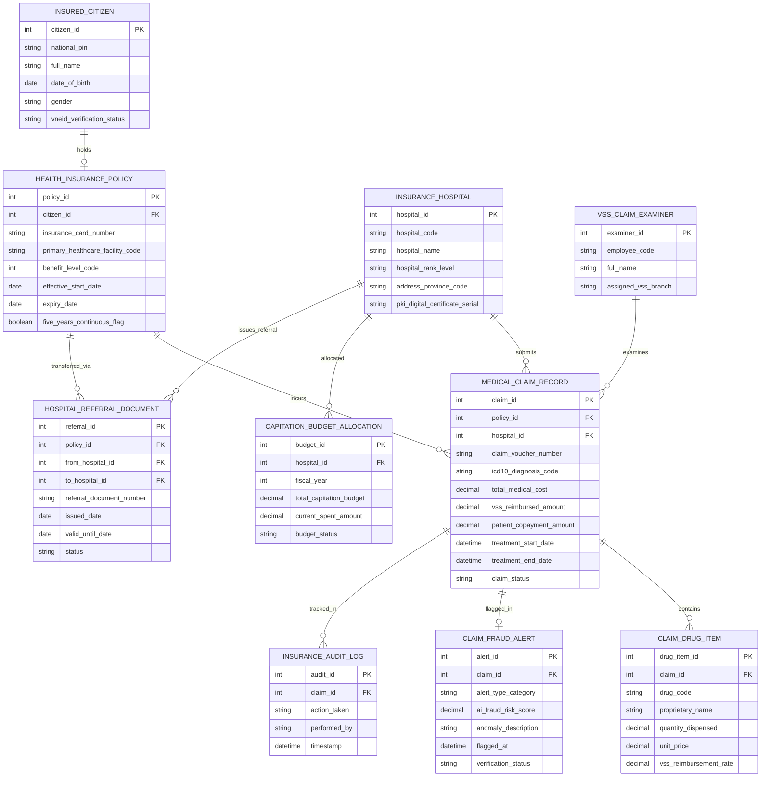

# Conceptual ERD — National Healthcare Insurance System

## Mermaid Code

## Entity Description Table | Bảng mô tả Entity

| # | Entity Name | Vietnamese Name | Description | Key Attributes | Main Relationships |
|---|-------------|-----------------|-------------|----------------|-------------------|
| 1 | INSURED_CITIZEN | Công dân Tham gia BHYT | Thông tin nhân thân, mã định danh VNeID của người dân tham gia BHYT | citizen_id, national_pin, full_name, date_of_birth, vneid_verification_status | Holds HEALTH_INSURANCE_POLICY |
| 2 | HEALTH_INSURANCE_POLICY | Thẻ Bảo hiểm Y tế | Thông tin thẻ BHYT (số thẻ, nơi đăng ký KCB ban đầu, mã mức hưởng 1-4, thời hạn) | policy_id, insurance_card_number, benefit_level_code, expiry_date, five_years_continuous_flag | Belongs to CITIZEN, incurs MEDICAL_CLAIM_RECORD |
| 3 | MEDICAL_CLAIM_RECORD | Hồ sơ Chi phí KCB BHYT | Chi tiết lượt khám chữa bệnh BHYT (mã ICD-10, tổng chi phí, tiền BHYT trả, đồng chi trả) | claim_id, claim_voucher_number, icd10_diagnosis_code, total_medical_cost, vss_reimbursed_amount | Belongs to POLICY, HOSPITAL, contains DRUG_ITEM |
| 4 | CLAIM_DRUG_ITEM | Chi tiết Thuốc BHYT | Danh mục các khoản thuốc kê đơn BHYT chi trả trong lượt khám chữa bệnh | drug_item_id, drug_code, proprietary_name, quantity_dispensed, unit_price | Belongs to MEDICAL_CLAIM_RECORD |
| 5 | INSURANCE_HOSPITAL | Cơ sở KCB BHYT | Thông tin bệnh viện, phòng khám công lập/tư nhân có hợp đồng KCB BHYT | hospital_id, hospital_code, hospital_name, hospital_rank_level, pki_digital_certificate_serial | Submits MEDICAL_CLAIM_RECORD, allocated BUDGET |
| 6 | CLAIM_FRAUD_ALERT | Cảnh báo AI Trục lợi BHYT | Cảnh báo AI phát hiện lạm dụng/trục lợi quỹ BHYT (chỉ định lặp, khống dịch vụ) | alert_id, alert_type_category, ai_fraud_risk_score, anomaly_description | Flagged for MEDICAL_CLAIM_RECORD |
| 7 | HOSPITAL_REFERRAL_DOCUMENT | Giấy Chuyển tuyến KCB | Giấy chuyển tuyến KCB BHYT điện tử giữa các tuyến bệnh viện | referral_id, referral_document_number, issued_date, valid_until_date | Belongs to POLICY, HOSPITAL |
| 8 | VSS_CLAIM_EXAMINER | Giám định viên BHYT | Thông tin cán bộ giám định viên BHYT thuộc BHXH Việt Nam kiểm tra hồ sơ | examiner_id, employee_code, full_name, assigned_vss_branch | Examines MEDICAL_CLAIM_RECORD |
| 9 | CAPITATION_BUDGET_ALLOCATION | Quỹ Định suất Bệnh viện | Hạn mức quỹ định suất KCB BHYT giao cho bệnh viện quản lý trong năm tài chính | budget_id, fiscal_year, total_capitation_budget, current_spent_amount | Belongs to INSURANCE_HOSPITAL |
| 10 | INSURANCE_AUDIT_LOG | Nhật ký Kiểm toán BHYT | Lưu toàn bộ vết xác thực thẻ VNeID, đẩy tệp XML, giám định tự động và gạch nợ Quỹ | audit_id, action_taken, performed_by, timestamp | Belongs to MEDICAL_CLAIM_RECORD |

## Relationship Description | Mô tả Quan hệ

| # | From Entity | Cardinality | To Entity | Relationship Label | Business Explanation |
|---|-------------|-------------|-----------|-------------------|----------------------|
| 1 | INSURED_CITIZEN | one-to-one | HEALTH_INSURANCE_POLICY | holds | Mỗi công dân sở hữu duy nhất một Thẻ bảo hiểm y tế điện tử VNeID |
| 2 | HEALTH_INSURANCE_POLICY | one-to-many | MEDICAL_CLAIM_RECORD | incurs | Một thẻ BHYT phát sinh nhiều lượt khám chữa bệnh và hồ sơ chi phí KCB |
| 3 | INSURANCE_HOSPITAL | one-to-many | MEDICAL_CLAIM_RECORD | submits | Một bệnh viện đẩy hàng ngàn tệp XML hồ sơ chi phí KCB BHYT lên hệ thống |
| 4 | MEDICAL_CLAIM_RECORD | one-to-many | CLAIM_DRUG_ITEM | contains | Một hồ sơ KCB chứa danh mục nhiều loại thuốc BHYT được kê đơn |
| 5 | MEDICAL_CLAIM_RECORD | one-to-one | CLAIM_FRAUD_ALERT | flagged_in | Hồ sơ KCB bất thường bị phát hiện phát sinh duy nhất một Cảnh báo AI trục lợi |
| 6 | HEALTH_INSURANCE_POLICY | one-to-many | HOSPITAL_REFERRAL_DOCUMENT | transferred_via | Thẻ BHYT của bệnh nhân được chuyển tuyến KCB qua các Giấy chuyển tuyến |
| 7 | INSURANCE_HOSPITAL | one-to-many | CAPITATION_BUDGET_ALLOCATION | allocated | Mỗi bệnh viện được giao các gói Quỹ định suất KCB BHYT hàng năm |
| 8 | VSS_CLAIM_EXAMINER | one-to-many | MEDICAL_CLAIM_RECORD | examines | Một giám định viên BHYT thẩm định và duyệt chi trả cho nhiều hồ sơ KCB |
| 9 | MEDICAL_CLAIM_RECORD | one-to-many | INSURANCE_AUDIT_LOG | tracked_in | Mọi thao tác trên hồ sơ chi phí KCB BHYT được ghi lại nhật ký kiểm toán bất biến |
| 10 | INSURANCE_HOSPITAL | one-to-many | HOSPITAL_REFERRAL_DOCUMENT | issues_referral | Một bệnh viện tuyến dưới phát hành nhiều Giấy chuyển tuyến cho bệnh nhân |
