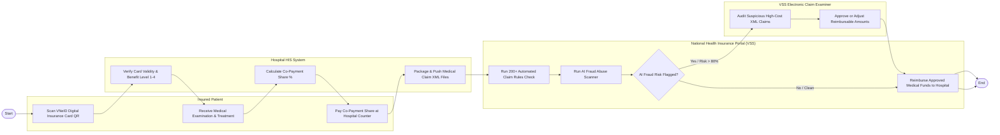

# Swimlane Diagram — National Healthcare Insurance System

## Mermaid Code

## Flow Description | Mô tả luồng

| Lane | Actor | Role in Flow |
|------|-------|-------------|
| 1 | Insured Patient | Quét mã QR thẻ BHYT trên ứng dụng VNeID tại quầy đón tiếp, khám chữa bệnh và nộp phần tiền đồng chi trả. |
| 2 | Hospital HIS System | Tự động xác thực thẻ BHYT và mức hưởng, tính số tiền đồng chi trả, đóng gói 5 tệp XML chi phí KCB đẩy lên Cổng VSS. |
| 3 | National Health Insurance Portal (VSS) | Chạy 200+ quy tắc giám định tự động, quét AI chống lạm dụng/trục lợi Quỹ BHYT và duyệt chuyển tiền quyết toán cho bệnh viện. |
| 4 | VSS Electronic Claim Examiner | Thẩm định trực tiếp các hồ sơ bị AI cảnh báo nghi vấn trục lợi, phê duyệt lại số tiền Quỹ BHYT chi trả. |
