# Action Tree — National Healthcare Insurance System

## Mermaid Code

```mermaid
graph TD
    Root["National Healthcare Insurance System"]

    Root --> M1["VNeID Health Card & Contribution Management"]
    Root --> M2["Electronic Medical Claim & Direct Reimbursement"]
    Root --> M3["Fraud Detection AI & Prescription Audit"]
    Root --> M4["Referral Line & Capitation Budget"]
    Root --> M5["Drug Catalog & Price Control"]
    Root --> M6["VSS BI & National Insurance Database"]

    M1 --> A11["Verify VNeID Digital Health Insurance Cards"]
    M1 --> A12["Register Annual Household Contributions"]
    M1 --> A13["Track 5-Year Continuous Card Status"]
    M1 --> A14["Calculate Co-Payment Benefit Ratios"]

    M2 --> A21["Process Electronic Medical Claim XML Files"]
    M2 --> A22["Issue Electronic Medical Claim Vouchers"]
    M2 --> A23["Process Direct Patient Reimbursement Claims"]
    M2 --> A24["Audit Outpatient Consultation Claims"]

    M3 --> A31["Detect Insurance Claim Fraud AI"]
    M3 --> A32["Audit Drug Prescriptions Reimbursable"]
    M3 --> A33["Detect Hospital Hopping Doctor Shopping"]
    M3 --> A34["Audit Over-Indication Medical Tests"]

    M4 --> A41["Manage Referral Hospital Transfer Lines"]
    M4 --> A42["Track Hospital Capitation Budget Limits"]
    M4 --> A43["Manage Chronic Disease Monthly Prescriptions"]
    M4 --> A44["Manage Cross-Boundary Emergency Claims"]

    M5 --> A51["Verify Medical Equipment Catalog Prices"]
    M5 --> A52["Manage MOH Approved Drug Price Ceiling"]
    M5 --> A53["Audit High-Tech Medical Stent Claims"]
    M5 --> A54["Integrate Commercial Health Co-Insurance"]

    M6 --> A61["Export National Health Insurance BI"]
    M6 --> A62["Calculate Actuarial VSS Fund Balance"]
    M6 --> A63["Sync National Health Insurance Database"]
    M6 --> A64["Log System Immutable Audit Trails"]
```

## Module Description | Mô tả Module

| # | Module | Description | Actions |
|---|--------|-------------|---------|
| 1 | VNeID Health Card & Contribution Management | Xác thực thẻ BHYT điện tử qua VNeID/CCCD gắn chíp, đăng ký đóng BHYT gia đình, theo dõi mốc 5 năm và tính tỷ lệ mức hưởng | Verify VNeID Digital Health Insurance Cards, Register Annual Household Contributions, Track 5-Year Continuous Card Status, Calculate Co-Payment Benefit Ratios |
| 2 | Electronic Medical Claim & Direct Reimbursement | Tiếp nhận và tự động giám định tệp dữ liệu XML chi phí KCB, in phiếu thanh toán Mẫu 01/BV và thanh toán trực tiếp cho bệnh nhân | Process Electronic Medical Claim XML Files, Issue Electronic Medical Claim Vouchers, Process Direct Patient Reimbursement Claims, Audit Outpatient Consultation Claims |
| 3 | Fraud Detection AI & Prescription Audit | Thuật toán AI phát hiện lạm dụng/trục lợi quỹ BHYT (đi khám nhiều bệnh viện trong ngày, chỉ định trùng, kê khống đơn thuốc) | Detect Insurance Claim Fraud AI, Audit Drug Prescriptions Reimbursable, Detect Hospital Hopping Doctor Shopping, Audit Over-Indication Medical Tests |
| 4 | Referral Line & Capitation Budget | Quản lý Giấy chuyển tuyến KCB BHYT điện tử toàn quốc, theo dõi quỹ định suất bệnh viện và cấp thuốc mãn tính hàng tháng | Manage Referral Hospital Transfer Lines, Track Hospital Capitation Budget Limits, Manage Chronic Disease Monthly Prescriptions, Manage Cross-Boundary Emergency Claims |
| 5 | Drug Catalog & Price Control | Kiểm tra đơn giá trúng thầu thuốc/VTYT theo danh mục Bộ Y tế, thẩm định chi phí vật tư y tế kỹ thuật cao và kết nối BHYT tư nhân | Verify Medical Equipment Catalog Prices, Manage MOH Approved Drug Price Ceiling, Audit High-Tech Medical Stent Claims, Integrate Commercial Health Co-Insurance |
| 6 | VSS BI & National Insurance Database | Trích xuất báo cáo phân tích cân đối Quỹ BHYT toàn quốc nộp Tổng Giám đốc BHXH, đồng bộ CSDL Quốc gia và kiểm toán bất biến | Export National Health Insurance BI, Calculate Actuarial VSS Fund Balance, Sync National Health Insurance Database, Log System Immutable Audit Trails |
