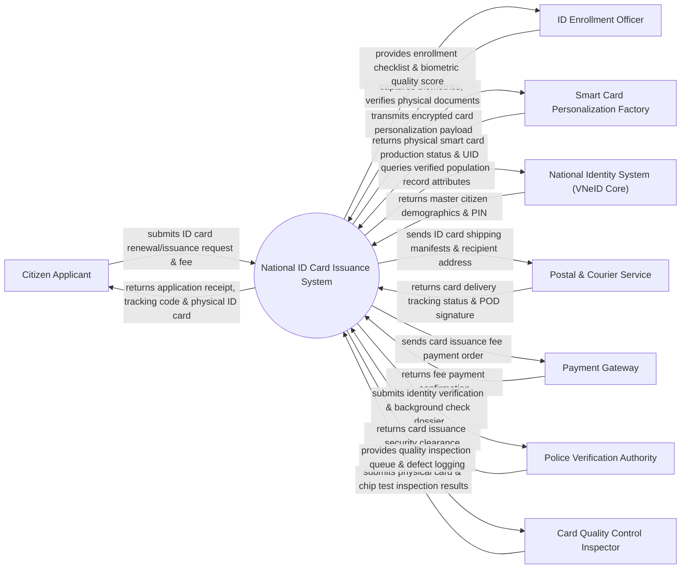

# Context Diagram — National ID Card Issuance System

## Mermaid Code

## Actor & Interaction Table | Bảng Actor & Tương tác

| # | Actor | Actor Type | Data Sent TO System | Data Received FROM System | Notes |
|---|-------|------------|---------------------|---------------------------|-------|
| 1 | Citizen Applicant | Primary | ID card application form, old card (if renewal), fee payment | Application receipt code, delivery tracking ID, physical smart card | Công dân làm thủ tục cấp mới, cấp đổi, cấp lại thẻ CCCD |
| 2 | ID Enrollment Officer | Primary | Document verification status, captured biometrics & photo | Enrollment task queue, biometric quality feedback, signature check | Cán bộ công an tiếp nhận hồ sơ và thu nhận sinh trắc học |
| 3 | Smart Card Personalization Factory | Supporting | Card chip UID, laser engraving status, production completion | Encrypted card personalization payload, batch print orders | Nhà máy in phôi và cá thể hóa thẻ căn cước thông minh gắn chip |
| 4 | National Identity System (VNeID Core) | Supporting | Master demographic records, 12-digit PIN, household reference | Population data query, national PIN verification | Cơ sở dữ liệu quốc gia về dân cư cung cấp dữ liệu gốc |
| 5 | Postal & Courier Service | Supporting | Delivery status updates, proof-of-delivery (POD) digital signature | Package shipping manifest, citizen delivery address | Bưu điện Việt Nam thực hiện chuyển phát thẻ CCCD tận nhà |
| 6 | Payment Gateway | Supporting | Fee payment confirmation, transaction reference | ID card issuance fee amount, citizen application ID | Cổng thanh toán trực tuyến xử lý lệ phí cấp thẻ |
| 7 | Police Verification Authority | Regulatory | Security approval status, criminal check clearance | Dossier verification query, card issuance request details | Cơ quan công an có thẩm quyền duyệt cấp thẻ |
| 8 | Card Quality Control Inspector | Supporting | Physical card defect status, chip readability test score | Card quality inspection queue, defect log form | Cán bộ kiểm định chất lượng phôi thẻ và dữ liệu chíp |

## System Boundary Description | Mô tả Phạm vi Hệ thống

Hệ thống National ID Card Issuance System (Hệ thống Cấp phát Căn cước Công dân Quốc gia) chịu trách nhiệm quản lý quy trình sản xuất và cấp phát thẻ Căn cước thông minh gắn chip điện tử. Hệ thống bao gồm tiếp nhận đơn cấp thẻ, kiểm tra dữ liệu nhân khẩu gốc, thu nhận sinh trắc học, đẩy dữ liệu sang nhà máy cá thể hóa phôi thẻ (khắc laser và ghi chip PKI), kiểm định chất lượng và chuyển phát tới tay công dân qua bưu điện. Tuy nhiên, hệ thống KHÔNG trực tiếp vận hành máy móc cơ khí dập phôi nhựa và KHÔNG thay thế ứng dụng định danh số VNeID trên điện thoại di động.
