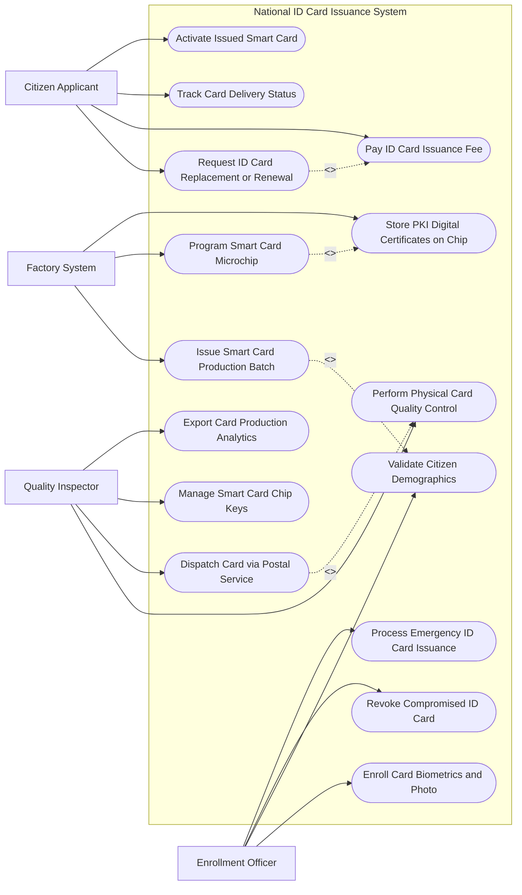

# Use Case Diagram — National ID Card Issuance System

## Mermaid Code

## Actor Table | Bảng Actor

| # | Actor | Actor Type | Role Description | Related Use Cases |
|---|-------|------------|------------------|-------------------|
| 1 | Citizen Applicant | Primary | Công dân nộp đơn cấp đổi/cấp lại thẻ Căn cước, thanh toán lệ phí | UC01, UC04, UC10, UC11 |
| 2 | Enrollment Officer | Primary | Cán bộ công an thu nhận sinh trắc học và xác minh giấy tờ | UC02, UC03, UC12, UC14 |
| 3 | Factory System | Secondary / System | Hệ thống nhà máy cá thể hóa phôi thẻ, khắc laser và nạp chip | UC05, UC06, UC07 |
| 4 | Quality Inspector | Secondary | Cán bộ kiểm tra chất lượng thẻ, bàn giao bưu điện và báo cáo | UC08, UC09, UC13, UC15 |

## Use Case Table | Bảng Use Case

| # | UC ID | Use Case Name | Primary Actor | Secondary Actor | Description | Priority |
|---|-------|---------------|---------------|-----------------|-------------|----------|
| 1 | UC01 | Request ID Card Replacement or Renewal | Citizen | VNeID | Đăng ký cấp đổi, cấp lại thẻ CCCD trực tuyến hoặc tại bốt | High |
| 2 | UC02 | Enroll Card Biometrics and Photo | Officer | Biometric Device | Thu thập 10 dấu vân tay, chụp ảnh chân dung ICAO và mống mắt | High |
| 3 | UC03 | Validate Citizen Demographics | Officer | VNeID Core | Đối soát thông tin nhân khẩu học với CSDL Dân cư Quốc gia | High |
| 4 | UC04 | Pay ID Card Issuance Fee | Citizen | PayGW | Thanh toán lệ phí cấp/đổi thẻ Căn cước trực tuyến | High |
| 5 | UC05 | Issue Smart Card Production Batch | Factory | - | Gom hồ sơ thành các lô sản xuất (Batch) để chuyển sang nhà máy in phôi | High |
| 6 | UC06 | Program Smart Card Microchip | Factory | - | Ghi dữ liệu nhân khẩu và vector sinh trắc học vào chip ICAO điện tử | High |
| 7 | UC07 | Store PKI Digital Certificates on Chip | Factory | Security Authority | Nạp cặp khóa mật mã PKI và chứng thư số công cộng vào chip thẻ | High |
| 8 | UC08 | Perform Physical Card Quality Control | Inspector | - | Kiểm tra bề mặt in laser, độ bền phôi thẻ và đọc thử chip ICAO | High |
| 9 | UC09 | Dispatch Card via Postal Service | Inspector | Postal Service | Đóng gói và bàn giao thẻ cho bưu điện chuyển phát tận nhà | High |
| 10 | UC10 | Track Card Delivery Status | Citizen | Postal Service | Tra cứu vị trí đơn hàng chuyển phát thẻ Căn cước qua mã bưu gửi | Medium |
| 11 | UC11 | Activate Issued Smart Card | Citizen | VNeID App | Kích hoạt chip thẻ Căn cước mới và hủy hiệu lực thẻ cũ | High |
| 12 | UC12 | Revoke Compromised ID Card | Officer | - | Vô hiệu hóa chip và thu hồi thẻ Căn cước khi bị mất hoặc hỏng | High |
| 13 | UC13 | Manage Smart Card Chip Keys | SysAdmin | - | Quản lý vòng đời cặp khóa bảo mật chip thẻ theo chuẩn ICAO Doc 9303 | High |
| 14 | UC14 | Process Emergency ID Card Issuance | Officer | Factory | Cấp thẻ Căn cước khẩn cấp trong vòng 24 giờ cho các trường hợp đặc biệt | Medium |
| 15 | UC15 | Export Card Production Analytics | SysAdmin | - | Thống kê số lượng thẻ sản xuất, tỷ lệ lỗi phôi và tiến độ chuyển phát | Low |

## Use Case Specification | Đặc tả Use Case

---

### UC01 — Request ID Card Replacement or Renewal

| Field | Detail |
|-------|--------|
| **UC ID** | UC01 |
| **Use Case Name** | Request ID Card Replacement or Renewal |
| **Actor(s)** | Primary: Citizen Applicant / Secondary: VNeID Core System |
| **Description** | Công dân đăng ký hồ sơ cấp mới, cấp đổi (đủ 14, 25, 40, 60 tuổi) hoặc cấp lại (do mất/hỏng) thẻ Căn cước thông minh. |
| **Precondition** | 1. Công dân có thông tin hợp lệ trên Cơ sở dữ liệu Quốc gia về Dân cư. |
| **Main Flow** | 1. Citizen đăng nhập ứng dụng VNeID hoặc Cổng Dịch vụ công Bộ Công an.   2. Select "Đăng ký cấp thẻ Căn cước".   3. System tự động trích xuất thông tin nhân khẩu (Họ tên, ngày sinh, Số định danh 12 số, quê quán, nơi thường trú).   4. Citizen chọn lý do cấp (Cấp mới, Cấp đổi hết hạn, Cấp lại do mất, Thay đổi thông tin nhân khẩu).   5. Citizen chọn phương thức nhận thẻ: "Nhận trực tiếp tại Công an" hoặc "Nhận qua bưu điện tận nhà".   6. Citizen thực hiện thanh toán lệ phí cấp thẻ trực tuyến (UC04).   7. System cấp Phiếu hẹn thu nhận sinh trắc học kèm Mã hồ sơ (Registration Code) và mã QR hẹn giờ. |
| **Alternative Flow** | **AF1** — Đăng ký trực tiếp tại trụ sở Công an: Citizen đến công an quận/huyện, cán bộ quét mã QR trên CCCD cũ/VNeID để mở hồ sơ đăng ký. |
| **Exception Flow** | **EX1** — Thông tin nhân khẩu trên CSDL dân cư chưa chính xác: System tạm dừng đăng ký cấp thẻ, yêu cầu công dân làm thủ tục cập nhật nhân khẩu trước. |
| **Postcondition** | Hồ sơ được khởi tạo ở trạng thái "Đã nộp lệ phí - Chờ thu nhận sinh trắc học". |
| **Business Rule** | **BR1**: Các trường hợp cấp đổi thẻ khi đủ mốc tuổi quy định (14, 25, 40, 60) được miễn/giao nộp lại thẻ cũ theo luật định. |

---

### UC02 — Enroll Card Biometrics and Photo

| Field | Detail |
|-------|--------|
| **UC ID** | UC02 |
| **Use Case Name** | Enroll Card Biometrics and Photo |
| **Actor(s)** | Primary: Enrollment Officer / Secondary: Biometric Hardware |
| **Description** | Cán bộ công an thực hiện thu nhận 10 dấu vân tay, chụp ảnh chân dung chuẩn ICAO và quét mống mắt của công dân tại điểm tiếp nhận. |
| **Precondition** | 1. Công dân có mặt tại điểm tiếp nhận với mã hồ sơ hẹn (UC01).   2. Thiết bị thu thập sinh trắc được hiệu chỉnh chuẩn. |
| **Main Flow** | 1. Officer quét mã QR phiếu hẹn của Citizen để truy xuất hồ sơ.   2. Officer chụp ảnh chân dung phông nền trắng chuẩn ICAO của Citizen.   3. System tự động chấm điểm ảnh: Độ sắc nét, tỷ lệ khuôn mặt, ánh sáng và mắt mở rõ.   4. Officer thu nhận 10 dấu vân tay (Lăn phẳng và lăn lăn).   5. Officer quét mống mắt 2 bên bằng thiết bị camera mống mắt.   6. System kiểm tra điểm chất lượng sinh trắc (Quality Score >= 80%).   7. Citizen kiểm tra lại thông tin trên Phiếu thu nhận và ký tên/lăn tay xác nhận.   8. System đóng gói dữ liệu sinh trắc mã hóa và đẩy hồ sơ sang luồng chờ phê duyệt cấp thẻ (UC03). |
| **Alternative Flow** | **AF1** — Thu nhận sinh trắc học lưu động (Cho người già yếu/bệnh tật): Officer mang máy thu sinh trắc valy di động đến tận nhà/bệnh viện để lấy mẫu. |
| **Exception Flow** | **EX1** — Vân tay công dân mờ/mất nét do lao động: Officer chuyển sang chế độ lấy mẫu nâng cao, ghi chú nguyên nhân bất khả kháng trên hệ thống. |
| **Postcondition** | Dữ liệu sinh trắc học và ảnh chân dung được đóng gói mã hóa bảo mật, sẵn sàng gửi nhà máy cá thể hóa phôi thẻ. |
| **Business Rule** | **BR1**: Ảnh chân dung in trên thẻ Căn cước phải tuân thủ nghiêm ngặt tiêu chuẩn ICAO Doc 9303 về nhận dạng khuôn mặt hàng không. |

---

### UC05 — Issue Smart Card Production Batch

| Field | Detail |
|-------|--------|
| **UC ID** | UC05 |
| **Use Case Name** | Issue Smart Card Production Batch |
| **Actor(s)** | Primary: Factory System / Secondary: None |
| **Description** | Hệ thống tự động gom các hồ sơ cấp thẻ đã được công an phê duyệt thành các lô (Batch) sản xuất và truyền xuống nhà máy in thẻ. |
| **Precondition** | 1. Hồ sơ đã được thẩm định pháp lý và phê duyệt cấp thẻ. |
| **Main Flow** | 1. System tự động gom 1,000 hồ sơ đã duyệt thành 01 Lô sản xuất (Production Batch).   2. System kiểm tra tính toàn vẹn dữ liệu của từng hồ sơ trong lô.   3. System sinh mã bảo mật SHA-256 cho toàn bộ lô dữ liệu.   4. System mã hóa kênh truyền (VPN/TLS 1.3) và truyền lô dữ liệu xuống Nhà máy Cá thể hóa Thẻ Căn cước.   5. Factory System tiếp nhận lô dữ liệu, giải mã và nạp vào máy in laser cá thể hóa.   6. System cập nhật trạng thái các hồ sơ trong lô sang "Đang sản xuất tại nhà máy". |
| **Alternative Flow** | **AF1** — Gom lô cấp khẩn cấp (UC14): Hồ sơ khẩn cấp được gom vào Lô ưu tiên đặc biệt (Priority Batch) để sản xuất ngay lập tức trong vòng 2 giờ. |
| **Exception Flow** | **EX1** — Lỗi truyền dữ liệu lô (Hỏng gói tin): Factory System gửi yêu cầu truyền lại (Re-transmit request), System tự động đóng gói và truyền lại lô dữ liệu. |
| **Postcondition** | Lô dữ liệu cấp thẻ nằm trong hàng đợi sản xuất trực tiếp tại máy in laser nhà máy. |
| **Business Rule** | **BR1**: Kênh truyền dữ liệu sản xuất thẻ giữa trung tâm dữ liệu và nhà máy bắt buộc phải được mã hóa phần cứng HSM. |

---

### UC06 — Program Smart Card Microchip

| Field | Detail |
|-------|--------|
| **UC ID** | UC06 |
| **Use Case Name** | Program Smart Card Microchip |
| **Actor(s)** | Primary: Factory System / Secondary: None |
| **Description** | Máy sản xuất ghi dữ liệu nhân khẩu học, vector sinh trắc học và chứng thư số lên vi mạch (microchip) của phôi thẻ nhựa. |
| **Precondition** | 1. Phôi thẻ nhựa đã được in thông tin bề mặt bằng công nghệ khắc laser.   2. Chip vi mạch trên phôi thẻ đã qua bước nạp hệ điều hành thẻ (Card OS). |
| **Main Flow** | 1. Máy cá thể hóa đưa phôi thẻ nhựa vào đầu đọc/ghi chip tiếp xúc/không tiếp xúc (Contact/Contactless).   2. System đọc Mã UID định danh duy nhất của con chip trên phôi.   3. System ghi thông tin nhân khẩu (Số định danh, Họ tên, Ngày sinh, Quê quán) vào các vùng nhớ Data Group (DG1, DG2) theo chuẩn ICAO Doc 9303.   4. System ghi mẫu vector vân tay mã hóa và ảnh chân dung nén vào vùng nhớ sinh trắc.   5. System nạp Cặp khóa PKI và Chứng thư số (UC07) vào phân vùng bảo mật của chip.   6. System khóa phân vùng ghi (Lock Write Access) để ngăn chặn hành vi sửa đổi dữ liệu chip sau này.   7. System trả phôi thẻ sang bước kiểm định chất lượng (UC08). |
| **Alternative Flow** | **AF1** — Thẻ lỗi chip trong quá trình ghi: Máy cá thể hóa tự động loại phôi hỏng ra khay thẻ lỗi (Reject Bin), System phát lệnh in lại phôi thay thế. |
| **Exception Flow** | **EX1** — Chip bị hỏng hóc vật lý: System đánh dấu mã UID phôi hỏng, hủy mã hồ sơ trong lô và ghi log phôi bị tiêu hủy. |
| **Postcondition** | Con chip trên thẻ Căn cước được nạp đầy đủ dữ liệu bảo mật và khóa chống ghi đè vĩnh viễn. |
| **Business Rule** | **BR1**: Dữ liệu lưu trong chip thẻ phải áp dụng các cơ chế bảo mật ICAO: Active Authentication (AA), Passive Authentication (PA) và PACE. |

---

### UC09 — Dispatch Card via Postal Service

| Field | Detail |
|-------|--------|
| **UC ID** | UC09 |
| **Use Case Name** | Dispatch Card via Postal Service |
| **Actor(s)** | Primary: Quality Inspector / Secondary: Postal Service |
| **Description** | Đóng gói thẻ Căn cước đạt chuẩn chất lượng vào bì thư bảo mật và bàn giao cho Bưu điện chuyển phát đến địa chỉ công dân đăng ký. |
| **Precondition** | 1. Thẻ Căn cước đã qua bước kiểm tra chất lượng in và chip (UC08) đạt 100%.   2. Công dân chọn hình thức nhận thẻ qua bưu điện (UC01). |
| **Main Flow** | 1. Inspector quét mã vạch trên thẻ Căn cước vừa hoàn thiện.   2. System in Thư cảm ơn kèm hướng dẫn bảo quản thẻ và Giấy báo phát bưu điện.   3. Máy đóng gói tự động lồng thẻ Căn cước vào phong bì thư bảo mật chống soi chiếu.   4. System sinh Mã vận đơn bưu gửi (Item Code / Tracking Number) và dán nhãn bưu gửi lên phong bì.   5. System gửi danh sách bảng kê bàn giao bưu gửi cho Bưu điện (Postal Service).   6. Nhân viên bưu điện quét mã vận đơn tiếp nhận bưu gửi và ký xác nhận bàn giao điện tử.   7. System gửi tin nhắn SMS/Email thông báo mã vận đơn cho công dân tra cứu (UC10). |
| **Alternative Flow** | **AF1** — Nhận trực tiếp tại cơ quan Công an: Thẻ được đóng gói vào hộp lưu trữ theo đơn vị hành chính xã/phường và vận chuyển bằng xe chuyên dụng đến Công an địa phương. |
| **Exception Flow** | **EX1** — Thư chuyển phát bị thất lạc/không tìm thấy công dân: Bưu điện chuyển hoàn thư về kho Công an, System cập nhật trạng thái "Chờ công dân đến nhận trực tiếp". |
| **Postcondition** | Thẻ Căn cước nằm trong lộ trình vận chuyển của Bưu điện, công dân nhận được mã theo dõi bưu gửi. |
| **Business Rule** | **BR1**: Thẻ Căn cước trong quá trình bưu điện vận chuyển ở trạng thái "Chưa kích hoạt" (Inactive), chỉ kích hoạt khi công dân nhận được thẻ. |
