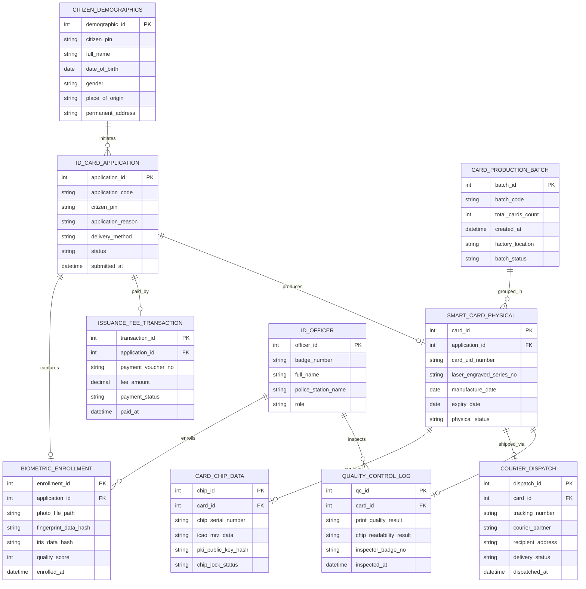

# Conceptual ERD — National ID Card Issuance System

## Mermaid Code

## Entity Description Table | Bảng mô tả Entity

| # | Entity Name | Vietnamese Name | Description | Key Attributes | Main Relationships |
|---|-------------|-----------------|-------------|----------------|-------------------|
| 1 | ID_CARD_APPLICATION | Hồ sơ Đăng ký Thẻ Căn cước | Đơn đăng ký cấp mới, cấp đổi, cấp lại thẻ CCCD của công dân | application_id, application_code, citizen_pin, delivery_method | Belongs to CITIZEN_DEMOGRAPHICS, produces SMART_CARD_PHYSICAL |
| 2 | CITIZEN_DEMOGRAPHICS | Nhân khẩu học Dân cư | Dữ liệu nhân khẩu học gốc của công dân trích xuất từ CSDL Quốc gia | demographic_id, citizen_pin, full_name, permanent_address | Initiates ID_CARD_APPLICATION |
| 3 | BIOMETRIC_ENROLLMENT | Dữ liệu Sinh trắc học Thu nhận | Ảnh chân dung ICAO, dữ liệu vân tay và mống mắt thu thập trực tiếp | enrollment_id, photo_file_path, quality_score, enrolled_at | Belongs to ID_CARD_APPLICATION, enrolled by ID_OFFICER |
| 4 | SMART_CARD_PHYSICAL | Thẻ Căn cước Thông minh Vật lý | Thông tin phôi thẻ nhựa được in khắc laser bề mặt | card_id, card_uid_number, laser_engraved_series_no, expiry_date | Belongs to ID_CARD_APPLICATION, contains CARD_CHIP_DATA |
| 5 | CARD_PRODUCTION_BATCH | Lô Sản xuất Thẻ | Quản lý lô gom hồ sơ in ấn sản xuất tại nhà máy cá thể hóa | batch_id, batch_code, total_cards_count, batch_status | Groups SMART_CARD_PHYSICAL |
| 6 | CARD_CHIP_DATA | Dữ liệu Vi mạch Chip Thẻ | Thông tin nạp trong chip vi mạch ICAO (dữ liệu nhân khẩu, khóa PKI) | chip_id, chip_serial_number, pki_public_key_hash, chip_lock_status | Belongs to SMART_CARD_PHYSICAL |
| 7 | COURIER_DISPATCH | Vận đơn Chuyển phát Bưu điện | Thông tin theo dõi lộ trình vận chuyển thẻ Căn cước tới tay công dân | dispatch_id, tracking_number, courier_partner, delivery_status | Belongs to SMART_CARD_PHYSICAL |
| 8 | ISSUANCE_FEE_TRANSACTION | Giao dịch Lệ phí Cấp thẻ | Nhật ký thu lệ phí cấp/đổi thẻ Căn cước trực tuyến | transaction_id, payment_voucher_no, fee_amount, payment_status | Belongs to ID_CARD_APPLICATION |
| 9 | QUALITY_CONTROL_LOG | Nhật ký Kiểm định Chất lượng | Kết quả kiểm tra bề mặt in laser và độ nhạy đọc chip phôi thẻ | qc_id, print_quality_result, chip_readability_result | Belongs to SMART_CARD_PHYSICAL, inspected by ID_OFFICER |
| 10 | ID_OFFICER | Cán bộ Công an Cấp thẻ | Thông tin cán bộ chiến sĩ tiếp nhận sinh trắc và kiểm định thẻ | officer_id, badge_number, full_name, police_station_name | Enrolls BIOMETRIC_ENROLLMENT, inspects QUALITY_CONTROL_LOG |

## Relationship Description | Mô tả Quan hệ

| # | From Entity | Cardinality | To Entity | Relationship Label | Business Explanation |
|---|-------------|-------------|-----------|-------------------|----------------------|
| 1 | CITIZEN_DEMOGRAPHICS | one-to-many | ID_CARD_APPLICATION | initiates | Một công dân có thể tạo nhiều hồ sơ đăng ký cấp đổi thẻ qua các độ tuổi |
| 2 | ID_CARD_APPLICATION | one-to-one | BIOMETRIC_ENROLLMENT | captures | Mỗi hồ sơ nộp đi kèm một bộ dữ liệu sinh trắc học thu nhận trực tiếp |
| 3 | ID_CARD_APPLICATION | one-to-one | ISSUANCE_FEE_TRANSACTION | paid_by | Mỗi hồ sơ cấp thẻ phát sinh một giao dịch nộp lệ phí cấp thẻ |
| 4 | ID_CARD_APPLICATION | one-to-one | SMART_CARD_PHYSICAL | produces | Mỗi hồ sơ hợp lệ sau khi sản xuất tạo ra một thẻ Căn cước vật lý duy nhất |
| 5 | CARD_PRODUCTION_BATCH | one-to-many | SMART_CARD_PHYSICAL | grouped_in | Một lô sản xuất gom nhiều phôi thẻ để in ấn hàng loạt tại nhà máy |
| 6 | SMART_CARD_PHYSICAL | one-to-one | CARD_CHIP_DATA | contains | Mỗi thẻ Căn cước vật lý chứa duy nhất một con chip vi mạch bảo mật |
| 7 | SMART_CARD_PHYSICAL | one-to-one | COURIER_DISPATCH | shipped_via | Mỗi thẻ Căn cước hoàn thiện sinh ra một vận đơn chuyển phát bưu điện |
| 8 | SMART_CARD_PHYSICAL | one-to-one | QUALITY_CONTROL_LOG | inspected_in | Mỗi thẻ Căn cước trước khi xuất xưởng được ghi nhật ký kiểm định chất lượng |
| 9 | ID_OFFICER | one-to-many | BIOMETRIC_ENROLLMENT | enrolls | Một cán bộ công an thực hiện lấy mẫu sinh trắc cho nhiều hồ sơ công dân |
| 10 | ID_OFFICER | one-to-many | QUALITY_CONTROL_LOG | inspects | Một cán bộ kiểm định thực hiện đánh giá chất lượng cho nhiều thẻ sản xuất |
