# Swimlane Diagram — National ID Card Issuance System

## Mermaid Code

```mermaid
flowchart LR
    Start(["Start"])

    subgraph Lane1["Citizen Applicant"]
        A1["Register ID Application & Pay Fee"]
        A2["Present Appointment QR at Station"]
        A3["Provide Fingerprints Photo & Iris"]
        A4["Sign Biometric Enrollment Sheet"]
        A5["Receive ID Card via Courier"]
    end

    subgraph Lane2["National ID Card Issuance System"]
        S1["Verify Demographic via VNeID"]
        S2["Validate Biometric Quality Score"]
        S3["Group Dossiers into Batch"]
        S4["Pass Quality Inspection Check"]
        S5["Dispatch Package to Courier"]
    end

    subgraph Lane3["Registration Officer"]
        O1["Verify Physical Paper Documents"]
        O2["Instruct Biometric Sampling"]
        O3["Approve ID Issuance Dossier"]
    end

    subgraph Lane4["Smart Card Personalization Factory"]
        F1["Laser Engrave Card Surface"]
        F2["Program ICAO Microchip & PKI"]
        F3{"Chip Readability OK?"}
        F4["Reject Defective Card"]
        F5["Pass Finished Card to QC"]
    end

    Finish(["End"])

    Start --> A1 --> S1 --> A2 --> O1 --> O2 --> A3 --> S2 --> A4 --> O3 --> S3 --> F1 --> F2 --> F3
    F3 -->|"No"| F4 --> F1
    F3 -->|"Yes"| F5 --> S4 --> S5 --> A5 --> Finish
```

## Flow Description | Mô tả luồng

| Lane | Actor | Role in Flow |
|------|-------|-------------|
| 1 | Citizen Applicant | Đăng ký cấp đổi thẻ trực tuyến, nộp phí, mang mã QR đến điểm tiếp nhận, lấy sinh trắc học và nhận thẻ Căn cước tại nhà. |
| 2 | National ID Card Issuance System | Xác thực nhân khẩu dân cư, kiểm tra chất lượng sinh trắc học, gom lô sản xuất, tạo mã vận đơn và chuyển phát bưu điện. |
| 3 | Registration Officer | Kiểm tra đối soát giấy tờ gốc, hướng dẫn công dân thu nhận vân tay/ảnh mặt/mống mắt và duyệt hồ sơ cấp thẻ. |
| 4 | Smart Card Personalization Factory | Cá thể hóa khắc laser phôi thẻ nhựa, nạp dữ liệu chuẩn ICAO và chứng thư PKI vào vi mạch chip, kiểm định chip trước khi xuất xưởng. |
