# Action Tree — National ID Card Issuance System

## Mermaid Code

```mermaid
graph TD
    Root["National ID Card Issuance System"]

    Root --> M1["ID Application & Online Payment"]
    Root --> M2["Biometric & Demographic Enrollment"]
    Root --> M3["Smart Card Production Batching"]
    Root --> M4["Chip Personalization & PKI Keys"]
    Root --> M5["Quality Inspection & Logistics"]
    Root --> M6["Card Activation & Lifecycle Revocation"]

    M1 --> A11["Submit ID Card Renewal Application"]
    M1 --> A12["Verify VNeID Demographics Profile"]
    M1 --> A13["Process Online Card Issuance Fee"]
    M1 --> A14["Generate Appointment QR Code Receipt"]

    M2 --> A21["Capture 10-Fingerprint Scans"]
    M2 --> A22["Capture ICAO Face Photograph"]
    M2 --> A23["Capture Dual-Iris Scans"]
    M2 --> A24["Sign Digital Enrollment Sheet"]

    M3 --> A31["Group Dossiers into Production Batches"]
    M3 --> A32["Transmit Encrypted Batch Data HSM"]
    M3 --> A33["Queue Manufacturing Print Tasks"]
    M3 --> A34["Process Emergency Priority Issuance"]

    M4 --> A41["Laser Engrave Card Text & Photo"]
    M4 --> A42["Program ICAO Doc 9303 Microchip"]
    M4 --> A43["Load PKI Digital Certificates"]
    M4 --> A44["Lock Microchip Write Access"]

    M5 --> A51["Inspect Laser Surface Print Quality"]
    M5 --> A52["Test Contactless Chip Readability"]
    M5 --> A53["Pack Secure Postal Envelopes"]
    M5 --> A54["Track Delivery Postal Status"]

    M6 --> A61["Activate New Smart Card Profile"]
    M6 --> A62["Revoke Lost Compromised ID Cards"]
    M6 --> A63["Manage Chip Cryptographic Keys"]
    M6 --> A64["Export Card Production Metrics"]
```

## Module Description | Mô tả Module

| # | Module | Description | Actions |
|---|--------|-------------|---------|
| 1 | ID Application & Online Payment | Tiếp nhận đơn xin cấp đổi thẻ CCCD trực tuyến, đối soát dữ liệu dân cư và thu lệ phí cấp thẻ | Submit ID Card Renewal Application, Verify VNeID Demographics Profile, Process Online Card Issuance Fee, Generate Appointment QR Code Receipt |
| 2 | Biometric & Demographic Enrollment | Thu nhận trực tiếp 10 dấu vân tay, chụp ảnh chân dung chuẩn ICAO, quét mống mắt và ký xác nhận | Capture 10-Fingerprint Scans, Capture ICAO Face Photograph, Capture Dual-Iris Scans, Sign Digital Enrollment Sheet |
| 3 | Smart Card Production Batching | Gom hồ sơ thành lô sản xuất mã hóa, truyền dữ liệu xuống nhà máy cá thể hóa phôi thẻ | Group Dossiers into Production Batches, Transmit Encrypted Batch Data HSM, Queue Manufacturing Print Tasks, Process Emergency Priority Issuance |
| 4 | Chip Personalization & PKI Keys | Khắc laser bề mặt thẻ nhựa, ghi dữ liệu nhân khẩu ICAO Doc 9303 và nạp chứng thư số PKI vào vi mạch chip | Laser Engrave Card Text & Photo, Program ICAO Doc 9303 Microchip, Load PKI Digital Certificates, Lock Microchip Write Access |
| 5 | Quality Inspection & Logistics | Kiểm định chất lượng in và chip, đóng gói bì thư bảo mật và bàn giao bưu điện chuyển phát tận nhà | Inspect Laser Surface Print Quality, Test Contactless Chip Readability, Pack Secure Postal Envelopes, Track Delivery Postal Status |
| 6 | Card Activation & Lifecycle Revocation | Kích hoạt chip thẻ mới, vô hiệu hóa thẻ bị báo mất/hỏng và quản lý vòng đời khóa mật mã | Activate New Smart Card Profile, Revoke Lost Compromised ID Cards, Manage Chip Cryptographic Keys, Export Card Production Metrics |
