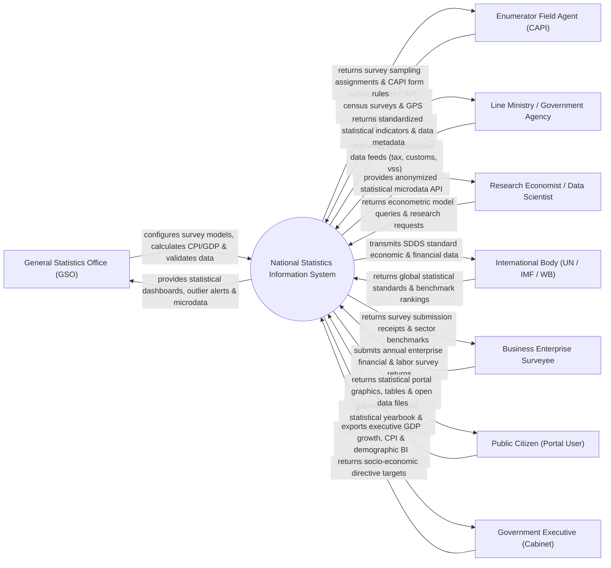

# Context Diagram — National Statistics Information System

## Mermaid Code

## Actor & Interaction Table | Bảng Actor & Tương tác

| # | Actor | Actor Type | Data Sent TO System | Data Received FROM System | Notes |
|---|-------|------------|---------------------|---------------------------|-------|
| 1 | General Statistics Office (GSO) | Primary | Statistical survey designs, CPI basket weights, GDP formulas | Aggregated indicators, anomaly alerts, statistical yearbooks | Điều tra viên và chuyên viên Tổng cục Thống kê (Bộ KH&ĐT) |
| 2 | Enumerator Field Agent (CAPI) | Primary | CAPI tablet survey responses, photos, GPS coordinates | Assigned enumeration area maps, CAPI electronic survey forms | Điều tra viên thực địa dùng máy tính bảng CAPI thu thập số liệu |
| 3 | Line Ministry / Government Agency | Supporting | Administrative data feeds (Customs trade, Tax revenue, VSS) | Standardized statistical metadata, sector indicator reports | Các Bộ/Nành gửi dữ liệu hành chính (Tổng cục Thuế, Hải quan) |
| 4 | Research Economist / Data Scientist | Supporting | Econometric query scripts, statistical data requests | Anonymized microdata files, open data API endpoints | Chuyên gia kinh tế và nhà nghiên cứu khai thác dữ liệu vi mô |
| 5 | International Body (UN / IMF / WB) | Regulatory | SDDS Data dissemination standards, IMF SNA 2008 framework | National SDDS data packages, GDP & inflation reports | Liên Hợp Quốc, Quỹ Tiền tệ Quốc tế, Ngân hàng Thế giới |
| 6 | Business Enterprise Surveyee | Supporting | Enterprise financial reports, labor count, industrial output | Electronic survey submission receipt, industry benchmarks | Các doanh nghiệp nộp báo cáo điều tra thống kê doanh nghiệp |
| 7 | Public Citizen (Portal User) | Supporting | Statistical indicator queries, timeline filters | Interactive CPI charts, population pyramids, open datasets | Công chúng tra cứu Niên giám Thống kê Quốc gia |
| 8 | Government Executive (Cabinet) | Primary | Socio-economic targets, policy planning parameters | Real-time GDP growth BI dashboards, CPI forecasting | Thủ tướng và các Thành viên Chính phủ chỉ đạo kinh tế vĩ mô |

## System Boundary Description | Mô tả Phạm vi Hệ thống

Hệ thống National Statistics Information System (Hệ thống Thông tin Thống kê Quốc gia / GSO System) chịu trách nhiệm tự động hóa toàn bộ vòng đời sản xuất thông tin thống kê quốc gia: Thu thập dữ liệu tổng điều tra bằng máy tính bảng CAPI (Computer-Assisted Personal Interviewing), tính toán chỉ số giá tiêu dùng CPI hàng tháng, tính toán Tổng sản phẩm trong nước GDP (theo chuẩn SNA 2008 của IMF), tổng hợp thống kê dân số và lao động, ẩn danh hóa dữ liệu vi mô (Microdata Anonymization), công khai Niên giám Thống kê Quốc gia và phát hành dữ liệu theo chuẩn SDDS của IMF. Tuy nhiên, hệ thống KHÔNG trực tiếp thu thuế/hải quan và KHÔNG thay thế công tác điều tra thực địa của các điều tra viên.
