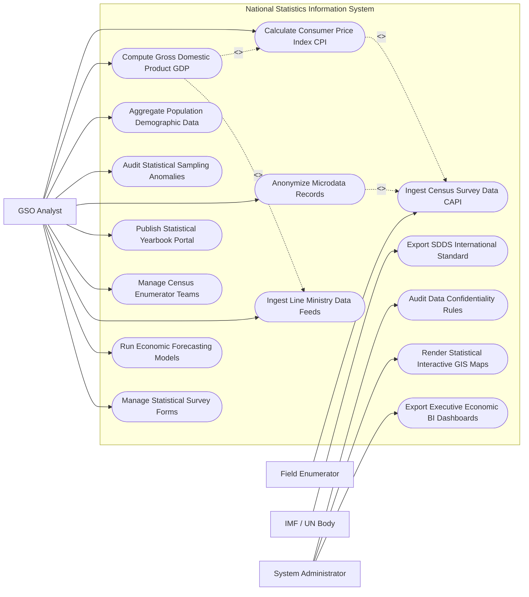

# Use Case Diagram — National Statistics Information System

## Mermaid Code

## Actor Table | Bảng Actor

| # | Actor | Actor Type | Role Description | Related Use Cases |
|---|-------|------------|------------------|-------------------|
| 1 | Field Enumerator | Primary | Điều tra viên thực địa thu thập số liệu tổng điều tra bằng tablet CAPI | UC01 |
| 2 | GSO Analyst | Primary | Chuyên viên Tổng cục Thống kê cấu hình mẫu điều tra, tính CPI, GDP và ấn hành | UC02, UC03, UC04, UC05, UC06, UC07, UC08, UC09, UC10, UC12 |
| 3 | IMF / UN Body | Secondary | Tổ chức quốc tế tiếp nhận dữ liệu thống kê theo chuẩn SDDS và SNA 2008 | UC11 |
| 4 | System Administrator | System | Quản trị viên quản lý bảo mật dữ liệu vi mô, bản đồ GIS và báo cáo BI | UC13, UC14, UC15 |

## Use Case Table | Bảng Use Case

| # | UC ID | Use Case Name | Primary Actor | Secondary Actor | Description | Priority |
|---|-------|---------------|---------------|-----------------|-------------|----------|
| 1 | UC01 | Ingest Census Survey Data CAPI | Enumerator | GSO | Thu thập và truyền trực tiếp dữ liệu điều tra từ tablet CAPI về hệ thống | High |
| 2 | UC02 | Calculate Consumer Price Index CPI | GSO | - | Tự động tính chỉ số giá tiêu dùng CPI hàng tháng dựa trên danh mục rổ hàng hóa | High |
| 3 | UC03 | Compute Gross Domestic Product GDP | GSO | LineMinistry | Tính tổng sản phẩm trong nước GDP quý/năm theo phương pháp sản xuất và chi tiêu | High |
| 4 | UC04 | Aggregate Population Demographic Data | GSO | VNeID | Tổng hợp số liệu quy mô dân số, tháp dân số và tỷ lệ sinh/tử toàn quốc | High |
| 5 | UC05 | Audit Statistical Sampling Anomalies | GSO | System | Thuật toán AI phát hiện các số liệu điều tra bất thường hoặc sai lệch mẫu | High |
| 6 | UC06 | Anonymize Microdata Records | GSO | Researcher | Khử định danh dữ liệu vi mô (Microdata) trước khi chia sẻ cho các nhà nghiên cứu | High |
| 7 | UC07 | Publish Statistical Yearbook Portal | GSO | Public | Ấn hành Niên giám Thống kê Quốc gia trên Cổng thông tin dữ liệu mở | High |
| 8 | UC08 | Manage Census Enumerator Teams | GSO | Enumerator | Phân công địa bàn điều tra và quản lý đội ngũ điều tra viên thực địa | Medium |
| 9 | UC09 | Ingest Line Ministry Data Feeds | GSO | LineMinistry | Tự động thu thập dữ liệu hành chính từ Thuế, Hải quan, Ngân hàng Nhà nước | High |
| 10 | UC10 | Run Economic Forecasting Models | GSO | Executive | Chạy các mô hình kinh tế lượng dự báo tăng trưởng GDP và lạm phát | Medium |
| 11 | UC11 | Export SDDS International Standard | IntBody | System | Trích xuất dữ liệu tài chính kinh tế theo chuẩn công bố SDDS của IMF | High |
| 12 | UC12 | Manage Statistical Survey Forms | GSO | - | Cấu hình biểu mẫu điều tra thống kê điện tử (Tổng điều tra dân số, doanh nghiệp) | Medium |
| 13 | UC13 | Audit Data Confidentiality Rules | Admin | SecurityAgency | Kiểm toán tuân thủ quy định bảo mật thông tin thống kê cá nhân và doanh nghiệp | High |
| 14 | UC14 | Render Statistical Interactive GIS Maps | Admin | GIS Engine | Trực quan hóa số liệu thống kê kinh tế xã hội trên bản đồ không gian GIS | Medium |
| 15 | UC15 | Export Executive Economic BI Dashboards | Admin | Executive | Trích xuất báo cáo BI tình hình kinh tế vĩ mô nộp Thủ tướng Chính phủ | Low |

## Use Case Specification | Đặc tả Use Case

---

### UC01 — Ingest Census Survey Data CAPI

| Field | Detail |
|-------|--------|
| **UC ID** | UC01 |
| **Use Case Name** | Ingest Census Survey Data CAPI |
| **Actor(s)** | Primary: Field Enumerator / Secondary: General Statistics Office (GSO) |
| **Description** | Điều tra viên sử dụng ứng dụng CAPI trên máy tính bảng thu thập dữ liệu tổng điều tra và truyền về CSDL trung tâm. |
| **Precondition** | 1. Điều tra viên được cấp tài khoản CAPI và địa bàn điều tra (EA - Enumeration Area).   2. Biểu mẫu điều tra đã được cấu hình trên ứng dụng di động (UC12). |
| **Main Flow** | 1. Enumerator đến hộ gia đình/doanh nghiệp trên địa bàn được phân công.   2. Enumerator mở ứng dụng CAPI, chọn địa bàn và mã hộ/mã doanh nghiệp.   3. System tự động kích hoạt GPS ghi nhận tọa độ vị trí phỏng vấn.   4. Enumerator nhập các câu hỏi phỏng vấn theo kịch bản hiển thị trên màn hình.   5. System kiểm tra lô-gích thời gian thực (Logic Check): Ngăn chặn nhập sai độ tuổi, thu nhập âm hoặc mâu thuẫn giữa các câu trả lời.   6. Enumerator chụp ảnh minh chứng và lấy chữ ký điện tử của người trả lời.   7. Enumerator bấm "Gửi dữ liệu": System đóng gói gói tin mã hóa và truyền về CSDL Trung tâm GSO qua 4G/Wi-Fi. |
| **Alternative Flow** | **AF1** — Điều tra CAPI offline khi mất mạng: System lưu dữ liệu vào bộ nhớ máy tính bảng, tự động đồng bộ về trung tâm khi có kết nối mạng. |
| **Exception Flow** | **EX1** — Tọa độ GPS phỏng vấn nằm ngoài ranh giới địa bàn được giao: System báo cảnh báo "Sai địa bàn điều tra", yêu cầu Enumerator xác nhận lại vị trí. |
| **Postcondition** | Phiếu điều tra điện tử được ghi nhận vào Kho dữ liệu thô, sẵn sàng cho khâu kiểm tra làm sạch (UC05). |
| **Business Rule** | **BR1**: Dữ liệu điều tra CAPI gửi về trung tâm phải được mã hóa theo tiêu chuẩn an toàn thông tin chống can thiệp. |

---

### UC02 — Calculate Consumer Price Index CPI

| Field | Detail |
|-------|--------|
| **UC ID** | UC02 |
| **Use Case Name** | Calculate Consumer Price Index CPI |
| **Actor(s)** | Primary: GSO Analyst / Secondary: None |
| **Description** | Hệ thống tự động tính toán Chỉ số Giá Tiêu dùng (CPI) hàng tháng dựa trên dữ liệu giá của 752 mặt hàng trong rổ hàng hóa đại diện. |
| **Precondition** | 1. Dữ liệu giá thu thập từ các chợ, siêu thị toàn quốc tháng hiện tại đã được nhập đầy đủ.   2. Quyền số (Weights) của rổ hàng hóa đại diện đã được cấu hình chuẩn. |
| **Main Flow** | 1. System tập hợp dữ liệu giá của 752 mặt hàng thuộc 11 nhóm hàng hóa và dịch vụ tiêu dùng chính.   2. System tính Chỉ số giá của từng mặt hàng cá biệt ($I_{p} = \frac{P_{1}}{P_{0}} \times 100$).   3. System áp dụng công thức Laspeyres có trọng số tính Chỉ số CPI cho từng Tỉnh/Thành phố: $CPI = \frac{\sum (I_{p} \times W_{0})}{\sum W_{0}}$.   4. System tổng hợp chỉ số CPI toàn quốc, CPI so với tháng trước, CPI so với cùng kỳ năm trước và CPI bình quân.   5. System tính Lạm phát cơ bản (Core Inflation) sau khi đã loại trừ lương thực, thực phẩm tươi sống và năng lượng.   6. GSO Analyst rà soát bảng tính và bấm "Ký duyệt Chỉ số CPI tháng".   7. System công bố chỉ số CPI trên Cổng thông tin Niên giám Thống kê (UC07). |
| **Alternative Flow** | **AF1** — Tính CPI theo thời gian thực (Online Price Scraping): System tự động thu thập giá nông sản/hàng hóa từ các sàn thương mại điện tử để dự báo CPI hàng tuần. |
| **Exception Flow** | **EX1** — Giá một mặt hàng tăng vọt bất thường (> 50% trong 1 tháng): System cảnh báo màu Đỏ, yêu cầu GSO Analyst xác minh lại giá thực tế tại thị trường. |
| **Postcondition** | Chỉ số CPI chính thức được phát hành, làm căn cứ điều hành chính sách tiền tệ của Ngân hàng Nhà nước. |
| **Business Rule** | **BR1**: Chỉ số CPI hàng tháng bắt buộc phải được công bố chính thức vào ngày 29 hàng tháng. |

---

### UC03 — Compute Gross Domestic Product GDP

| Field | Detail |
|-------|--------|
| **UC ID** | UC03 |
| **Use Case Name** | Compute Gross Domestic Product GDP |
| **Actor(s)** | Primary: GSO Analyst / Secondary: Line Ministry |
| **Description** | Hệ thống tính toán Tổng sản phẩm trong nước (GDP) theo giá hiện hành và giá so sánh theo 3 phương pháp (Sản xuất, Chi tiêu, Thu nhập). |
| **Precondition** | 1. Dữ liệu giá trị sản xuất các ngành Nông nghiệp, Công nghiệp, Dịch vụ và Thuế sản phẩm đã được tổng hợp (UC09). |
| **Main Flow** | 1. GSO Analyst kích hoạt Tiến trình Tính toán GDP Quý/Năm.   2. System trích xuất Giá trị gia tăng ($VA$) của 21 ngành kinh tế cấp 1 theo Phương pháp Sản xuất: $GDP = \sum VA + Thuế\_sản\_phẩm - Trợ\_cap\_sản\_phẩm$.   3. System đối soát với Phương pháp Chi tiêu: $GDP = Tiêu\_dùng\_cúi\_cùng + Tích\_lũy\_tài\_sản + (Xuất\_khẩu - Nhập\_khẩu)$.   4. System tính Tốc độ tăng trưởng GDP giá so sánh (%) và Quy mô GDP theo Đồng Việt Nam và Đô la Mỹ.   5. System tính chỉ số Tăng trưởng GRDP cho từng Tỉnh/Thành phố trực thuộc trung ương.   6. GSO Analyst kiểm tra sự cân đối giữa các phương pháp tính toán và phê duyệt Kết quả GDP.   7. System tự động xuất Báo cáo BI tình hình kinh tế vĩ mô trình Chính phủ (UC15). |
| **Alternative Flow** | **AF1** — Đánh giá lại quy mô GDP: System cập nhật lại hệ thống phân ngành và nguồn dữ liệu hành chính mới để điều chỉnh lại quy mô GDP toàn quốc. |
| **Exception Flow** | **EX1** — Sai lệch giữa Phương pháp Sản xuất và Chi tiêu > 2%: System bật cảnh báo "Cân đối vĩ mô chưa đạt", yêu cầu GSO Analyst đối soát lại số liệu xuất nhập khẩu và tồn kho. |
| **Postcondition** | Số liệu tăng trưởng GDP quốc gia chính thức được phát hành, phục vụ đánh giá mục tiêu phát triển kinh tế xã hội. |
| **Business Rule** | **BR1**: Phương pháp tính toán GDP của Việt Nam tuân thủ nghiêm ngặt Hệ thống Tài khoản Quốc gia SNA 2008 của Liên Hợp Quốc và IMF. |

---

### UC06 — Anonymize Microdata Records

| Field | Detail |
|-------|--------|
| **UC ID** | UC06 |
| **Use Case Name** | Anonymize Microdata Records |
| **Actor(s)** | Primary: GSO Analyst / Secondary: Research Economist |
| **Description** | Thực hiện thuật toán ẩn danh hóa dữ liệu vi mô (Microdata) để loại bỏ tuyệt đối thông tin định danh cá nhân và doanh nghiệp trước khi mở Open Data. |
| **Precondition** | 1. Dữ liệu thô từ các cuộc Tổng điều tra Dân số, Doanh nghiệp đã hoàn thành thu thập và làm sạch. |
| **Main Flow** | 1. GSO Analyst chọn Tập dữ liệu vi mô cần mở cho cộng đồng nghiên cứu (Ví dụ: Dữ liệu điều tra Mức sống dân cư VHLSS).   2. System tự động quét và loại bỏ các trường định danh trực tiếp: Họ tên, Số CCCD, Mã số thuế, Số điện thoại, Địa chỉ chi tiết.   3. System áp dụng các kỹ thuật ẩn danh hóa dữ liệu vi mô nâng cao:   - K-Anonymity ($k \ge 5$): Gom nhóm các thuộc tính bán định danh (Tuổi, Giới tính, Mã Huyện) sao cho tối thiểu có $k$ bản ghi giống hệt nhau.   - L-Diversity: Đảm bảo tính đa dạng của các thuộc tính nhạy cảm trong cùng một nhóm.   - Top-Coding / Bottom-Coding: Mã hóa trần/sàn các giá trị thu nhập quá cao hoặc quá thấp để chống nhận diện cá nhân kiệt xuất.   4. System kiểm tra đánh giá Nguy cơ tái định danh (Re-identification Risk Score $< 1\%$).   5. GSO Analyst duyệt phát hành Tập dữ liệu vi mô đã ẩn danh.   6. System phát hành tệp dữ liệu vi mô (định dạng Stata .dta / SPSS .sav / CSV) trên Cổng Open Data. |
| **Alternative Flow** | **AF1** — Cấp quyền khai thác dữ liệu vi mô bảo mật trong phòng đọc an toàn (Secure Data Room): Dành cho các dự án nghiên cứu đặc biệt của Chính phủ. |
| **Exception Flow** | **EX1** — Nguy cơ rò rỉ danh tính doanh nghiệp độc quyền trong ngành: System tự động gộp ngành kinh tế cấp 4 thành ngành cấp 2 để bảo vệ bí mật kinh doanh. |
| **Postcondition** | Dữ liệu vi mô được chia sẻ công khai an toàn, bảo vệ tuyệt đối bí mật thông tin thống kê theo Luật Thống kê. |
| **Business Rule** | **BR1**: Nghiêm cấm tuyệt đối việc phát hành dữ liệu vi mô chưa qua xử lý ẩn danh hóa ra ngoài cơ quan thống kê. |

---

### UC07 — Publish Statistical Yearbook Portal

| Field | Detail |
|-------|--------|
| **UC ID** | UC07 |
| **Use Case Name** | Publish Statistical Yearbook Portal |
| **Actor(s)** | Primary: GSO Analyst / Secondary: Public Citizen |
| **Description** | Xuất bản Niên giám Thống kê Quốc gia bản điện tử trên Cổng thông tin trực tuyến với các biểu đồ và bản đồ tương tác. |
| **Precondition** | 1. Toàn bộ chỉ số thống kê chính thức năm tài chính đã được ký duyệt. |
| **Main Flow** | 1. System tự động gom nhóm dữ liệu theo các chuyên mục Niên giám: Khí hậu-Địa lý, Dân số-Lao động, Tài khoản quốc gia, Tài chính-Tiền tệ, Nông-Lâm-Thủy sản, Công nghiệp, Thương mại-Du lịch.   2. System tự động biên tập thành tệp Niên giám Thống kê điện tử (e-Yearbook PDF) và các bảng số liệu Excel/CSV tương ứng.   3. System tạo các Biểu đồ tương tác (Interactive Charts: Tháp dân số, Biểu đồ lạm phát, Cơ cấu GDP) và Bản đồ GIS (UC14).   4. GSO Analyst duyệt nội dung và xuất bản trên Cổng thông tin Niên giám Thống kê Quốc gia.   5. System phát hành mã QR và liên kết tải về miễn phí cho công chúng.   6. PublicCitizen truy cập cổng thông tin, tra cứu và tải về các bảng số liệu theo nhu cầu. |
| **Alternative Flow** | **AF1** — Xuất bản Niên giám Thống kê bằng 2 ngôn ngữ (Tiếng Việt và Tiếng Anh): System tự động biên dịch nhãn chỉ số sang Tiếng Anh. |
| **Exception Flow** | **EX1** — Phát hiện sai sót số liệu sau khi xuất bản: GSO Analyst phát hành Thông báo đính chính số liệu, System tự động cập nhật lại tệp và lưu lịch sử sửa đổi (Version History). |
| **Postcondition** | Niên giám Thống kê Quốc gia được xuất bản rộng rãi, nâng cao tính minh bạch số liệu của quốc gia. |
| **Business Rule** | **BR1**: Niên giám Thống kê Quốc gia hàng năm phải được xuất bản trước ngày 30 tháng 6 của năm tiếp theo. |
