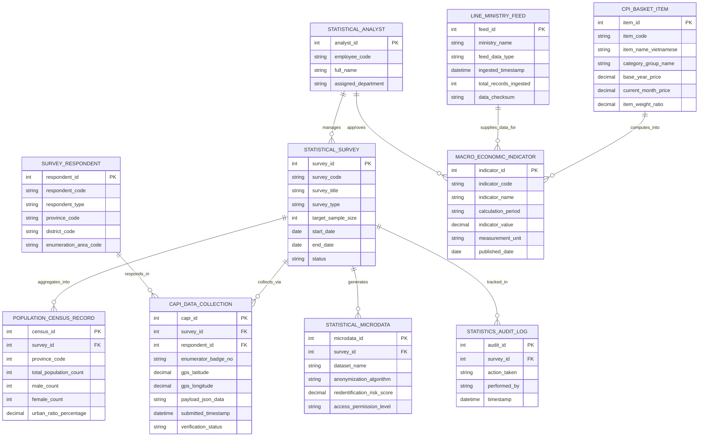

# Conceptual ERD — National Statistics Information System

## Mermaid Code

## Entity Description Table | Bảng mô tả Entity

| # | Entity Name | Vietnamese Name | Description | Key Attributes | Main Relationships |
|---|-------------|-----------------|-------------|----------------|-------------------|
| 1 | STATISTICAL_SURVEY | Cuộc Điều tra Thống kê | Thông tin các cuộc tổng điều tra (Dân số, Doanh nghiệp, Nông nghiệp, Giá) | survey_id, survey_code, survey_title, target_sample_size, status | Collects via CAPI_DATA_COLLECTION, aggregates into POPULATION_CENSUS_RECORD |
| 2 | SURVEY_RESPONDENT | Đơn vị Điều tra (Đối tượng) | Thông tin mã định danh và địa bàn của hộ gia đình, doanh nghiệp trả lời | respondent_id, respondent_code, respondent_type, enumeration_area_code | Responds in CAPI_DATA_COLLECTION |
| 3 | CAPI_DATA_COLLECTION | Phiếu Điều tra CAPI Điện tử | Dữ liệu phiếu điều tra thô thu thập qua ứng dụng CAPI máy tính bảng đính kèm GPS | capi_id, enumerator_badge_no, gps_latitude, payload_json_data, verification_status | Belongs to STATISTICAL_SURVEY, SURVEY_RESPONDENT |
| 4 | CPI_BASKET_ITEM | Mặt hàng Rổ Giá CPI | Danh mục 752 mặt hàng đại diện tính CPI, trọng số và giá chu kỳ | item_id, item_code, item_name_vietnamese, item_weight_ratio | Computes into MACRO_ECONOMIC_INDICATOR |
| 5 | MACRO_ECONOMIC_INDICATOR | Chỉ số Kinh tế Vĩ mô | Các chỉ số vĩ mô đã tính toán (CPI, GDP, Tốc độ tăng trưởng, Lạm phát) | indicator_id, indicator_code, indicator_name, indicator_value, published_date | Computed from CPI_BASKET_ITEM, LINE_MINISTRY_FEED |
| 6 | POPULATION_CENSUS_RECORD | Số liệu Thống kê Dân số | Kết quả tổng hợp quy mô dân số, tháp dân số theo từng Tỉnh/Thành | census_id, total_population_count, male_count, female_count | Belongs to STATISTICAL_SURVEY |
| 7 | STATISTICAL_MICRODATA | Tập Dữ liệu Vi mô (Microdata) | Tập dữ liệu vi mô đã qua thuật toán xử lý ẩn danh hóa phục vụ Open Data | microdata_id, dataset_name, anonymization_algorithm, reidentification_risk_score | Belongs to STATISTICAL_SURVEY |
| 8 | LINE_MINISTRY_FEED | Luồng Dữ liệu Hành chính Bộ/Ngành | Dữ liệu tích hợp liên thông tự động từ Thuế, Hải quan, Bảo hiểm Xã hội | feed_id, ministry_name, feed_data_type, total_records_ingested | Supplies data for MACRO_ECONOMIC_INDICATOR |
| 9 | STATISTICAL_ANALYST | Chuyên viên Thống kê GSO | Thông tin chuyên viên Tổng cục Thống kê phụ trách thiết kế và duyệt chỉ số | analyst_id, employee_code, full_name, assigned_department | Manages SURVEY, approves MACRO_ECONOMIC_INDICATOR |
| 10 | STATISTICS_AUDIT_LOG | Nhật ký Kiểm toán Thống kê | Lưu toàn bộ lịch sử thu thập dữ liệu CAPI, làm sạch, tính toán CPI/GDP | audit_id, action_taken, performed_by, timestamp | Belongs to STATISTICAL_SURVEY |

## Relationship Description | Mô tả Quan hệ

| # | From Entity | Cardinality | To Entity | Relationship Label | Business Explanation |
|---|-------------|-------------|-----------|-------------------|----------------------|
| 1 | STATISTICAL_SURVEY | one-to-many | CAPI_DATA_COLLECTION | collects_via | Một cuộc điều tra thu thập hàng triệu phiếu điều tra điện tử CAPI |
| 2 | SURVEY_RESPONDENT | one-to-many | CAPI_DATA_COLLECTION | responds_in | Một đối tượng điều tra trả lời thông tin trong các phiếu điều tra CAPI |
| 3 | STATISTICAL_SURVEY | one-to-many | POPULATION_CENSUS_RECORD | aggregates_into | Một cuộc tổng điều tra dân số tổng hợp thành các bản ghi số liệu dân số |
| 4 | STATISTICAL_SURVEY | one-to-many | STATISTICAL_MICRODATA | generates | Một cuộc điều tra sản xuất ra các tập dữ liệu vi mô mở cho nghiên cứu |
| 5 | CPI_BASKET_ITEM | one-to-many | MACRO_ECONOMIC_INDICATOR | computes_into | Các mặt hàng trong rổ giá tính toán ra các chỉ số CPI và lạm phát |
| 6 | LINE_MINISTRY_FEED | one-to-many | MACRO_ECONOMIC_INDICATOR | supplies_data_for | Các luồng dữ liệu từ Bộ/Ngành cung cấp số liệu đầu vào tính toán GDP |
| 7 | STATISTICAL_ANALYST | one-to-many | STATISTICAL_SURVEY | manages | Một chuyên viên thống kê GSO thiết kế và quản lý nhiều cuộc điều tra |
| 8 | STATISTICAL_ANALYST | one-to-many | MACRO_ECONOMIC_INDICATOR | approves | Một chuyên viên thẩm định và duyệt phát hành các chỉ số vĩ mô |
| 9 | STATISTICAL_SURVEY | one-to-many | STATISTICS_AUDIT_LOG | tracked_in | Mọi thao tác xử lý dữ liệu điều tra được ghi nhật ký kiểm toán bất biến |
