# Swimlane Diagram — National Statistics Information System

## Mermaid Code

```mermaid
flowchart LR
    Start(["Start"])

    subgraph Lane1["Field Enumerator (CAPI)"]
        A1["Interview Household & Enter CAPI Data"]
        A2["Capture GPS & Digital Signature"]
        A3["Submit CAPI Payload to Central Server"]
    end

    subgraph Lane2["National Statistics Platform Core"]
        S1["Verify GPS Boundary & Real-time Logic"]
        S2["Detect Sampling Outliers via AI"]
        S3["Aggregate Provincial CPI & National GDP"]
        S4["Apply K-Anonymity to Microdata"]
        S5["Publish Statistical e-Yearbook & SDDS Feed"]
    end

    subgraph Lane3["GSO Statistical Analyst"]
        O1["Review AI Outlier Alert Queue"]
        O2["Approve Final CPI and GDP Indicators"]
    end

    subgraph Lane4["International Body (IMF / UN)"]
        B1["Fetch National SDDS Statistical Package"]
        B2["Incorporate into Global SNA 2008 Report"]
    end

    Finish(["End"])

    Start --> A1 --> A2 --> A3 --> S1 --> S2 --> O1 --> S3 --> O2 --> S4 --> S5 --> B1 --> B2 --> Finish
```

## Flow Description | Mô tả luồng

| Lane | Actor | Role in Flow |
|------|-------|-------------|
| 1 | Field Enumerator (CAPI) | Phỏng vấn hộ gia đình, nhập số liệu vào ứng dụng CAPI trên máy tính bảng, ghi nhận GPS và gửi dữ liệu về trung tâm. |
| 2 | National Statistics Platform Core | Tự động kiểm tra logic dữ liệu, phát hiện số liệu bất thường AI, tính toán CPI/GDP, ẩn danh hóa dữ liệu vi mô và công bố. |
| 3 | GSO Statistical Analyst | Thẩm định các số liệu bất thường do AI cảnh báo và phê duyệt ký số phát hành các chỉ số kinh tế vĩ mô chính thức. |
| 4 | International Body (IMF / UN) | Tiếp nhận dữ liệu chỉ số kinh tế quốc gia theo chuẩn SDDS để tổng hợp vào báo cáo xếp hạng toàn cầu. |
