# Action Tree — National Statistics Information System

## Mermaid Code

```mermaid
graph TD
    Root["National Statistics Information System"]

    Root --> M1["Census & CAPI Data Collection"]
    Root --> M2["Price & CPI Indexing Engine"]
    Root --> M3["Macroeconomic & GDP Accounting"]
    Root --> M4["Demographics & Population Analytics"]
    Root --> M5["Microdata Anonymization & Open Portal"]
    Root --> M6["International SDDS & Executive BI"]

    M1 --> A11["Collect Tablet CAPI Census Surveys"]
    M1 --> A12["Verify GPS Coordinates Interview Boundary"]
    M1 --> A13["Manage Enumeration Area EA Maps"]
    M1 --> A14["Detect AI Sampling Data Outliers"]

    M2 --> A21["Calculate Consumer Price Index CPI"]
    M2 --> A22["Manage 752 CPI Basket Item Weights"]
    M2 --> A23["Calculate Core Inflation Rate"]
    M2 --> A24["Scrape Online E-Commerce Item Prices"]

    M3 --> A31["Compute GDP via Production Method"]
    M3 --> A32["Compute GDP via Expenditure Method"]
    M3 --> A33["Calculate Provincial GRDP Growth Rates"]
    M3 --> A34["Ingest Line Ministry Administrative Feeds"]

    M4 --> A41["Aggregate Population Pyramid Metrics"]
    M4 --> A42["Track Birth Death Migration Statistics"]
    M4 --> A43["Analyze National Labor Employment Rates"]
    M4 --> A44["Sync VNeID Population Demographics"]

    M5 --> A51["Apply K-Anonymity Microdata Records"]
    M5 --> A52["Assess Re-identification Risk Scores"]
    M5 --> A53["Publish e-Yearbook Portal Open Data"]
    M5 --> A54["Grant Secure Data Room Access"]

    M6 --> A61["Export IMF SDDS Data Packages"]
    M6 --> A62["Generate Executive Cabinet BI Dashboards"]
    M6 --> A63["Run Econometric Forecasting Models"]
    M6 --> A64["Render Interactive Statistical GIS Maps"]
```

## Module Description | Mô tả Module

| Mô tả Module | Description | Actions |
|---|--------|-------------|
| 1 | Census & CAPI Data Collection | Thu thập dữ liệu điều tra bằng máy tính bảng CAPI, kiểm tra GPS thực địa, quản lý sơ đồ địa bàn và phát hiện số liệu bất thường AI | Collect Tablet CAPI Census Surveys, Verify GPS Coordinates Interview Boundary, Manage Enumeration Area EA Maps, Detect AI Sampling Data Outliers |
| 2 | Price & CPI Indexing Engine | Tự động tính chỉ số giá tiêu dùng CPI hàng tháng cho 752 mặt hàng, tính lạm phát cơ bản và thu thập giá thương mại điện tử | Calculate Consumer Price Index CPI, Manage 752 CPI Basket Item Weights, Calculate Core Inflation Rate, Scrape Online E-Commerce Item Prices |
| 3 | Macroeconomic & GDP Accounting | Tính toán Tổng sản phẩm trong nước GDP theo phương pháp sản xuất và chi tiêu (SNA 2008), tính GRDP và kết nối dữ liệu Bộ/Ngành | Compute GDP via Production Method, Compute GDP via Expenditure Method, Calculate Provincial GRDP Growth Rates, Ingest Line Ministry Administrative Feeds |
| 4 | Demographics & Population Analytics | Tổng hợp quy mô dân số, tháp dân số, tỷ lệ sinh tử, tỷ lệ thất nghiệp và đồng bộ CSDL Quốc gia về Dân cư VNeID | Aggregate Population Pyramid Metrics, Track Birth Death Migration Statistics, Analyze National Labor Employment Rates, Sync VNeID Population Demographics |
| 5 | Microdata Anonymization & Open Portal | Thuật toán ẩn danh hóa dữ liệu vi mô (K-Anonymity), đánh giá nguy cơ tái định danh, công khai Niên giám Thống kê trên Open Data | Apply K-Anonymity Microdata Records, Assess Re-identification Risk Scores, Publish e-Yearbook Portal Open Data, Grant Secure Data Room Access |
| 6 | International SDDS & Executive BI | Trích xuất báo cáo dữ liệu theo chuẩn SDDS của IMF, trực quan hóa biểu đồ BI trình Thủ tướng và chạy mô hình dự báo kinh tế | Export IMF SDDS Data Packages, Generate Executive Cabinet BI Dashboards, Run Econometric Forecasting Models, Render Interactive Statistical GIS Maps |
