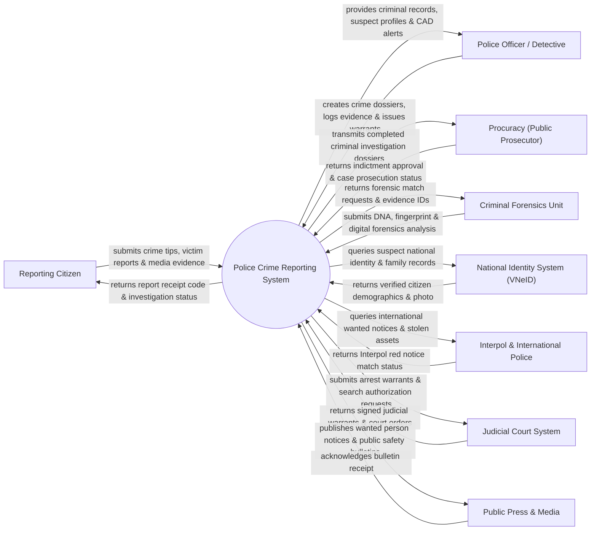

# Context Diagram — Police Crime Reporting System

## Mermaid Code

## Actor & Interaction Table | Bảng Actor & Tương tác

| # | Actor | Actor Type | Data Sent TO System | Data Received FROM System | Notes |
|---|-------|------------|---------------------|---------------------------|-------|
| 1 | Reporting Citizen | Primary | Anonymous crime tips, victim statements, photo/video evidence | Crime report receipt code, safety advice, case progress status | Người dân báo án, tố giác tội phạm hoặc nạn nhân vụ án |
| 2 | Police Officer / Detective | Primary | Case investigation files, suspect details, evidence logs, warrants | Criminal background checks, suspect mugshots, incident GIS map | Cảnh sát điều tra, điều tra viên công an các cấp |
| 3 | Procuracy (Public Prosecutor) | Primary | Indictments (Cáo trạng), prosecution approvals, case return notices | Completed criminal investigation dossiers, evidence lists | Viện Kiểm sát Nhân dân thực hành quyền công tố |
| 4 | Criminal Forensics Unit | Supporting | DNA profiles, fingerprint match scores, ballistics report XML | Forensic analysis requests, physical evidence serial numbers | Phân viện Kỹ thuật Hình sự (Giám định ADN, vân tay, ma túy) |
| 5 | National Identity System (VNeID) | Supporting | Suspect demographic details, national 12-digit PIN data | Identity verification queries, citizen mugshot lookup | Cơ sở dữ liệu quốc gia về dân cư xác thực nhân thân nghi phạm |
| 6 | Interpol & International Police | Supporting | Global red notices, international wanted list, stolen passports | Red notice match queries, fugitive identity parameters | Tổ chức Cảnh sát Hình sự Quốc gia / Interpol |
| 7 | Judicial Court System | Supporting | Judicial search warrants, arrest approvals, trial dates | Warrant issuance requests, suspect detention dossiers | Tòa án Nhân dân phê duyệt lệnh bắt tạm giam và khám xét |
| 8 | Public Press & Media | Supporting | Public media inquiries | Published wanted posters, public safety warnings | Báo chí truyền thông công bố thông tin truy nã tội phạm |

## System Boundary Description | Mô tả Phạm vi Hệ thống

Hệ thống Police Crime Reporting System (Hệ thống Tiếp nhận Báo cáo Tội phạm và Quản lý Hồ sơ Vụ án Công an) chịu trách nhiệm tự động hóa quy trình nghiệp vụ ngành công an từ khâu tiếp nhận tin báo tố giác tội phạm của người dân (trực tiếp hoặc ẩn danh), khởi tố vụ án hình sự, quản lý hồ sơ điều tra, theo dõi vật chứng vụ án, truy nã đối tượng, phát hành lệnh bắt tạm giam và chuyển hồ sơ sang Viện Kiểm sát đề nghị truy tố. Hệ thống bảo mật thông tin tuyệt đối theo cấp độ an ninh quốc gia. Tuy nhiên, hệ thống KHÔNG trực tiếp tham gia bắt giữ vật lý nghi phạm tại hiện trường và KHÔNG thay thế quyền phán quyết của Tòa án.
