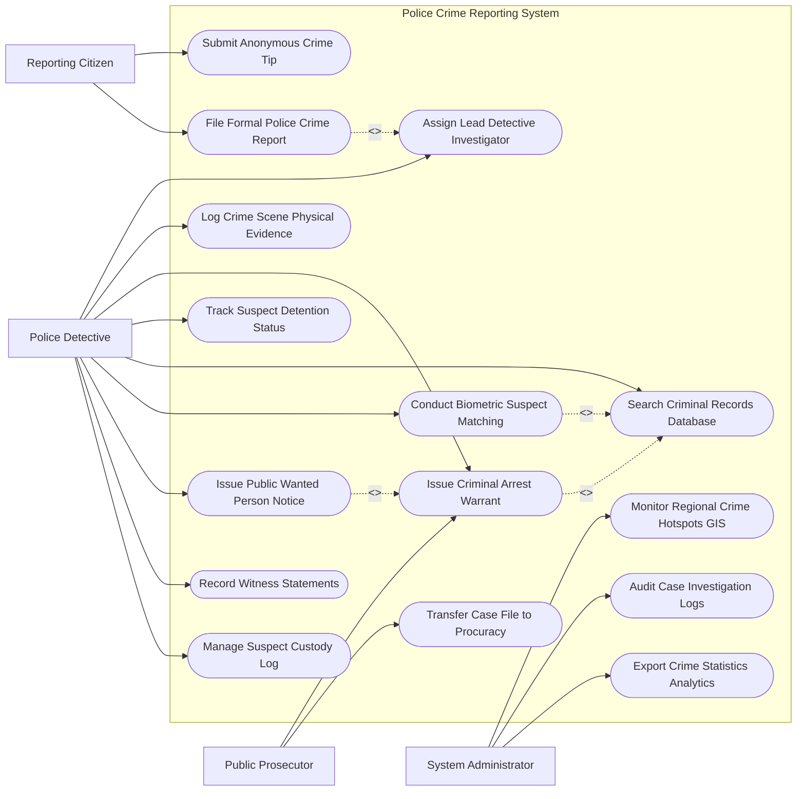

# Use Case Diagram — Police Crime Reporting System

## Mermaid Code

## Actor Table | Bảng Actor

| # | Actor | Actor Type | Role Description | Related Use Cases |
|---|-------|------------|------------------|-------------------|
| 1 | Reporting Citizen | Primary | Người dân gửi tin báo tố giác tội phạm (công khai hoặc ẩn danh) | UC01, UC02 |
| 2 | Police Detective | Primary | Cán bộ điều tra lập hồ sơ vụ án, thu thập chứng cứ, truy nã và ghi lời khai | UC03, UC04, UC05, UC06, UC07, UC08, UC09, UC13, UC14 |
| 3 | Public Prosecutor | Primary | Kiểm sát viên phê duyệt lệnh bắt tạm giam và tiếp nhận hồ sơ đề nghị truy tố | UC05, UC10 |
| 4 | System Administrator | System | Quản trị viên theo dõi bản đồ nhiệt tội phạm, kiểm toán log và trích xuất báo cáo | UC11, UC12, UC15 |

## Use Case Table | Bảng Use Case

| # | UC ID | Use Case Name | Primary Actor | Secondary Actor | Description | Priority |
|---|-------|---------------|---------------|-----------------|-------------|----------|
| 1 | UC01 | Submit Anonymous Crime Tip | Citizen | - | Gửi tin nhắn, hình ảnh tố giác tội phạm bảo mật ẩn danh | High |
| 2 | UC02 | File Formal Police Crime Report | Citizen | Officer | Trình báo chính thức vụ án hình sự/dân sự tại cơ quan công an | High |
| 3 | UC03 | Assign Lead Detective Investigator | Officer | - | Phân công Điều tra viên thụ lý chính và lập Ban chuyên án | High |
| 4 | UC04 | Log Crime Scene Physical Evidence | Officer | Forensics | Quản lý, niêm phong và đánh mã số vật chứng thu thập tại hiện trường | High |
| 5 | UC05 | Issue Criminal Arrest Warrant | Officer | Procuracy, Court | Khởi tạo lệnh bắt tạm giam, lệnh khám xét trình Kiểm sát viên phê duyệt | High |
| 6 | UC06 | Track Suspect Detention Status | Officer | - | Theo dõi thời hạn tạm giữ, tạm giam nghi phạm theo đúng luật tố tụng | High |
| 7 | UC07 | Search Criminal Records Database | Officer | VNeID | Tra cứu tiền án tiền sự, nhân thân và dấu vết của đối tượng nghi vấn | High |
| 8 | UC08 | Conduct Biometric Suspect Matching | Officer | Forensics | Đối soát vân tay, khuôn mặt và ADN của nghi phạm với CSDL hình sự | High |
| 9 | UC09 | Issue Public Wanted Person Notice | Officer | PublicPress | Phát hành Quyết định truy nã đối tượng bỏ trốn trên toàn quốc | High |
| 10 | UC10 | Transfer Case File to Procuracy | Officer | Procuracy | Hoàn thành Kết luận điều tra và chuyển toàn bộ hồ sơ sang Viện kiểm sát | High |
| 11 | UC11 | Monitor Regional Crime Hotspots GIS | Admin | GIS Engine | Phân tích bản đồ nhiệt tình hình an ninh trật tự và các tụ điểm tội phạm | Medium |
| 12 | UC12 | Audit Case Investigation Logs | Admin | - | Kiểm toán nhật ký truy cập và sửa đổi hồ sơ vụ án chống làm sai lệch | High |
| 13 | UC13 | Record Witness Statements | Officer | Witness | Ghi nhận và lưu trữ biên bản lời khai của người làm chứng và bị hại | Medium |
| 14 | UC14 | Manage Suspect Custody Log | Officer | Detention Center | Quản lý nhật ký can phạm, sức khỏe và dịch chuyển trong trại tạm giam | Medium |
| 15 | UC15 | Export Crime Statistics Analytics | Admin | Ministry Police | Trích xuất báo cáo thống kê tình hình vi phạm pháp luật nộp Bộ Công an | Low |

## Use Case Specification | Đặc tả Use Case

---

### UC01 — Submit Anonymous Crime Tip

| Field | Detail |
|-------|--------|
| **UC ID** | UC01 |
| **Use Case Name** | Submit Anonymous Crime Tip |
| **Actor(s)** | Primary: Reporting Citizen / Secondary: None |
| **Description** | Công dân gửi tin báo tố giác hành vi vi phạm pháp luật, ổ nhóm tội phạm một cách ẩn danh tuyệt đối. |
| **Precondition** | 1. Có kết nối Internet hoặc ứng dụng Báo án khẩn cấp. |
| **Main Flow** | 1. Citizen truy cập tính năng "Tố giác Tội phạm Ẩn danh" trên ứng dụng.   2. Citizen chọn loại hình tội phạm (Ma túy, Cờ bạc, Trộm cắp, Tham nhũng, Tội phạm mạng).   3. Citizen tải lên bằng chứng hình ảnh, video, tài liệu hoặc file ghi âm.   4. Citizen nhập mô tả địa điểm, thời gian và thông tin đối tượng nghi vấn.   5. System xóa toàn bộ thông tin địa chỉ IP, số điện thoại và định danh thiết bị của Citizen (Anonymization).   6. System sinh Mã tin báo ẩn danh (Anonymous Tip Code) để Citizen tự theo dõi kết quả.   7. System tự động mã hóa và chuyển tin báo đến Trực ban Công an địa bàn tương ứng. |
| **Alternative Flow** | **AF1** — Tố giác công khai danh tính: Citizen chọn "Công khai thông tin", thông tin người báo án được bảo mật theo chế độ bảo vệ người tố giác tội phạm. |
| **Exception Flow** | **EX1** — Tệp đính kèm chứa mã độc vi-rút: System tự động quét vi-rút, chặn tệp độc hại và chỉ nhận nội dung văn bản. |
| **Postcondition** | Tin báo tố giác được lưu vào danh sách chờ xác minh của Trưởng Công an địa bàn. |
| **Business Rule** | **BR1**: Thông tin cá nhân của người tố giác ẩn danh tuyệt đối không được ghi lại trong cơ sở dữ liệu hệ thống. |

---

### UC02 — File Formal Police Crime Report

| Field | Detail |
|-------|--------|
| **UC ID** | UC02 |
| **Use Case Name** | File Formal Police Crime Report |
| **Actor(s)** | Primary: Reporting Citizen / Secondary: Police Officer |
| **Description** | Người dân hoặc nạn nhân trực tiếp trình báo vụ án hình sự tại trụ sở Công an hoặc qua Cổng Dịch vụ công Bộ Công an. |
| **Precondition** | 1. Người trình báo có giấy tờ tùy thân hoặc xác thực tài khoản VNeID. |
| **Main Flow** | 1. Citizen nộp Đơn trình báo vụ việc/tố giác tội phạm trực tuyến hoặc trực tiếp.   2. Officer tiếp nhận đơn và xác minh thông tin người trình báo qua VNeID.   3. Officer ghi nhận chi tiết: Diễn biến sự việc, thời gian, địa điểm, thiệt hại tài sản/sức khỏe, đối tượng nghi vấn.   4. Officer lập Biên bản tiếp nhận tin báo tố giác tội phạm theo biểu mẫu tố tụng.   5. Citizen và Officer cùng ký số/ký tên vào biên bản.   6. System cấp Mã vụ việc (Incident Tracking Code) và cấp Sổ tiếp nhận tin báo cho Citizen.   7. System khởi tạo hồ sơ và chuyển lên Thủ trưởng cơ quan điều tra phê duyệt phân công (UC03). |
| **Alternative Flow** | **AF1** — Trình báo vụ án hình sự nghiêm trọng (Giết người, cướp tài sản): Officer báo động trực ban hình sự cử lực lượng xuống bảo vệ hiện trường ngay lập tức. |
| **Exception Flow** | **EX1** — Vụ việc thuộc tranh chấp dân sự (không có dấu hiệu hình sự): Officer hướng dẫn Citizen làm đơn khởi kiện sang Tòa án Nhân dân. |
| **Postcondition** | Tin báo tố giác tội phạm được thụ lý chính thức, bắt đầu thời hạn 20 ngày xác minh sơ bộ. |
| **Business Rule** | **BR1**: Thời hạn xử lý xác minh tin báo tố giác tội phạm ban đầu không quá 20 ngày (tối đa 02 tháng đối với vụ việc phức tạp). |

---

### UC03 — Assign Lead Detective Investigator

| Field | Detail |
|-------|--------|
| **UC ID** | UC03 |
| **Use Case Name** | Assign Lead Detective Investigator |
| **Actor(s)** | Primary: Police Detective (Thủ trưởng CQĐT) / Secondary: None |
| **Description** | Thủ trưởng Cơ quan Điều tra ra Quyết định phân công Điều tra viên và Cán bộ điều tra thụ lý chính vụ án. |
| **Precondition** | 1. Tin báo tố giác tội phạm (UC02) đã được tiếp nhận chính thức. |
| **Main Flow** | 1. Thủ trưởng cơ quan điều tra mở danh sách vụ việc mới thụ lý.   2. System hiển thị danh sách các Điều tra viên thuộc đội chuyên trách (Đội Trật tự xã hội, Đội Ma túy, Đội Kinh tế) kèm số lượng vụ án đang thụ lý.   3. Thủ trưởng chọn Điều tra viên chính (Lead Detective) và các cán bộ phối hợp.   4. System khởi tạo Quyết định phân công Điều tra viên thụ lý vụ án theo mẫu tố tụng hình sự.   5. Thủ trưởng ký số điện tử vào Quyết định.   6. System tự động cấp quyền truy cập toàn bộ hồ sơ vụ án cho Điều tra viên được phân công.   7. System gửi thông báo phân công tới Điều tra viên và Viện Kiểm sát cùng cấp. |
| **Alternative Flow** | **AF1** — Thành lập Ban Chuyên án đối với vụ án đặc biệt nghiêm trọng: Thủ trưởng ra quyết định thành lập Ban Chuyên án, chỉ định Trưởng ban chuyên án và phân công nhiều đội tham gia. |
| **Exception Flow** | **EX1** — Điều tra viên có quan hệ thân thích với bị hại/nghi phạm: System cảnh báo xung đột lợi ích, yêu cầu phân công Điều tra viên khác. |
| **Postcondition** | Điều tra viên thụ lý bắt đầu triển khai các biện pháp điều tra tố tụng. |
| **Business Rule** | **BR1**: Quyết định phân công Điều tra viên phải được gửi cho Viện Kiểm sát cùng cấp trong thời hạn 03 ngày làm việc. |

---

### UC05 — Issue Criminal Arrest Warrant

| Field | Detail |
|-------|--------|
| **UC ID** | UC05 |
| **Use Case Name** | Issue Criminal Arrest Warrant |
| **Actor(s)** | Primary: Police Detective / Secondary: Public Prosecutor |
| **Description** | Khởi tạo Lệnh bắt bị can để tạm giam, Lệnh khám xét trình Viện Kiểm sát phê duyệt trước khi thực thi. |
| **Precondition** | 1. Đã có Quyết định khởi tố bị can đối với đối tượng nghi vấn.   2. Có đủ căn cứ pháp lý chứng minh nguy cơ bỏ trốn hoặc cản trở điều tra. |
| **Main Flow** | 1. Detective lập Quyết định khởi tố bị can và Lệnh bắt bị can để tạm giam trên hệ thống.   2. Detective đính kèm các tài liệu chứng cứ chứng minh hành vi phạm tội.   3. Thủ trưởng Cơ quan điều tra duyệt và ký số Lệnh bắt.   4. System tự động truyền mã hóa Hồ sơ đề nghị phê duyệt lệnh bắt sang Viện Kiểm sát (Public Prosecutor).   5. Prosecutor thẩm định hồ sơ và phê duyệt Quyết định phê duyệt lệnh bắt tạm giam bằng chữ ký số.   6. System cấp Mã lệnh bắt chính thức và cập nhật trạng thái bị can "Đã có lệnh bắt phê duyệt".   7. Lực lượng điều tra tổ chức thi hành Lệnh bắt bị can theo đúng quy định. |
| **Alternative Flow** | **AF1** — Bắt người trong trường hợp khẩn cấp/Phạm tội quả đứt: Detective tiến hành bắt ngay không cần lệnh trước, sau đó lập hồ sơ đề nghị Viện kiểm sát phê duyệt lệnh bắt khẩn cấp trong 12 giờ. |
| **Exception Flow** | **EX1** — Viện Kiểm sát không phê duyệt lệnh bắt: System báo trạng thái "VKS từ chối phê duyệt", yêu cầu hủy bỏ lệnh bắt và thả tự do cho đối tượng nếu đang tạm giữ. |
| **Postcondition** | Lệnh bắt tạm giam có hiệu lực tố tụng, nghi phạm được đưa vào Trại tạm giam (UC14). |
| **Business Rule** | **BR1**: Lệnh bắt tạm giam bắt buộc phải có Quyết định phê duyệt của Viện Kiểm sát cùng cấp mới có giá trị thi hành (trừ bắt quả tang). |

---

### UC10 — Transfer Case File to Procuracy

| Field | Detail |
|-------|--------|
| **UC ID** | UC10 |
| **Use Case Name** | Transfer Case File to Procuracy |
| **Actor(s)** | Primary: Police Detective / Secondary: Public Prosecutor |
| **Description** | Hoàn thành Bản kết luận điều tra, đóng gói toàn bộ hồ sơ vụ án hình sự và chuyển giao sang Viện Kiểm sát đề nghị truy tố. |
| **Precondition** | 1. Thời hạn điều tra vụ án kết thúc và các chứng cứ đã được thu thập đầy đủ. |
| **Main Flow** | 1. Detective biên soạn Bản kết luận điều tra đề nghị truy tố bị can.   2. Thủ trưởng Cơ quan điều tra ký duyệt Bản kết luận điều tra.   3. System tự động kiểm tra danh mục tài liệu hồ sơ: Biên bản lời khai, Biên bản khám nghiệm, Kết luận giám định, Vật chứng.   4. System đóng gói Hồ sơ vụ án điện tử (e-Case File PDF/A) kèm mã băm SHA-256 chống chỉnh sửa.   5. System truyền toàn bộ Hồ sơ vụ án sang Hệ thống Quản lý Án của Viện Kiểm sát Nhân dân.   6. Prosecutor tiếp nhận hồ sơ, kiểm tra tính đầy đủ và ký xác nhận Giấy giao nhận hồ sơ vụ án điện tử.   7. System cập nhật trạng thái vụ án sang "Đã kết thúc điều tra - Chuyển Viện Kiểm sát thụ lý truy tố". |
| **Alternative Flow** | **AF1** — Kết luận điều tra đình chỉ vụ án (Do không có sự việc phạm tội): Detective lập Bản kết luận điều tra đình chỉ, System gửi thông báo cho bị can và VKS. |
| **Exception Flow** | **EX1** — Viện Kiểm sát trả lại hồ sơ yêu cầu điều tra bổ sung: System chuyển trạng thái vụ án về "Điều tra bổ sung", mở lại quyền chỉnh sửa hồ sơ cho Detective. |
| **Postcondition** | Giai đoạn điều tra của Công an hoàn thành, trách nhiệm tố tụng chuyển sang Viện Kiểm sát. |
| **Business Rule** | **BR1**: Hồ sơ vụ án chuyển sang Viện Kiểm sát bắt buộc phải được mã hóa toàn vẹn và không được phép sửa đổi bất kỳ tài liệu nào. |
