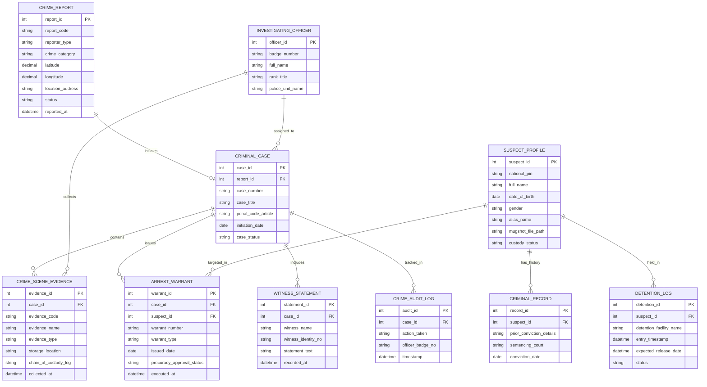

# Conceptual ERD — Police Crime Reporting System

## Mermaid Code

## Entity Description Table | Bảng mô tả Entity

| # | Entity Name | Vietnamese Name | Description | Key Attributes | Main Relationships |
|---|-------------|-----------------|-------------|----------------|-------------------|
| 1 | CRIME_REPORT | Tin báo Tố giác Tội phạm | Thông tin tin báo tố giác tội phạm từ công dân (công khai hoặc ẩn danh) | report_id, report_code, crime_category, location_address, status | Initiates CRIMINAL_CASE |
| 2 | CRIMINAL_CASE | Hồ sơ Vụ án Hình sự | Thông tin khởi tố vụ án hình sự, điều khoản Bộ luật Hình sự áp dụng | case_id, case_number, case_title, penal_code_article, case_status | Belongs to CRIME_REPORT, contains EVIDENCE, issues ARREST_WARRANT |
| 3 | SUSPECT_PROFILE | Hồ sơ Bị can / Nghi phạm | Thông tin nhân thân, đặc điểm nhận dạng và ảnh hình sự của nghi phạm | suspect_id, national_pin, full_name, alias_name, custody_status | Targeted in ARREST_WARRANT, has CRIMINAL_RECORD, held in DETENTION_LOG |
| 4 | CRIME_SCENE_EVIDENCE | Vật chứng Hiện trường | Danh mục các mẫu vật chứng, tang vật thu giữ tại hiện trường vụ án | evidence_id, evidence_code, evidence_name, chain_of_custody_log | Belongs to CRIMINAL_CASE, collected by OFFICER |
| 5 | ARREST_WARRANT | Lệnh Bắt / Khám xét | Thông tin lệnh bắt tạm giam, lệnh khám xét đã qua phê duyệt của VKS | warrant_id, warrant_number, warrant_type, procuracy_approval_status | Belongs to CRIMINAL_CASE, SUSPECT_PROFILE |
| 6 | INVESTIGATING_OFFICER | Điều tra viên Công an | Thông tin cán bộ chiến sĩ cảnh sát điều tra được phân công thụ lý vụ án | officer_id, badge_number, full_name, rank_title | Assigned to CRIMINAL_CASE, collects EVIDENCE |
| 7 | WITNESS_STATEMENT | Biên bản Lời khai Người làm chứng | Nội dung ghi chép lời khai của người làm chứng và người bị hại | statement_id, witness_name, witness_identity_no, statement_text | Belongs to CRIMINAL_CASE |
| 8 | CRIMINAL_RECORD | Tiền án Tiền sự | Lịch sử bản án và tiền án tiền sự của nghi phạm trong cơ sở dữ liệu | record_id, prior_conviction_details, sentencing_court | Belongs to SUSPECT_PROFILE |
| 9 | DETENTION_LOG | Sổ Quản lý Tạm giữ Tạm giam | Theo dõi việc nhập trại, gia hạn tạm giam và tình trạng sức khỏe can phạm | detention_id, detention_facility_name, entry_timestamp, status | Belongs to SUSPECT_PROFILE |
| 10 | CRIME_AUDIT_LOG | Nhật ký Kiểm toán Hồ sơ Vụ án | Lưu vết mọi thao tác xem, sửa, phê duyệt hồ sơ vụ án chống can thiệp | audit_id, action_taken, officer_badge_no, timestamp | Belongs to CRIMINAL_CASE |

## Relationship Description | Mô tả Quan hệ

| # | From Entity | Cardinality | To Entity | Relationship Label | Business Explanation |
|---|-------------|-------------|-----------|-------------------|----------------------|
| 1 | CRIME_REPORT | one-to-one | CRIMINAL_CASE | initiates | Một tin báo tố giác có đủ căn cứ sẽ khởi tạo một vụ án hình sự |
| 2 | CRIMINAL_CASE | one-to-many | CRIME_SCENE_EVIDENCE | contains | Một vụ án hình sự chứa nhiều vật chứng, tang vật thu thập tại hiện trường |
| 3 | CRIMINAL_CASE | one-to-many | ARREST_WARRANT | issues | Một vụ án có thể ban hành các lệnh bắt tạm giam đối với các bị can |
| 4 | SUSPECT_PROFILE | one-to-many | ARREST_WARRANT | targeted_in | Một nghi phạm có thể là mục tiêu của các lệnh bắt, lệnh truy nã |
| 5 | CRIMINAL_CASE | one-to-many | WITNESS_STATEMENT | includes | Một vụ án bao gồm biên bản lời khai của nhiều người làm chứng |
| 6 | SUSPECT_PROFILE | one-to-many | CRIMINAL_RECORD | has_history | Một nghi phạm có thể có các bản ghi tiền án tiền sự trước đây |
| 7 | SUSPECT_PROFILE | one-to-many | DETENTION_LOG | held_in | Một nghi phạm được ghi nhật ký tạm giữ/tạm giam tại trại giam |
| 8 | INVESTIGATING_OFFICER | one-to-many | CRIMINAL_CASE | assigned_to | Một Điều tra viên được phân công thụ lý chính nhiều vụ án |
| 9 | INVESTIGATING_OFFICER | one-to-many | CRIME_SCENE_EVIDENCE | collects | Một Điều tra viên thực hiện thu thập và niêm phong nhiều vật chứng |
| 10 | CRIMINAL_CASE | one-to-many | CRIME_AUDIT_LOG | tracked_in | Mọi thao tác tố tụng trên hồ sơ vụ án đều được ghi lại nhật ký kiểm toán bất biến |
