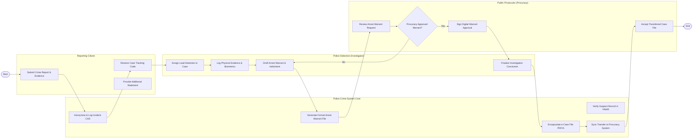

# Swimlane Diagram — Police Crime Reporting System

## Mermaid Code

## Flow Description | Mô tả luồng

| Lane | Actor | Role in Flow |
|------|-------|-------------|
| 1 | Reporting Citizen | Trình báo vụ án tố giác tội phạm, tải lên bằng chứng hình ảnh/video, nhận mã theo dõi và phối hợp cung cấp lời khai. |
| 2 | Police Crime System Core | Khởi tạo vụ án trên CAD, tự động tra cứu nhân thân nghi phạm trên VNeID, đóng gói hồ sơ vụ án mã hóa và truyền sang Viện Kiểm sát. |
| 3 | Police Detective (Investigator) | Phân công điều tra viên chính, thu thập và niêm phong vật chứng hiện trường, lập lệnh bắt bị can và hoàn thành kết luận điều tra. |
| 4 | Public Prosecutor (Procuracy) | Thẩm định tính pháp lý của hồ sơ xin lệnh bắt tạm giam, ký số phê duyệt lệnh bắt và tiếp nhận hồ sơ vụ án đề nghị truy tố. |
