# Action Tree — Police Crime Reporting System

## Mermaid Code

```mermaid
graph TD
    Root["Police Crime Reporting System"]

    Root --> M1["Crime Tip & Intake Management"]
    Root --> M2["Investigation & Case Dossiers"]
    Root --> M3["Evidence & Forensic Tracking"]
    Root --> M4["Suspects & Arrest Warrants"]
    Root --> M5["Case Transfer & Procuracy Sync"]
    Root --> M6["Crime Analytics & Hotspot Mapping"]

    M1 --> A11["Receive Anonymous Crime Tips"]
    M1 --> A12["Process Formal Crime Reports"]
    M1 --> A13["Anonymize Reporter Metadata"]
    M1 --> A14["Issue Incident Tracking Receipts"]

    M2 --> A21["Assign Lead Detective Investigators"]
    M2 --> A22["Establish Special Task Force Teams"]
    M2 --> A23["Record Witness Victim Statements"]
    M2 --> A24["Track Statutory Investigation Deadlines"]

    M3 --> A31["Log Physical Evidence Chain Custody"]
    M3 --> A32["Match Suspect Fingerprints AFIS"]
    M3 --> A33["Analyze DNA Forensic Profiles"]
    M3 --> A34["Extract Digital Mobile Forensics"]

    M4 --> A41["Draft Criminal Arrest Warrants"]
    M4 --> A42["Issue Public Wanted Person Notices"]
    M4 --> A43["Track Suspect Detention Custody Logs"]
    M4 --> A44["Query Interpol Global Red Notices"]

    M5 --> A51["Submit Warrants Procuracy Approval"]
    M5 --> A52["Compile Final Investigation Reports"]
    M5 --> A53["Encrypt e-Case Files PDF Packages"]
    M5 --> A54["Sync Case Transfer Prosecutor Office"]

    M6 --> A61["Render Regional Crime GIS Heatmaps"]
    M6 --> A62["Analyze Modus Operandi MO Trends"]
    M6 --> A63["Log Immutable Case Audit Ledgers"]
    M6 --> A64["Export Ministry Police Reports"]
```

## Module Description | Mô tả Module

| # | Module | Description | Actions |
|---|--------|-------------|---------|
| 1 | Crime Tip & Intake Management | Tiếp nhận tin báo tố giác tội phạm, ẩn danh hóa dữ liệu người tố giác và cấp mã tra cứu vụ việc | Receive Anonymous Crime Tips, Process Formal Crime Reports, Anonymize Reporter Metadata, Issue Incident Tracking Receipts |
| 2 | Investigation & Case Dossiers | Quản lý hồ sơ vụ án hình sự, phân công Điều tra viên thụ lý chính, lập Ban chuyên án và ghi nhận lời khai | Assign Lead Detective Investigators, Establish Special Task Force Teams, Record Witness Victim Statements, Track Statutory Investigation Deadlines |
| 3 | Evidence & Forensic Tracking | Quản lý niêm phong và chuỗi bảo quản vật chứng hiện trường, đối soát sinh trắc học vân tay ADN và kỹ thuật hình sự | Log Physical Evidence Chain Custody, Match Suspect Fingerprints AFIS, Analyze DNA Forensic Profiles, Extract Digital Mobile Forensics |
| 4 | Suspects & Arrest Warrants | Khởi tạo lệnh bắt bị can tạm giam, phát hành quyết định truy nã toàn quốc và theo dõi thời hạn can phạm tại trại giam | Draft Criminal Arrest Warrants, Issue Public Wanted Person Notices, Track Suspect Detention Custody Logs, Query Interpol Global Red Notices |
| 5 | Case Transfer & Procuracy Sync | Truyền mã hóa hồ sơ xin duyệt lệnh bắt sang Viện Kiểm sát, đóng gói kết luận điều tra và chuyển giao truy tố | Submit Warrants Procuracy Approval, Compile Final Investigation Reports, Encrypt e-Case Files PDF Packages, Sync Case Transfer Prosecutor Office |
| 6 | Crime Analytics & Hotspot Mapping | Phân tích bản đồ nhiệt an ninh trật tự GIS, nghiên cứu phương thức thủ đoạn phạm tội và trích xuất báo cáo Bộ Công an | Render Regional Crime GIS Heatmaps, Analyze Modus Operandi MO Trends, Log Immutable Case Audit Ledgers, Export Ministry Police Reports |
