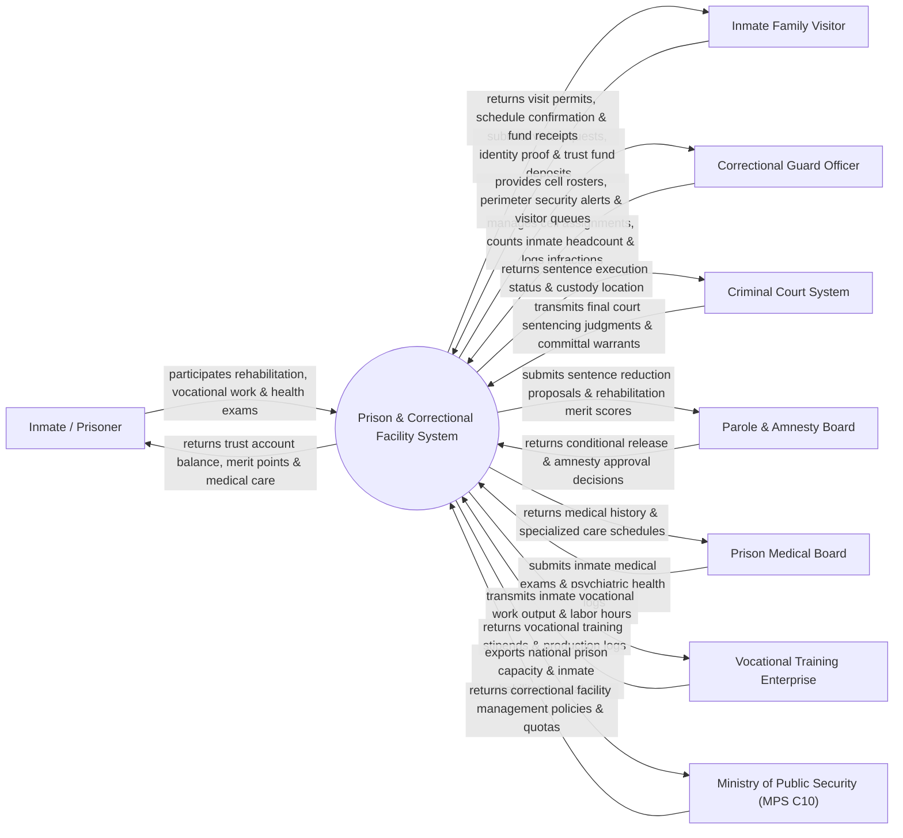

# Context Diagram — Prison & Correctional Facility System

## Mermaid Code

## Actor & Interaction Table | Bảng Actor & Tương tác

| # | Actor | Actor Type | Data Sent TO System | Data Received FROM System | Notes |
|---|-------|------------|---------------------|---------------------------|-------|
| 1 | Inmate / Prisoner | Primary | Rehabilitation progress, vocational work logs, health symptoms, canteen orders | Trust account balance, merit points, medical prescription care | Phạm nhân đang chấp hành án phạt tù tại các Trại giam |
| 2 | Correctional Guard Officer | Primary | Cell assignments, daily headcount counts, disciplinary infraction logs | Cell rosters, perimeter AI security alerts, visitor queues | Cán bộ Chiến sĩ Quản giáo và Cảnh sát Bảo vệ Trại giam |
| 3 | Inmate Family Visitor | Supporting | Family visit requests, VNeID identity proof, canteen fund deposits | Approved visit permits, schedule QR codes, fund receipts | Thân nhân phạm nhân đăng ký thăm gặp và gửi lưu ký |
| 4 | Criminal Court System | Supporting | Final court sentencing judgments, committal warrants, appeal status | Sentence execution verification, custody location status | Tòa án Nhân dân các cấp gửi Bản án và Quyết định thi hành án |
| 5 | Parole Board | Regulatory | Conditional release decisions, national amnesty decrees (Đặc xá) | Sentence reduction proposals, rehabilitation merit scores | Hội đồng Xét giảm thời hạn chấp hành án phạt tù / Đặc xá |
| 6 | Prison Medical Board | Supporting | Inmate medical exam results, chronic disease logs, hospital transfer | Medical history files, specialized healthcare schedules | Bệnh xá Trại giam kiểm tra sức khỏe và khám chữa bệnh phạm nhân |
| 7 | Vocational Training Enterprise | Supporting | Vocational training stipends, production output logs | Inmate work assignment lists, labor hours completed | Cơ sở sản xuất/lao động hướng nghiệp hợp tác với Trại giam |
| 8 | Ministry of Public Security (MPS C10) | Regulatory | Correctional facility management policies, security alert quotas | National prison capacity BI dashboards, rehabilitation analytics | Cục Quản lý Trại giam, Cơ sở giáo dục bắt buộc (C10 - Bộ Công an) |

## System Boundary Description | Mô tả Phạm vi Hệ thống

Hệ thống Prison & Correctional Facility System (Hệ thống Quản lý Trại giam và Cơ sở Giáo dục Cảnh sát) chịu trách nhiệm tự động hóa quy trình quản lý giam giữ và cải tạo phạm nhân: Tiếp nhận phạm nhân, số hóa sinh trắc học (Khuôn mặt/Vân tay), quản lý buồng giam và điểm danh quân số tự động, giám sát an ninh hàng rào bằng camera AI phát hiện vượt ngục, đăng ký lịch thăm gặp thân nhân trực tuyến, quản lý tiền lưu ký phạm nhân (Trust Account), đánh giá điểm thi đua cải tạo để xét giảm thời hạn chấp hành án phạt tù (Đặc xá), quản lý lao động hướng nghiệp và bệnh án quân y. Hệ thống vận hành trên mạng bảo mật riêng của Bộ Công an. Tuy nhiên, hệ thống KHÔNG trực tiếp canh gác vật lý và KHÔNG thay thế việc vũ lực cưỡng chế của lực lượng Cảnh sát Bảo vệ.
