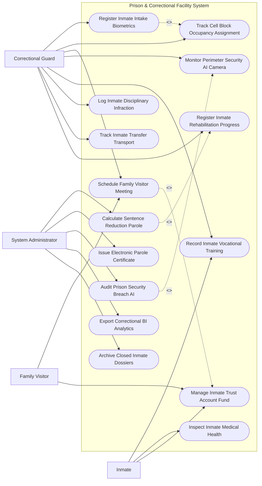

# Use Case Diagram — Prison & Correctional Facility System

## Mermaid Code

## Actor Table | Bảng Actor

| # | Actor | Actor Type | Role Description | Related Use Cases |
|---|-------|------------|------------------|-------------------|
| 1 | Inmate | Primary | Phạm nhân tham gia lao động hướng nghiệp, kiểm tra sức khỏe và mua căng tin qua tài khoản lưu ký | UC05, UC07, UC08 |
| 2 | Family Visitor | Primary | Thân nhân đăng ký lịch thăm gặp phạm nhân trực tuyến và gửi tiền lưu ký vào tài khoản | UC03, UC08 |
| 3 | Correctional Guard | Primary | Cán bộ quản giáo làm thủ tục tiếp nhận, phân buồng giam, điểm danh, theo dõi vi phạm kỷ luật | UC01, UC02, UC03, UC04, UC05, UC10, UC12, UC13 |
| 4 | System Administrator | System | Quản trị viên theo dõi AI an ninh hàng rào, tính điểm giảm án đặc xá và trích xuất báo cáo | UC06, UC09, UC11, UC14, UC15 |

## Use Case Table | Bảng Use Case

| # | UC ID | Use Case Name | Primary Actor | Secondary Actor | Description | Priority |
|---|-------|---------------|---------------|-----------------|-------------|----------|
| 1 | UC01 | Register Inmate Intake Biometrics | Guard | Court | Tiếp nhận phạm nhân mới, quét ảnh khuôn mặt 3D, vân tay và nhập Bản án Tòa án | High |
| 2 | UC02 | Track Cell Block Occupancy Assignment | Guard | - | Quản lý biên chế buồng giam, phân loại mức độ nguy hiểm và điểm danh quân số | High |
| 3 | UC03 | Schedule Family Visitor Meeting | Visitor, Guard | VNeID | Đăng ký lịch thăm gặp thân nhân trực tuyến, phê duyệt sổ thăm gặp và cấp mã QR | High |
| 4 | UC04 | Monitor Perimeter Security AI Camera | Guard | AI Camera | Phân tích luồng video camera AI giám sát hàng rào phát hiện hành vi trốn trại | High |
| 5 | UC05 | Record Inmate Vocational Training | Inmate, Guard | Enterprise | Ghi nhận kết quả lao động hướng nghiệp, học nghề và chấm điểm thi đua lao động | Medium |
| 6 | UC06 | Calculate Sentence Reduction Parole | Admin | ParoleBoard | Tự động tổng hợp điểm thi đua chấp hành án để xét giảm thời hạn phạt tù/đặc xá | High |
| 7 | UC07 | Inspect Inmate Medical Health | Inmate, Guard | MedicalBoard | Khám chữa bệnh tại bệnh xá trại giam, quản lý hồ sơ bệnh mãn tính của phạm nhân | High |
| 8 | UC08 | Manage Inmate Trust Account Fund | Visitor, Inmate | Bank | Quản lý tài khoản tiền lưu ký thân nhân gửi cho phạm nhân mua hàng căng tin | High |
| 9 | UC09 | Issue Electronic Parole Certificate | Admin | Court | Ban hành Quyết định đặc xá / Cấp Giấy chứng nhận chấp hành xong án phạt tù | High |
| 10 | UC10 | Log Inmate Disciplinary Infraction | Guard | - | Lập biên bản vi phạm nội quy trại giam, phạt kỷ luật cấm thăm gặp/chuyển buồng | High |
| 11 | UC11 | Audit Prison Security Breach AI | Admin | Guard | Bật báo động khẩn cấp khi camera AI phát hiện xô xát nhóm hoặc trèo hàng rào | High |
| 12 | UC12 | Track Inmate Transfer Transport | Guard | Police | Quản lý điều chuyển phạm nhân giữa các trại giam hoặc trích xuất ra tòa án | High |
| 13 | UC13 | Register Inmate Rehabilitation Progress | Guard | Admin | Đánh giá xếp loại thi đua cải tạo định kỳ hàng tháng (Tốt, Khá, Trung bình, Kém) | High |
| 14 | UC14 | Export Correctional BI Analytics | Admin | MPS C10 | Trích xuất báo cáo tỷ lệ tái hòa nhập cộng đồng và công suất trại giam nộp Bộ Công an | Low |
| 15 | UC15 | Archive Closed Inmate Dossiers | System | Archives | Đóng gói và lưu trữ vĩnh viễn hồ sơ phạm nhân đã chấp hành xong án phạt tù | Low |

## Use Case Specification | Đặc tả Use Case

---

### UC01 — Register Inmate Intake Biometrics

| Field | Detail |
|-------|--------|
| **UC ID** | UC01 |
| **Use Case Name** | Register Inmate Intake Biometrics |
| **Actor(s)** | Primary: Correctional Guard Officer / Secondary: Criminal Court System |
| **Description** | Làm thủ tục tiếp nhận phạm nhân mới nhập trại, thu thập sinh trắc học (ảnh 3 góc, 10 dấu vân tay, mống mắt) và nạp Bản án Tòa án. |
| **Precondition** | 1. Cán bộ cảnh sát áp giải phạm nhân kèm Quyết định thi hành án phạt tù của Tòa án có hiệu lực. |
| **Main Flow** | 1. GuardOfficer mở Phân hệ Tiếp nhận Phạm nhân Mới.   2. GuardOfficer quét mã Quyết định thi hành án: System kết nối Tòa án (UC00) lấy thông tin bản án (Họ tên, Mức án tù, Tội danh, Ngày bắt).   3. GuardOfficer chụp ảnh chân dung phạm nhân 3 góc (Chính diện, Nghiêng trái, Nghiêng phải) và lấy 10 dấu vân tay.   4. GuardOfficer lăn tay mống mắt (Iris Scan) và ghi nhận các đặc điểm nhận dạng riêng (Sẹo, hình xăm).   5. GuardOfficer cân đo thể lực và khám sức khỏe ban đầu (UC07).   6. System tự động khởi tạo Mã số Phạm nhân (Inmate ID) duy nhất và gạch mã phân loại an ninh.   7. GuardOfficer phân bổ phạm nhân về Buồng giam tạm thu (UC02) và phát quần áo áo phạm nhân. |
| **Alternative Flow** | **AF1** — Phạm nhân tái phạm nguy hiểm/án tử hình: System tự động gán nhãn "Mức độ an ninh đặc biệt" và phân về Phân trại giam riêng. |
| **Exception Flow** | **EX1** — Thông tin bản án bị sai lệch với nhân thân thực tế: GuardOfficer lập biên bản tạm giữ, gửi yêu cầu đối soát sang Tòa án Nhân dân. |
| **Postcondition** | Hồ sơ phạm nhân điện tử được khởi tạo chính thức, đưa vào danh sách quản lý giam giữ của trại giam. |
| **Business Rule** | **BR1**: 100% phạm nhân nhập trại bắt buộc phải thu thập đủ ảnh chân dung 3D và 10 dấu vân tay trước khi đưa vào buồng giam. |

---

### UC02 — Track Cell Block Occupancy Assignment

| Field | Detail |
|-------|--------|
| **UC ID** | UC02 |
| **Use Case Name** | Track Cell Block Occupancy Assignment |
| **Actor(s)** | Primary: Correctional Guard Officer / Secondary: None |
| **Description** | Quản lý danh sách buồng giam, phân bổ vị trí chỗ nằm, điểm danh quân số phạm nhân tự động và cảnh báo quá tải buồng. |
| **Precondition** | 1. Phạm nhân đã có Mã số Phạm nhân hợp lệ trên hệ thống (UC01). |
| **Main Flow** | 1. GuardOfficer mở Sơ đồ Quản lý Buồng giam Trại giam (Cell Block Map).   2. System hiển thị danh sách các Phân trại, Nhà giam, Buồng giam (Cell A1, A2, B1...) kèm sức chứa tối đa và số lượng hiện có.   3. GuardOfficer chọn phạm nhân mới và thực hiện "Phân buồng giam": System tự động kiểm tra quy tắc phân phòng (Không xếp đồng phạm cùng vụ án vào 1 buồng; Không xếp mâu thuẫn vào 1 buồng).   4. GuardOfficer điểm danh quân số đầu giờ sáng và trước giờ đi ngủ.   5. GuardOfficer quét mã QR Thẻ phạm nhân tại cửa buồng hoặc dùng camera AI điểm danh khuôn mặt.   6. System đối soát số lượng phạm nhân thực tế vs Danh sách biên chế buồng giam.   7. If Đủ quân số: System hiển thị nhãn Màu Xanh "Đã kiểm diện đủ quân số buồng X". |
| **Alternative Flow** | **AF1** — Chuyển buồng giam do vi phạm kỷ luật (UC10): GuardOfficer chọn "Điều chuyển buồng giam kỷ luật", System cập nhật vị trí buồng giam mới. |
| **Exception Flow** | **EX1** — Phát hiện thiếu 01 phạm nhân khi điểm danh: System lập tức báo động Đỏ "Thiếu quân số buồng X", khóa toàn bộ cổng phân trại và báo động truy tìm. |
| **Postcondition** | Vị trí giam giữ phạm nhân được quản lý chặt chẽ 24/7, phòng ngừa các nguy cơ xung đột và trốn trại. |
| **Business Rule** | **BR1**: Nghiêm cấm tuyệt đối việc xếp các phạm nhân trong cùng một vụ án đồng phạm vào chung một buồng giam. |

---

### UC03 — Schedule Family Visitor Meeting

| Field | Detail |
|-------|--------|
| **UC ID** | UC03 |
| **Use Case Name** | Schedule Family Visitor Meeting |
| **Actor(s)** | Primary: Inmate Family Visitor, Correctional Guard Officer / Secondary: VNeID |
| **Description** | Thân nhân phạm nhân đăng ký lịch hẹn thăm gặp trực tuyến qua ứng dụng di động, cán bộ duyệt và cấp mã QR vào thăm. |
| **Precondition** | 1. Thân nhân có tên trong Sổ theo dõi thăm gặp của phạm nhân và có tài khoản VNeID xác thực.   2. Phạm nhân không trong thời gian bị kỷ luật cấm thăm gặp (UC10). |
| **Main Flow** | 1. FamilyVisitor truy cập Cổng Đăng ký Thăm gặp Phạm nhân Trực tuyến.   2. FamilyVisitor chọn Mã phạm nhân muốn thăm và mối quan hệ (Bố, Mẹ, Vợ, Chồng, Con).   3. System kết nối VNeID xác thực mối quan hệ quan hệ thân nhân hợp pháp.   4. FamilyVisitor chọn Ngày thăm và Khung giờ thăm còn trống tại Nhà thăm gặp của Trại giam.   5. GuardOfficer rà soát đơn đăng ký: Kiểm tra xếp loại thi đua cải tạo của phạm nhân (được thăm 1-3 lần/tháng).   6. If Hợp lệ: GuardOfficer bấm "Phê duyệt lịch thăm gặp".   7. System gửi Mã QR Giấy phép thăm gặp (Visit Permit QR) về ứng dụng VNeID của FamilyVisitor.   8. Đến ngày hẹn, FamilyVisitor xuất trình Mã QR tại Cổng bảo vệ trại giam để vào nhà thăm gặp. |
| **Alternative Flow** | **AF1** — Thăm gặp đặc biệt (Phòng hạnh phúc cho vợ/chồng): FamilyVisitor nộp Giấy đăng ký kết hôn, GuardOfficer duyệt phòng thăm gặp riêng 24 giờ theo quy định. |
| **Exception Flow** | **EX1** — Thân nhân mang vật cấm (điện thoại, ma túy, tiền mặt): Cán bộ bảo vệ quét máy soi phát hiện, lập tức hủy Giấy phép thăm gặp và lập biên bản xử lý. |
| **Postcondition** | Thăm gặp thân nhân diễn ra trật tự, đúng đối tượng và đúng chế độ chính sách nhà nước. |
| **Business Rule** | **BR1**: Phạm nhân xếp loại thi đua Kém hoặc đang chấp hành phạt kỷ luật sẽ bị cấm thăm gặp theo quy định trại giam. |

---

### UC06 — Calculate Sentence Reduction Parole

| Field | Detail |
|-------|--------|
| **UC ID** | UC06 |
| **Use Case Name** | Calculate Sentence Reduction Parole |
| **Actor(s)** | Primary: System Administrator / Secondary: Parole & Amnesty Board |
| **Description** | Thuật toán tự động tổng hợp điểm thi đua cải tạo, thời gian đã chấp hành án và đề xuất danh sách giảm thời hạn phạt tù hoặc đặc xá. |
| **Precondition** | 1. Đang trong đợt xét giảm thời hạn chấp hành án phạt tù (Đợt 30/4, 2/9, Tết Nguyên đán) hoặc Đợt Đặc xá của Chủ tịch nước. |
| **Main Flow** | 1. System chạy tiến trình quét CSDL Phạm nhân toàn trại giam.   2. System tính toán các điều kiện xét giảm án:   - Đã chấp hành được ít nhất 1/3 thời hạn án phạt tù (hoặc 12 năm đối với án tù chung thân).   - Kết quả xếp loại thi đua cải tạo từ Khá hoặc Tốt trong 02 quý liên tục gần nhất (UC13).   - Đã bồi thường xong các khoản nghĩa vụ dân sự, án phí (đã nộp đủ tiền bồi thường thiệt hại).   3. If Đủ điều kiện: System tự động tính mức thời gian đề nghị giảm (Ví dụ: Đề nghị giảm 03 tháng, 06 tháng, 01 năm hoặc Đặc xá tha tù trước thời hạn).   4. System lập Danh sách Đề nghị Giảm thời hạn chấp hành án phạt tù kèm Bảng trích ngang thành tích.   5. Hội đồng Giám thị Trại giam họp thẩm định và ký số Báo cáo trình Hội đồng Xét giảm án Tòa án Tỉnh/Bộ Công an.   6. Tòa án ban hành Quyết định giảm thời hạn chấp hành án phạt tù.   7. System tự động cập nhật thời hạn chấp hành án mới và ngày dự kiến chấp hành xong án phạt tù của phạm nhân. |
| **Alternative Flow** | **AF1** — Xét đặc xá theo Quyết định của Chủ tịch nước: System áp dụng tiêu chí đặc xá đặc biệt cho phạm nhân lập công lớn hoặc người già yếu, bệnh hiểm nghèo. |
| **Exception Flow** | **EX1** — Phạm nhân có vi phạm kỷ luật chưa xóa án kỷ luật: System tự động loại khỏi danh sách đề nghị và ghi rõ lý do "Chưa đủ điều kiện thi đua". |
| **Postcondition** | Danh sách giảm án được lập tự động, chính xác, minh bạch, phòng ngừa tiêu cực chạy giảm án. |
| **Business Rule** | **BR1**: Việc xét giảm thời hạn phạt tù phải tuân thủ nghiêm ngặt các quy định của Bộ luật Hình sự và Luật Thi hành án hình sự. |

---

### UC08 — Manage Inmate Trust Account Fund

| Field | Detail |
|-------|--------|
| **UC ID** | UC08 |
| **Use Case Name** | Manage Inmate Trust Account Fund |
| **Actor(s)** | Primary: Inmate Family Visitor, Inmate / Secondary: Commercial Bank |
| **Description** | Quản lý tài khoản tiền lưu ký điện tử của phạm nhân, tiếp nhận tiền gửi từ thân nhân và trừ tiền mua đồ tại căng tin trại giam. |
| **Precondition** | 1. Phạm nhân đã có Mã số Phạm nhân (UC01) và Tài khoản lưu ký được mở tại trại giam. |
| **Main Flow** | 1. FamilyVisitor chuyển tiền vào Tài khoản Lưu ký Trại giam qua ứng dụng VNeID Pay / Ngân hàng (UC03).   2. FamilyVisitor nhập Mã số Phạm nhân và Họ tên phạm nhân được nhận.   3. System tự động ghi có số tiền vào Tài khoản Tiền lưu ký (Trust Account) của phạm nhân đó.   4. System kiểm tra hạn mức tiền lưu ký tối đa được giữ/tháng theo quy định trại giam (Ví dụ: Tối đa 3,000,000 VND/tháng).   5. When Inmate mua nhu yếu phẩm tại Căng tin trại giam: Inmate quét thẻ mống mắt / mã QR thẻ phạm nhân tại quầy căng tin.   6. Căng tin nhập danh mục hàng mua (Kem đánh răng, xà phòng, lương khô, sách báo).   7. System tự động trừ tiền trong Tài khoản lưu ký và phát hành Hóa đơn căng tin điện tử.   8. System gửi tin nhắn SMS biến động số dư tài khoản lưu ký cho FamilyVisitor biết. |
| **Alternative Flow** | **AF1** — Phạm nhân nhận tiền thưởng lao động hướng nghiệp: System tự động cộng tiền thưởng từ doanh nghiệp (UC05) vào tài khoản lưu ký của phạm nhân. |
| **Exception Flow** | **EX1** — Số dư tài khoản lưu ký không đủ thanh toán: System từ chối giao dịch căng tin và thông báo số dư hiện tại cho phạm nhân. |
| **Postcondition** | Tiền lưu ký được quản lý công khai, không dùng tiền mặt trong trại giam, phòng chống cờ bạc và tống tiền giữa các phạm nhân. |
| **Business Rule** | **BR1**: Nghiêm cấm tuyệt đối việc lưu hành và sử dụng tiền mặt trực tiếp trong khu vực giam giữ trại giam. |
