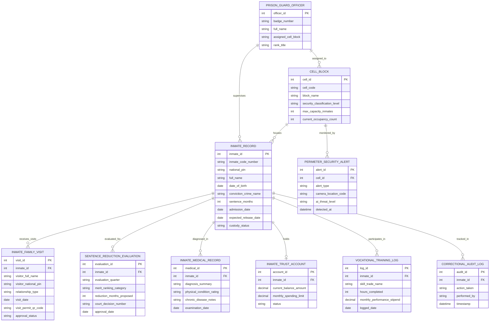

# Conceptual ERD — Prison & Correctional Facility System

## Mermaid Code

## Entity Description Table | Bảng mô tả Entity

| # | Entity Name | Vietnamese Name | Description | Key Attributes | Main Relationships |
|---|-------------|-----------------|-------------|----------------|-------------------|
| 1 | INMATE_RECORD | Hồ sơ Phạm nhân | Thông tin cá nhân, mã phạm nhân, tội danh, án phạt tù và ngày chấp hành xong | inmate_id, inmate_code_number, conviction_crime_name, sentence_months, custody_status | Housed in CELL_BLOCK, holds TRUST_ACCOUNT |
| 2 | CELL_BLOCK | Buồng Giam Trại giam | Danh mục nhà giam, buồng giam, cấp độ an ninh bảo vệ và sức chứa | cell_id, cell_code, block_name, security_classification_level, max_capacity_inmates | Houses INMATE_RECORD, monitored by SECURITY_ALERT |
| 3 | INMATE_FAMILY_VISIT | Sổ Thăm gặp Thân nhân | Nhật ký đăng ký lịch thăm gặp phạm nhân của thân nhân và mã QR phép thăm | visit_id, visitor_full_name, relationship_type, visit_permit_qr_code, approval_status | Belongs to INMATE_RECORD |
| 4 | SENTENCE_REDUCTION_EVALUATION | Hồ sơ Xét Giảm án Đặc xá | Kết quả thi đua cải tạo, số tháng đề nghị giảm án và quyết định của Tòa án | evaluation_id, evaluation_quarter, merit_ranking_category, reduction_months_proposed | Belongs to INMATE_RECORD |
| 5 | INMATE_MEDICAL_RECORD | Bệnh án Quân y Trại giam | Hồ sơ theo dõi sức khỏe, bệnh mãn tính và lịch sử khám chữa bệnh tại bệnh xá | medical_id, diagnosis_summary, physical_condition_rating, examination_date | Belongs to INMATE_RECORD |
| 6 | INMATE_TRUST_ACCOUNT | Tài khoản Tiền Lưu ký | Tài khoản tiền điện tử phạm nhân dùng để mua đồ căng tin và nhận tiền thân nhân gửi | account_id, current_balance_amount, monthly_spending_limit, status | Belongs to INMATE_RECORD |
| 7 | VOCATIONAL_TRAINING_LOG | Nhật ký Lao động Hướng nghiệp | Ghi nhận kết quả học nghề, số giờ lao động sản xuất và tiền thưởng thi đua | log_id, skill_trade_name, hours_completed, monthly_performance_stipend | Belongs to INMATE_RECORD |
| 8 | PRISON_GUARD_OFFICER | Cán bộ Quản giáo | Thông tin cán bộ quản giáo, cảnh sát bảo vệ được phân công phụ trách buồng giam | officer_id, badge_number, full_name, assigned_cell_block, rank_title | Supervises INMATE_RECORD, assigned to CELL_BLOCK |
| 9 | PERIMETER_SECURITY_ALERT | Cảnh báo An ninh Hàng rào | Cảnh báo AI camera phát hiện trốn trại, xâm nhập trái phép hoặc xô xát | alert_id, alert_type, camera_location_code, ai_threat_level, detected_at | Belongs to CELL_BLOCK |
| 10 | CORRECTIONAL_AUDIT_LOG | Nhật ký Kiểm toán Trại giam | Lưu toàn bộ vết tiếp nhận, chuyển buồng, điểm danh, kỷ luật, giảm án và lưu ký | audit_id, action_taken, performed_by, timestamp | Belongs to INMATE_RECORD |

## Relationship Description | Mô tả Quan hệ

| # | From Entity | Cardinality | To Entity | Relationship Label | Business Explanation |
|---|-------------|-------------|-----------|-------------------|----------------------|
| 1 | CELL_BLOCK | one-to-many | INMATE_RECORD | houses | Một buồng giam giam giữ nhiều phạm nhân theo hạn mức sức chứa |
| 2 | INMATE_RECORD | one-to-many | INMATE_FAMILY_VISIT | receives_visits | Một phạm nhân nhận được nhiều lượt thăm gặp từ thân nhân gia đình |
| 3 | INMATE_RECORD | one-to-many | SENTENCE_REDUCTION_EVALUATION | evaluated_for | Một phạm nhân được đánh giá thi đua và xét giảm án qua nhiều đợt |
| 4 | INMATE_RECORD | one-to-many | INMATE_MEDICAL_RECORD | diagnosed_in | Một phạm nhân được theo dõi sức khỏe qua nhiều đợt khám tại bệnh xá |
| 5 | INMATE_RECORD | one-to-one | INMATE_TRUST_ACCOUNT | holds | Mỗi phạm nhân sở hữu duy nhất một Tài khoản tiền lưu ký mua căng tin |
| 6 | INMATE_RECORD | one-to-many | VOCATIONAL_TRAINING_LOG | participates_in | Một phạm nhân tham gia nhiều đợt học nghề và lao động hướng nghiệp |
| 7 | PRISON_GUARD_OFFICER | one-to-many | INMATE_RECORD | supervises | Một cán bộ quản giáo trực tiếp quản lý và theo dõi nhiều phạm nhân |
| 8 | CELL_BLOCK | one-to-many | PERIMETER_SECURITY_ALERT | monitored_by | Một khu buồng giam được giám sát an ninh bởi hệ thống camera AI hàng rào |
| 9 | INMATE_RECORD | one-to-many | CORRECTIONAL_AUDIT_LOG | tracked_in | Mọi thao tác trên hồ sơ phạm nhân được ghi lại nhật ký kiểm toán bất biến |
| 10 | PRISON_GUARD_OFFICER | one-to-many | CELL_BLOCK | assigned_to | Một cán bộ quản giáo được phân công phụ trách quản lý các buồng giam |
