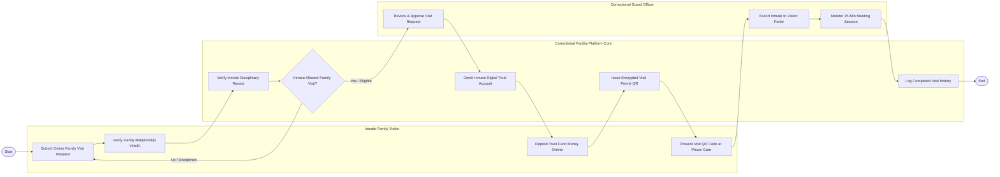

# Swimlane Diagram — Prison & Correctional Facility System

## Mermaid Code

## Flow Description | Mô tả luồng

| Lane | Actor | Role in Flow |
|------|-------|-------------|
| 1 | Inmate Family Visitor | Đăng ký lịch thăm gặp trực tuyến qua VNeID, nộp tiền lưu ký vào tài khoản phạm nhân và xuất trình mã QR tại trại giam. |
| 2 | Correctional Facility Platform Core | Tự động kiểm tra kỷ luật phạm nhân, nạp tiền vào tài khoản lưu ký, phát hành Giấy phép thăm gặp QR và ghi nhật ký. |
| 3 | Correctional Guard Officer | Rà soát phê duyệt lịch hẹn thăm gặp, trích xuất phạm nhân từ buồng giam ra nhà thăm gặp và giám sát buổi gặp 15 phút. |
