# Action Tree — Prison & Correctional Facility System

## Mermaid Code

```mermaid
graph TD
    Root["Prison & Correctional Facility System"]

    Root --> M1["Inmate Intake & Biometric Identification"]
    Root --> M2["Cell Assignment & Perimeter Security AI"]
    Root --> M3["Family Visitation & Trust Account"]
    Root --> M4["Medical Care & Rehabilitation Training"]
    Root --> M5["Parole Evaluation & Sentence Reduction"]
    Root --> M6["MPS Correctional BI & Dossier Archival"]

    M1 --> A11["Register Inmate Intake Biometrics"]
    M1 --> A12["Capture 3D Facial Iris Fingerprints"]
    M1 --> A13["Link Criminal Court Sentences VNeID"]
    M1 --> A14["Issue Digital Inmate ID Badges"]

    M2 --> A21["Track Cell Block Occupancy Assignment"]
    M2 --> A22["Monitor Perimeter Security AI Cameras"]
    M2 --> A23["Audit Prison Security Breach AI"]
    M2 --> A24["Conduct Daily Automated Headcount"]

    M3 --> A31["Schedule Family Visitor Meetings"]
    M3 --> A32["Manage Inmate Trust Account Funds"]
    M3 --> A33["Process Canteen E-Purse Purchases"]
    M3 --> A34["Issue Visit Permit QR Codes"]

    M4 --> A41["Inspect Inmate Medical Health"]
    M4 --> A42["Record Inmate Vocational Training"]
    M4 --> A43["Track Rehabilitation Merit Ratings"]
    M4 --> A44["Log Inmate Disciplinary Infractions"]

    M5 --> A51["Calculate Sentence Reduction Parole"]
    M5 --> A52["Submit National Amnesty Proposals"]
    M5 --> A53["Issue Electronic Parole Certificates"]
    M5 --> A54["Track Inmate Transfer Transport"]

    M6 --> A61["Export Correctional BI Analytics"]
    M6 --> A62["Calculate Reoffending Risk Metrics"]
    M6 --> A63["Log System Immutable Security Audits"]
    M6 --> A64["Archive Closed Inmate Dossiers"]
```

## Module Description | Mô tả Module

| # | Module | Description | Actions |
|---|--------|-------------|---------|
| 1 | Inmate Intake & Biometric Identification | Tiếp nhận phạm nhân mới nhập trại, chụp ảnh 3D, lấy 10 vân tay/mống mắt, nạp bản án Tòa án và cấp Mã phạm nhân | Register Inmate Intake Biometrics, Capture 3D Facial Iris Fingerprints, Link Criminal Court Sentences VNeID, Issue Digital Inmate ID Badges |
| 2 | Cell Assignment & Perimeter Security AI | Phân bổ buồng giam, điểm danh quân số tự động, camera AI giám sát hàng rào phát hiện vượt ngục và cảnh báo an ninh | Track Cell Block Occupancy Assignment, Monitor Perimeter Security AI Cameras, Audit Prison Security Breach AI, Conduct Daily Automated Headcount |
| 3 | Family Visitation & Trust Account | Đăng ký lịch thăm gặp thân nhân trực tuyến VNeID, quản lý tiền lưu ký điện tử không dùng tiền mặt và mua hàng căng tin | Schedule Family Visitor Meetings, Manage Inmate Trust Account Funds, Process Canteen E-Purse Purchases, Issue Visit Permit QR Codes |
| 4 | Medical Care & Rehabilitation Training | Khám chữa bệnh tại bệnh xá trại giam, quản lý lao động hướng nghiệp, chấm điểm thi đua cải tạo và kỷ luật vi phạm | Inspect Inmate Medical Health, Record Inmate Vocational Training, Track Rehabilitation Merit Ratings, Log Inmate Disciplinary Infractions |
| 5 | Parole Evaluation & Sentence Reduction | Thuật toán tự động xét giảm thời hạn phạt tù/đặc xá tha tù trước thời hạn, ban hành chứng nhận và quản lý điều chuyển | Calculate Sentence Reduction Parole, Submit National Amnesty Proposals, Issue Electronic Parole Certificates, Track Inmate Transfer Transport |
| 6 | MPS Correctional BI & Dossier Archival | Trích xuất báo cáo tỷ lệ tái hòa nhập cộng đồng nộp Bộ Công an (C10), kiểm toán an ninh mật và lưu trữ hồ sơ vĩnh viễn | Export Correctional BI Analytics, Calculate Reoffending Risk Metrics, Log System Immutable Security Audits, Archive Closed Inmate Dossiers |
