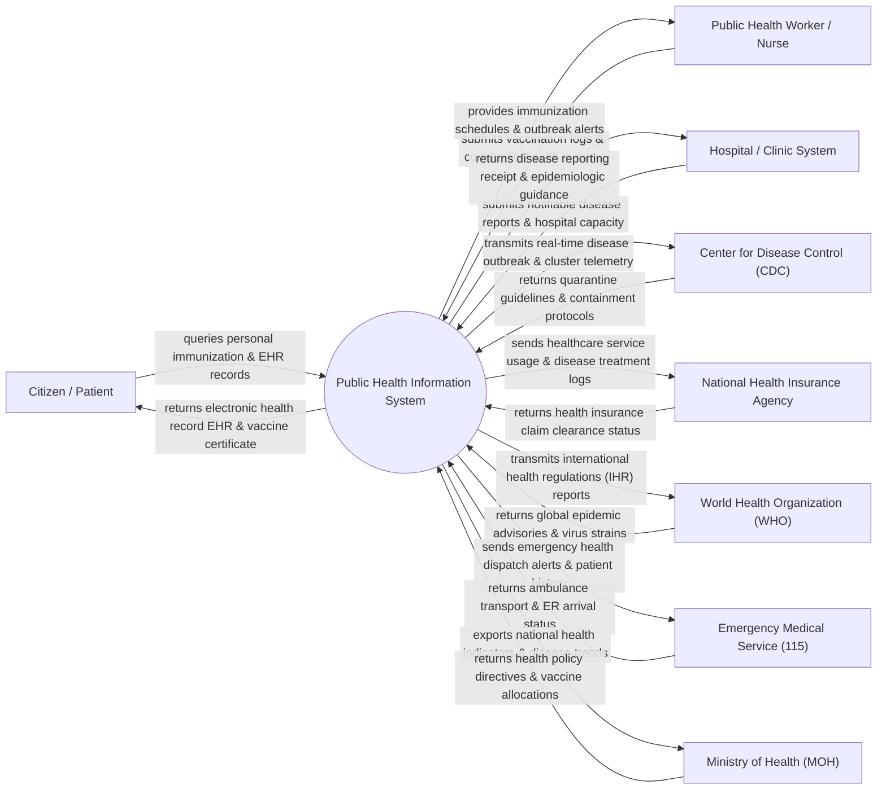

# Context Diagram — Public Health Information System

## Mermaid Code

## Actor & Interaction Table | Bảng Actor & Tương tác

| # | Actor | Actor Type | Data Sent TO System | Data Received FROM System | Notes |
|---|-------|------------|---------------------|---------------------------|-------|
| 1 | Citizen / Patient | Primary | Health survey responses, symptom check-in, identity PIN | Electronic Health Record (EHR), vaccination certificate QR | Người dân theo dõi hồ sơ sức khỏe điện tử và tiêm chủng |
| 2 | Public Health Worker / Nurse | Primary | Vaccination administration logs, local health survey data | Immunization target lists, community outbreak alerts | Cán bộ y tế dự phòng xã/phường/thực địa |
| 3 | Hospital / Clinic System | Primary | Notifiable communicable disease reports, ICU bed occupancy | Disease reporting confirmation, treatment guidelines | Các cơ sở khám chữa bệnh công lập và tư nhân |
| 4 | Center for Disease Control (CDC) | Primary | Epidemiological investigation reports, containment zones | Outbreak GIS heatmaps, disease cluster alerts | Trung tâm Kiểm soát Bệnh tật (CDC) các cấp |
| 5 | National Health Insurance Agency | Supporting | Insurance coverage verification, medical fee reimbursement | Health treatment logs, disease prevention services data | Cơ quan Bảo hiểm Y tế Quốc gia đối soát chi phí y tế |
| 6 | World Health Organization (WHO) | Regulatory | Global pandemic alerts, WHO vaccine recommendations | International Health Regulations (IHR 2005) disease statistics | Tổ chức Y tế Thế giới tiếp nhận báo cáo dịch bệnh quốc tế |
| 7 | Emergency Medical Service (115) | Supporting | Ambulance dispatch status, patient transport telemetry | Patient EHR medical history, hospital ER bed availability | Lực lượng Cấp cứu y tế khẩn cấp 115 |
| 8 | Ministry of Health (MOH) | Regulatory | National health policies, vaccine distribution plans | National health status reports, disease mortality analytics | Bộ Y tế chỉ đạo và ban hành chính sách y tế công cộng |

## System Boundary Description | Mô tả Phạm vi Hệ thống

Hệ thống Public Health Information System (Hệ thống Thông tin Y tế Công cộng Quốc gia) chịu trách nhiệm quản lý Hồ sơ sức khỏe điện tử (EHR) của toàn dân, giám sát bệnh truyền nhiễm dịch bệnh (CDC), quản lý Tiêm chủng mở rộng quốc gia, theo dõi chuỗi cung ứng vắc-xin và cảnh báo các đợt bùng phát dịch bệnh theo thời gian thực. Hệ thống giúp kết nối dữ liệu y tế từ các trạm y tế xã phường đến các bệnh viện tuyến trung ương. Tuy nhiên, hệ thống KHÔNG trực tiếp vận hành máy chẩn đoán hình ảnh (CT/MRI) tại bệnh viện và KHÔNG thay thế chuyên môn kê đơn thuốc của bác sĩ điều trị.
