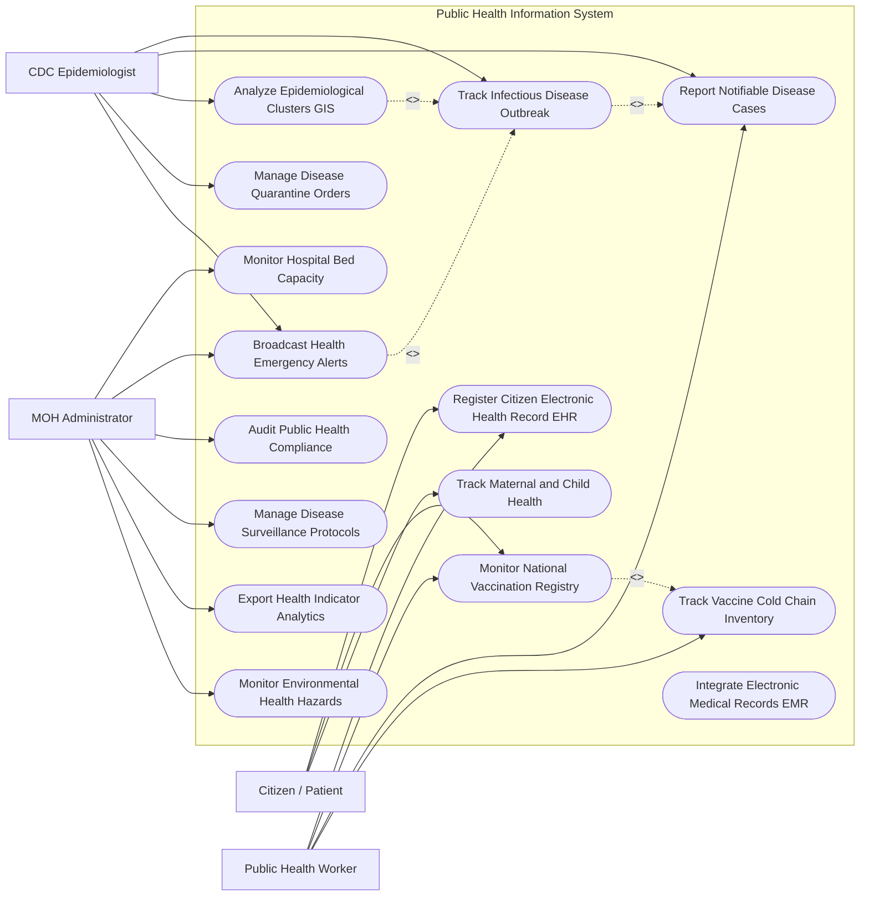

# Use Case Diagram — Public Health Information System

## Mermaid Code

## Actor Table | Bảng Actor

| # | Actor | Actor Type | Role Description | Related Use Cases |
|---|-------|------------|------------------|-------------------|
| 1 | Citizen / Patient | Primary | Người dân tra cứu hồ sơ sức khỏe, chứng nhận tiêm chủng và thông tin thai sản | UC01, UC03, UC14 |
| 2 | Public Health Worker | Primary | Cán bộ y tế xã/phường nhập lịch sử tiêm chủng, báo cáo ca bệnh truyền nhiễm | UC01, UC03, UC04, UC08 |
| 3 | CDC Epidemiologist | Primary | Chuyên gia dịch tễ theo dõi bùng phát dịch bệnh, khoanh vùng cách ly | UC02, UC04, UC05, UC06, UC09 |
| 4 | MOH Administrator | Primary | Quản trị viên Bộ Y tế quản lý năng lực bệnh viện, phát cảnh báo y tế công cộng | UC07, UC09, UC11, UC12, UC13, UC15 |

## Use Case Table | Bảng Use Case

| # | UC ID | Use Case Name | Primary Actor | Secondary Actor | Description | Priority |
|---|-------|---------------|---------------|-----------------|-------------|----------|
| 1 | UC01 | Register Citizen Electronic Health Record EHR | HealthWorker | Citizen, VNeID | Khởi tạo hồ sơ sức khỏe điện tử toàn dân gắn với mã định danh cá nhân | High |
| 2 | UC02 | Track Infectious Disease Outbreak | CDC | Hospital | Giám sát diễn biến ổ dịch truyền nhiễm (Sốt xuất huyết, COVID, Cúm) | High |
| 3 | UC03 | Monitor National Vaccination Registry | Citizen, HealthWorker | - | Quản lý sổ tiêm chủng điện tử mở rộng và phát hành chứng nhận QR | High |
| 4 | UC04 | Report Notifiable Disease Cases | HealthWorker, CDC | Hospital | Báo cáo các ca bệnh phải khai báo bắt buộc trong vòng 24 giờ | High |
| 5 | UC05 | Analyze Epidemiological Clusters GIS | CDC | GIS Engine | Phân tích chùm ca bệnh và bản đồ nhiệt dịch tễ học trên bản đồ GIS | High |
| 6 | UC06 | Manage Disease Quarantine Orders | CDC | Local Gov | Phát hành và quản lý quyết định cách ly y tế đối với ca bệnh/người tiếp xúc | High |
| 7 | UC07 | Monitor Hospital Bed Capacity | MOH | Hospital | Giám sát thời gian thực số lượng giường bệnh ICU, máy thở tại các bệnh viện | Medium |
| 8 | UC08 | Track Vaccine Cold Chain Inventory | HealthWorker | Vaccine Vendor | Giám sát nhiệt độ bảo quản vắc-xin và số lượng tồn kho theo chuỗi lạnh | High |
| 9 | UC09 | Broadcast Health Emergency Alerts | MOH, CDC | SMS Gateway | Phát thông báo cảnh báo khẩn cấp y tế diện rộng cho cộng đồng | High |
| 10 | UC10 | Integrate Electronic Medical Records EMR | System | Hospital EMR | Tích hợp dữ liệu tóm tắt hồ sơ bệnh án từ các bệnh viện lên hệ thống EHR | Medium |
| 11 | UC11 | Audit Public Health Compliance | MOH | - | Kiểm toán việc tuân thủ các quy chuẩn an toàn y tế tại các cơ sở khám chữa bệnh | Medium |
| 12 | UC12 | Manage Disease Surveillance Protocols | MOH | - | Cấu hình các kịch bản và quy trình phản ứng nhanh khi xảy ra dịch bệnh | Medium |
| 13 | UC13 | Export Health Indicator Analytics | MOH | WHO | Trích xuất báo cáo chỉ số y tế quốc gia (Tỷ lệ tử vong, tuổi thọ, tỷ lệ tiêm) | Low |
| 14 | UC14 | Track Maternal and Child Health | Citizen, HealthWorker | - | Theo dõi sức khỏe thai phụ, lịch khám thai và sự phát triển của trẻ nhỏ | Medium |
| 15 | UC15 | Monitor Environmental Health Hazards | MOH | Environment Sensor | Giám sát các nguy cơ ô nhiễm nguồn nước, hóa chất ảnh hưởng sức khỏe | Low |

## Use Case Specification | Đặc tả Use Case

---

### UC01 — Register Citizen Electronic Health Record EHR

| Field | Detail |
|-------|--------|
| **UC ID** | UC01 |
| **Use Case Name** | Register Citizen Electronic Health Record EHR |
| **Actor(s)** | Primary: Public Health Worker / Secondary: Citizen, VNeID System |
| **Description** | Khởi tạo và cập nhật Hồ sơ Sức khỏe Điện tử (EHR) cho công dân, tích hợp tiền sử bệnh, nhóm máu và dị ứng. |
| **Precondition** | 1. Công dân đã có Số định danh cá nhân 12 số trên VNeID. |
| **Main Flow** | 1. HealthWorker truy cập Phân hệ Quản lý Hồ sơ Sức khỏe.   2. HealthWorker nhập Số định danh cá nhân VNeID của Citizen.   3. System kết nối VNeID lấy thông tin nhân khẩu (Họ tên, ngày sinh, giới tính, địa chỉ).   4. HealthWorker nhập thông tin chỉ số sinh hiệu ban đầu: Chiều cao, cân nặng, nhóm máu, chỉ số BMI.   5. HealthWorker nhập tiền sử dị ứng (thuốc, thực phẩm), tiền sử bệnh mãn tính gia đình.   6. System khởi tạo Mã Hồ sơ Sức khỏe Điện tử duy nhất (EHR ID).   7. System đồng bộ Hồ sơ Sức khỏe vào tài khoản VNeID của Citizen để công dân tự theo dõi. |
| **Alternative Flow** | **AF1** — Tự động khởi tạo từ hồ sơ khám bệnh bệnh viện: Khi bệnh nhân đi khám lần đầu tại bệnh viện, hệ thống EMR bệnh viện tự động đẩy dữ liệu để khởi tạo EHR trên hệ thống quốc gia. |
| **Exception Flow** | **EX1** — Công dân chưa có Số định danh cá nhân: HealthWorker sử dụng số CCCD cũ hoặc giấy khai sinh để tạo hồ sơ tạm thời, chờ đồng bộ sau. |
| **Postcondition** | Hồ sơ Sức khỏe Điện tử công dân được lưu trữ vĩnh viễn, làm dữ liệu nền tảng cho mọi lần khám chữa bệnh sau này. |
| **Business Rule** | **BR1**: Thông tin tiền sử dị ứng thuốc trên EHR bắt buộc phải được làm nổi bật bằng cảnh báo đỏ khi bác sĩ mở hồ sơ. |

---

### UC02 — Track Infectious Disease Outbreak

| Field | Detail |
|-------|--------|
| **UC ID** | UC02 |
| **Use Case Name** | Track Infectious Disease Outbreak |
| **Actor(s)** | Primary: CDC Epidemiologist / Secondary: Hospital System |
| **Description** | Giám sát diễn biến, mức độ lây lan và bản đồ dịch tễ của các bệnh truyền nhiễm nguy hiểm (Sốt xuất huyết, COVID, Cúm A). |
| **Precondition** | 1. Có các ca bệnh truyền nhiễm được các bệnh viện báo cáo (UC04). |
| **Main Flow** | 1. System tự động gom nhóm các ca bệnh truyền nhiễm theo địa bàn (xã/phường/quận).   2. System tính toán chỉ số tốc độ lây lan $R_0$ và số ca mắc mới trong 24 giờ.   3. System cảnh báo CDC khi số ca bệnh tại 1 địa bàn vượt quá Ngưỡng báo động dịch.   4. CDC Epidemiologist mở Bảng điều khiển Giám sát Dịch bệnh.   5. CDC Epidemiologist xem bản đồ nhiệt dịch tễ (GIS Heatmap) thể hiện vùng ổ dịch.   6. CDC Epidemiologist khoanh vùng khu vực có nguy cơ cao và đưa ra các khuyến cáo phản ứng nhanh.   7. System tự động gửi báo cáo cập nhật dịch bệnh hàng ngày cho Bộ Y tế. |
| **Alternative Flow** | **AF1** — Phát hiện biến thể vi-rút mới: CDC cập nhật thông tin mã gen biến thể vi-rút vào hồ sơ theo dõi ổ dịch để đánh giá độc lực. |
| **Exception Flow** | **EX1** — Ổ dịch bùng phát vượt tầm kiểm soát cấp huyện: System phát cảnh báo Đỏ, đề xuất kích hoạt Use Case Phát cảnh báo khẩn cấp y tế (UC09). |
| **Postcondition** | Diễn biến ổ dịch được giám sát liên tục 24/7, các biện pháp dập dịch được triển khai kịp thời. |
| **Business Rule** | **BR1**: Các ca bệnh thuộc Nhóm A (dịch bệnh cực kỳ nguy hiểm) phải được hệ thống thông báo động tới CDC trong vòng tối đa 01 giờ. |

---

### UC03 — Monitor National Vaccination Registry

| Field | Detail |
|-------|--------|
| **UC ID** | UC03 |
| **Use Case Name** | Monitor National Vaccination Registry |
| **Actor(s)** | Primary: Citizen, Public Health Worker / Secondary: None |
| **Description** | Quản lý lịch sử tiêm chủng vắc-xin của công dân, nhắc lịch tiêm chủng mở rộng và phát hành Chứng nhận tiêm điện tử Mã QR. |
| **Precondition** | 1. Công dân có Hồ sơ sức khỏe điện tử (UC01). |
| **Main Flow** | 1. HealthWorker thực hiện tiêm vắc-xin cho Citizen tại điểm tiêm.   2. HealthWorker nhập thông tin mũi tiêm: Tên vắc-xin, Số lô sản xuất, Hạn sử dụng, Liều lượng, Vị trí tiêm.   3. System kiểm tra khoảng cách thời gian giữa các mũi tiêm theo phác đồ quy định.   4. HealthWorker bấm "Xác nhận đã tiêm".   5. System ghi nhận mũi tiêm vào Sổ Tiêm chủng Điện tử của Citizen.   6. System tự động phát hành Chứng nhận Tiêm chủng Điện tử (Vaccine Pass PDF) kèm Mã QR bảo mật.   7. System tự động đặt lịch nhắc mũi tiêm tiếp theo qua SMS/App notification cho Citizen. |
| **Alternative Flow** | **AF1** — Tiêm chủng dịch vụ tại phòng khám tư: Phòng khám tư sử dụng API đẩy dữ liệu mũi tiêm lên CSDL Tiêm chủng Quốc gia. |
| **Exception Flow** | **EX1** — Mũi tiêm không đúng khoảng cách phác đồ y tế: System cảnh báo màu vàng "Tiêm quá sớm so với khuyến cáo", yêu cầu cán bộ y tế xác nhận lại. |
| **Postcondition** | Lịch sử tiêm chủng được cập nhật đầy đủ, chứng nhận mã QR có thể sử dụng tra cứu quốc tế. |
| **Business Rule** | **BR1**: Mã QR chứng nhận tiêm chủng phải được mã hóa theo tiêu chuẩn an toàn thông tin chống làm giả. |

---

### UC04 — Report Notifiable Disease Cases

| Field | Detail |
|-------|--------|
| **UC ID** | UC04 |
| **Use Case Name** | Report Notifiable Disease Cases |
| **Actor(s)** | Primary: Public Health Worker, CDC Epidemiologist / Secondary: Hospital System |
| **Description** | Bệnh viện và các cơ sở y tế thực hiện khai báo bắt buộc các ca bệnh truyền nhiễm nguy hiểm lên CSDL Y tế Công cộng. |
| **Precondition** | 1. Bác sĩ tại bệnh viện chẩn đoán xác định (hoặc nghi ngờ) bệnh nhân mắc bệnh truyền nhiễm thuộc danh mục phải khai báo. |
| **Main Flow** | 1. Bác sĩ nhập chẩn đoán mã bệnh ICD-10 thuộc danh mục bệnh truyền nhiễm (Ví dụ: A91 - Sốt xuất huyết, A00 - Dịch tả).   2. System tự động kích hoạt Biểu mẫu Báo cáo Ca bệnh Truyền nhiễm Khẩn cấp.   3. Bác sĩ/HealthWorker nhập thông tin: Tên bệnh nhân, Mã định danh VNeID, Địa chỉ thường trú/tạm trú, Ngày phát bệnh, Tình trạng hiện tại.   4. HealthWorker bấm "Gửi Báo cáo Ca bệnh".   5. System cấp Mã báo cáo ca bệnh (Case Report ID) và phát thông báo tức thì tới Trung tâm CDC cấp huyện/tỉnh nơi bệnh nhân cư trú.   6. CDC tiếp nhận thông tin và phân công cán bộ dịch tễ đi điều tra thực địa. |
| **Alternative Flow** | **AF1** — Báo cáo chùm ca bệnh bất thường (không rõ nguyên nhân): Bác sĩ chọn nhóm "Chùm ca bệnh lạ", System báo động đỏ ưu tiên hàng đầu cho CDC. |
| **Exception Flow** | **EX1** — Bệnh viện chậm khai báo quá 24 giờ: System tự động lập hồ sơ ghi nhận vi phạm quy định khai báo dịch bệnh của cơ sở y tế. |
| **Postcondition** | Ca bệnh truyền nhiễm được ghi nhận vào hệ thống theo dõi dịch tễ toàn quốc. |
| **Business Rule** | **BR1**: Danh mục các bệnh truyền nhiễm bắt buộc phải khai báo trong 24h tuân thủ Luật Phòng chống bệnh truyền nhiễm. |

---

### UC09 — Broadcast Health Emergency Alerts

| Field | Detail |
|-------|--------|
| **UC ID** | UC09 |
| **Use Case Name** | Broadcast Health Emergency Alerts |
| **Actor(s)** | Primary: MOH Administrator, CDC Epidemiologist / Secondary: SMS Gateway |
| **Description** | Phát thông báo cảnh báo khẩn cấp về y tế (Dịch bệnh nguy hiểm, Mưa bão ô nhiễm nguồn nước, vắc-xin giả) đến cộng đồng. |
| **Precondition** | 1. Ban chỉ đạo Phòng chống dịch bệnh Bộ Y tế/CDC duyệt lệnh phát cảnh báo. |
| **Main Flow** | 1. MOHAdministrator chọn vùng địa lý phát cảnh báo (Toàn quốc hoặc theo Tỉnh/Thành).   2. MOHAdministrator nhập nội dung cảnh báo y tế và hướng dẫn phòng tránh.   3. MOHAdministrator duyệt lệnh phát cảnh báo bằng chữ ký số Bộ Y tế.   4. System truyền thông điệp cảnh báo tới hệ thống SMS Gateway của các nhà mạng và ứng dụng di động công dân.   5. Cư dân trong vùng nhận được tin nhắn cảnh báo y tế khẩn cấp.   6. System thống kê số lượng người dân đã nhận được cảnh báo. |
| **Alternative Flow** | **AF1** — Cảnh báo tự động khi ô nhiễm không khí AQI > 300 (Rất nguy hại): System tự động gửi thông báo nhắc người dân đeo khẩu trang và hạn chế ra đường. |
| **Exception Flow** | **EX1** — Hệ thống nghẽn tin nhắn SMS: System ưu tiên phát qua thông báo Push Notification của ứng dụng VNeID/EHR trước. |
| **Postcondition** | Thông tin cảnh báo y tế đến được với người dân kịp thời, chủ động ngăn ngừa nguy cơ dịch bệnh. |
| **Business Rule** | **BR1**: Tin nhắn cảnh báo y tế khẩn cấp phải có mã định danh xác thực từ Bộ Y tế để chống tin giả. |
