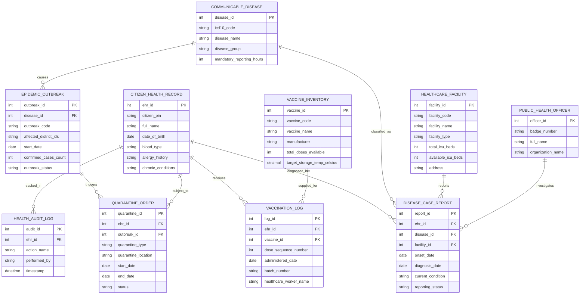

# Conceptual ERD — Public Health Information System

## Mermaid Code

## Entity Description Table | Bảng mô tả Entity

| # | Entity Name | Vietnamese Name | Description | Key Attributes | Main Relationships |
|---|-------------|-----------------|-------------|----------------|-------------------|
| 1 | CITIZEN_HEALTH_RECORD | Hồ sơ Sức khỏe Điện tử (EHR) | Lưu trữ thông tin chỉ số sinh hiệu, nhóm máu, dị ứng và tiền sử bệnh | ehr_id, citizen_pin, full_name, blood_type, allergy_history | Diagnosed in DISEASE_CASE_REPORT, receives VACCINATION_LOG |
| 2 | COMMUNICABLE_DISEASE | Danh mục Bệnh Truyền nhiễm | Danh mục bệnh truyền nhiễm theo phân loại ICD-10 và thời hạn báo cáo | disease_id, icd10_code, disease_name, disease_group | Classified as in DISEASE_CASE_REPORT, causes EPIDEMIC_OUTBREAK |
| 3 | DISEASE_CASE_REPORT | Báo cáo Ca bệnh Khai báo | Báo cáo ca bệnh truyền nhiễm do cơ sở y tế gửi lên CDC | report_id, onset_date, diagnosis_date, current_condition | Belongs to CITIZEN_HEALTH_RECORD, COMMUNICABLE_DISEASE, HEALTHCARE_FACILITY |
| 4 | VACCINATION_LOG | Nhật ký Tiêm chủng | Ghi nhận chi tiết mũi tiêm vắc-xin, số lô, ngày tiêm của công dân | log_id, dose_sequence_number, administered_date, batch_number | Belongs to CITIZEN_HEALTH_RECORD, VACCINE_INVENTORY |
| 5 | VACCINE_INVENTORY | Kho Vắc-xin & Chuỗi lạnh | Quản lý số lượng tồn kho vắc-xin và điều kiện nhiệt độ bảo quản lạnh | vaccine_id, vaccine_code, vaccine_name, total_doses_available | Supplied for VACCINATION_LOG |
| 6 | EPIDEMIC_OUTBREAK | Ổ dịch Bùng phát | Hồ sơ theo dõi diễn biến ổ dịch, vùng lây nhiễm và số ca mắc | outbreak_id, outbreak_code, start_date, confirmed_cases_count | Belongs to COMMUNICABLE_DISEASE, triggers QUARANTINE_ORDER |
| 7 | HEALTHCARE_FACILITY | Cơ sở Y tế / Bệnh viện | Thông tin bệnh viện, phòng khám và năng lực giường bệnh ICU | facility_id, facility_code, facility_name, available_icu_beds | Reports DISEASE_CASE_REPORT |
| 8 | QUARANTINE_ORDER | Quyết định Cách ly Y tế | Quyết định cách ly y tế tại nhà hoặc tại cơ sở tập trung | quarantine_id, quarantine_type, start_date, end_date | Belongs to CITIZEN_HEALTH_RECORD, EPIDEMIC_OUTBREAK |
| 9 | PUBLIC_HEALTH_OFFICER | Cán bộ Y tế Dự phòng | Thông tin nhân viên y tế, cán bộ CDC điều tra dịch tễ | officer_id, badge_number, full_name, organization_name | Investigates DISEASE_CASE_REPORT |
| 10 | HEALTH_AUDIT_LOG | Nhật ký Kiểm toán Y tế | Lưu lịch sử truy cập, khai thác thông tin hồ sơ sức khỏe cá nhân | audit_id, action_name, performed_by, timestamp | Belongs to CITIZEN_HEALTH_RECORD |

## Relationship Description | Mô tả Quan hệ

| # | From Entity | Cardinality | To Entity | Relationship Label | Business Explanation |
|---|-------------|-------------|-----------|-------------------|----------------------|
| 1 | CITIZEN_HEALTH_RECORD | one-to-many | DISEASE_CASE_REPORT | diagnosed_in | Một công dân có thể ghi nhận các ca bệnh truyền nhiễm từng mắc phải |
| 2 | COMMUNICABLE_DISEASE | one-to-many | DISEASE_CASE_REPORT | classified_as | Một loại bệnh truyền nhiễm quy định cho nhiều ca bệnh được báo cáo |
| 3 | HEALTHCARE_FACILITY | one-to-many | DISEASE_CASE_REPORT | reports | Một cơ sở y tế thực hiện báo cáo nhiều ca bệnh truyền nhiễm |
| 4 | CITIZEN_HEALTH_RECORD | one-to-many | VACCINATION_LOG | receives | Một công dân nhận nhiều mũi tiêm vắc-xin trong đời |
| 5 | VACCINE_INVENTORY | one-to-many | VACCINATION_LOG | supplied_for | Một loại vắc-xin trong kho được sử dụng cho nhiều lượt tiêm chủng |
| 6 | COMMUNICABLE_DISEASE | one-to-many | EPIDEMIC_OUTBREAK | causes | Một loại bệnh truyền nhiễm có thể bùng phát thành nhiều ổ dịch |
| 7 | EPIDEMIC_OUTBREAK | one-to-many | QUARANTINE_ORDER | triggers | Một ổ dịch kích hoạt nhiều quyết định cách ly y tế cho các đối tượng |
| 8 | CITIZEN_HEALTH_RECORD | one-to-many | QUARANTINE_ORDER | subject_to | Một công dân có thể thuộc diện phải thực hiện các đợt cách ly y tế |
| 9 | PUBLIC_HEALTH_OFFICER | one-to-many | DISEASE_CASE_REPORT | investigates | Một cán bộ y tế dự phòng thực hiện điều tra dịch tễ cho nhiều ca bệnh |
| 10 | CITIZEN_HEALTH_RECORD | one-to-many | HEALTH_AUDIT_LOG | tracked_in | Mọi thao tác truy cập hồ sơ sức khỏe cá nhân đều ghi vào nhật ký kiểm toán |
