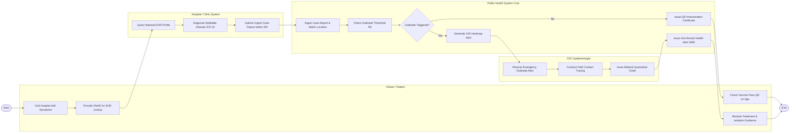

# Swimlane Diagram — Public Health Information System

## Mermaid Code

## Flow Description | Mô tả luồng

| Lane | Actor | Role in Flow |
|------|-------|-------------|
| 1 | Citizen / Patient | Đến khám bệnh tại cơ sở y tế, xuất trình VNeID tra cứu hồ sơ EHR, nhận hướng dẫn điều trị cách ly và kiểm tra chứng nhận tiêm vắc-xin. |
| 2 | Hospital / Clinic System | Tra cứu hồ sơ sức khỏe quốc gia, chẩn đoán ca bệnh truyền nhiễm theo mã ICD-10 và gửi báo cáo khai báo ca bệnh bắt buộc lên hệ thống. |
| 3 | Public Health System Core | Tiếp nhận báo cáo ca bệnh, tự động tính toán chỉ số bùng phát dịch R0, dựng bản đồ nhiệt GIS, gửi tin cảnh báo khẩn cấp và cấp mã QR vắc-xin. |
| 4 | CDC Epidemiologist | Nhận cảnh báo ổ dịch khẩn cấp, tiến hành điều tra dịch tễ truy vết F1/F2 tại thực địa và ban hành quyết định cách ly y tế. |
