# Action Tree — Public Health Information System

## Mermaid Code

```mermaid
graph TD
    Root["Public Health Information System"]

    Root --> M1["Electronic Health Records EHR"]
    Root --> M2["Communicable Disease Surveillance"]
    Root --> M3["Immunization & Cold Chain Logistics"]
    Root --> M4["Epidemic Outbreak Response"]
    Root --> M5["Healthcare Facility Capacity"]
    Root --> M6["Analytics & International WHO Reporting"]

    M1 --> A11["Register Citizen Health Record EHR"]
    M1 --> A12["Sync Personal Demographics VNeID"]
    M1 --> A13["Integrate Hospital EMR Diagnostics"]
    M1 --> A14["Manage Patient Allergy Medical History"]

    M2 --> A21["Report Mandatory Notifiable Cases"]
    M2 --> A22["Monitor Disease Incubation Period"]
    M2 --> A23["Map Epidemiological Clusters GIS"]
    M2 --> A24["Track Virus Variant Genetic Code"]

    M3 --> A31["Record Administration Vaccination Logs"]
    M3 --> A32["Issue Digital Vaccine Pass QR"]
    M3 --> A33["Monitor Cold Chain Storage Temp"]
    M3 --> A34["Schedule Automated Dose Reminders"]

    M4 --> A41["Detect R0 Outbreak Thresholds"]
    M4 --> A42["Issue Digital Quarantine Orders"]
    M4 --> A43["Conduct Field Contact Tracing"]
    M4 --> A44["Broadcast Emergency Health SMS Alerts"]

    M5 --> A51["Track Real-time ICU Bed Occupancy"]
    M5 --> A52["Monitor Ventilator Oxygen Inventory"]
    M5 --> A53["Allocate Emergency Medical Staff"]
    M5 --> A54["Audit Hospital Hygiene Compliance"]

    M6 --> A61["Export WHO International Health Data"]
    M6 --> A62["Generate National Mortality Analytics"]
    M6 --> A63["Log System Immutable Data Access"]
    M6 --> A64["Export MOH Strategic Policy Reports"]
```

## Module Description | Mô tả Module

| # | Module | Description | Actions |
|---|--------|-------------|---------|
| 1 | Electronic Health Records EHR | Quản lý khởi tạo hồ sơ sức khỏe điện tử toàn dân, đồng bộ VNeID và tích hợp dữ liệu bệnh án EMR | Register Citizen Health Record EHR, Sync Personal Demographics VNeID, Integrate Hospital EMR Diagnostics, Manage Patient Allergy Medical History |
| 2 | Communicable Disease Surveillance | Khai báo ca bệnh truyền nhiễm bắt buộc, theo dõi diễn biến lây nhiễm và vẽ bản đồ dịch tễ GIS | Report Mandatory Notifiable Cases, Monitor Disease Incubation Period, Map Epidemiological Clusters GIS, Track Virus Variant Genetic Code |
| 3 | Immunization & Cold Chain Logistics | Quản lý sổ tiêm chủng điện tử, cấp chứng nhận mã QR, theo dõi nhiệt độ bảo quản vắc-xin chuỗi lạnh | Record Administration Vaccination Logs, Issue Digital Vaccine Pass QR, Monitor Cold Chain Storage Temp, Schedule Automated Dose Reminders |
| 4 | Epidemic Outbreak Response | Động cơ phát hiện ngưỡng bùng phát dịch R0, ban hành quyết định cách ly y tế và phát tin nhắn cảnh báo | Detect R0 Outbreak Thresholds, Issue Digital Quarantine Orders, Conduct Field Contact Tracing, Broadcast Emergency Health SMS Alerts |
| 5 | Healthcare Facility Capacity | Giám sát số lượng giường bệnh ICU thời gian thực, quản lý máy thở, oxy y tế và điều động nhân lực | Track Real-time ICU Bed Occupancy, Monitor Ventilator Oxygen Inventory, Allocate Emergency Medical Staff, Audit Hospital Hygiene Compliance |
| 6 | Analytics & International WHO Reporting | Báo cáo chỉ số y tế quốc tế cho WHO (IHR 2005), phân tích tỷ lệ tử vong và trích xuất báo cáo Bộ Y tế | Export WHO International Health Data, Generate National Mortality Analytics, Log System Immutable Data Access, Export MOH Strategic Policy Reports |
