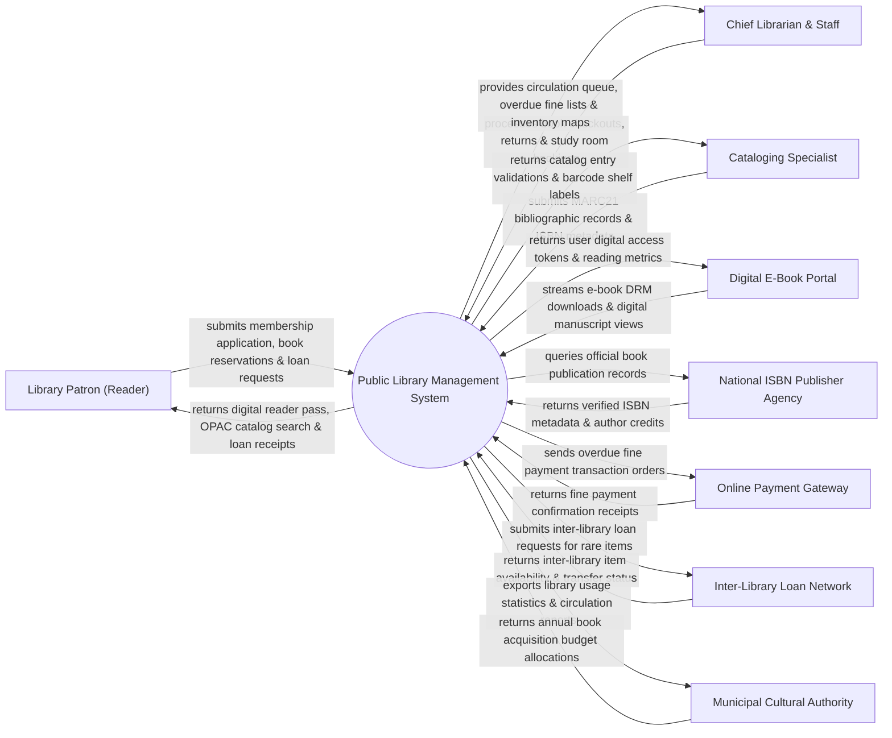

# Context Diagram — Public Library Management System

## Mermaid Code

## Actor & Interaction Table | Bảng Actor & Tương tác

| # | Actor | Actor Type | Data Sent TO System | Data Received FROM System | Notes |
|---|-------|------------|---------------------|---------------------------|-------|
| 1 | Library Patron (Reader) | Primary | Membership application, book loan requests, reservations, fine payments | Digital reader pass QR, OPAC search results, loan status receipts | Nạn nhân/Độc giả thư viện công cộng tra cứu và mượn trả sách |
| 2 | Chief Librarian & Staff | Primary | Book checkouts/returns, fine collection, study room reservations | Circulation queues, overdue notification lists, inventory logs | Thủ thư và cán bộ quản lý thư viện điều hành lưu thông sách |
| 3 | Cataloging Specialist | Primary | MARC21 bibliographic records, book categories, Dewey Decimal codes | Barcode labels, catalog validation receipts, inventory tags | Cán bộ biên mục chuyên trách phân loại và mạ mã sách |
| 4 | Digital E-Book Portal | Supporting | E-book DRM access logs, digital reader feedback, page views | Digital reader tokens, e-book PDF streams, licensing limits | Cổng đọc sách điện tử và tài liệu số hóa thư viện |
| 5 | National ISBN Publisher Agency | Supporting | Verified ISBN numbers, publication metadata, author indexing | ISBN lookup queries, catalog verification requests | Cục Xuất bản / Cơ quan cấp mã ISBN quốc gia đối soát sách |
| 6 | Online Payment Gateway | Supporting | Electronic fine payment confirmation receipts, transaction IDs | Fine payment request orders, patron invoice details | Cổng thanh toán trực tuyến thu tiền phạt nộp chậm |
| 7 | Inter-Library Loan Network | Supporting | Inter-library item availability, transfer tracking numbers | Inter-library loan requests, rare book loan manifests | Mạng lưới mượn liên thư viện giữa các tỉnh/thành phố |
| 8 | Municipal Cultural Authority | Regulatory | Book procurement budget allocations, cultural directives | Annual library circulation analytics, reader demographics | Sở Văn hóa Thể thao & Du lịch quản lý hệ thống thư viện |

## System Boundary Description | Mô tả Phạm vi Hệ thống

Hệ thống Public Library Management System (Hệ thống Quản lý Thư viện Công cộng) chịu trách nhiệm tự động hóa toàn bộ vòng đời lưu thông tài liệu và phục vụ độc giả: Đăng ký thẻ thư viện điện tử (QR/VNeID), biên mục sách chuẩn quốc tế MARC21/Dewey, tra cứu catalog trực tuyến (OPAC), mượn/trả sách tự động qua RFID/Barcode, gia hạn sách, quản lý mượn liên thư viện, lưu trữ sách điện tử E-Book và xử lý phạt nộp chậm. Tuy nhiên, hệ thống KHÔNG trực tiếp thực hiện công việc dán nhãn vật lý lên gáy sách và KHÔNG thay thế việc sắp xếp sách trên giá của nhân viên thủ thư.
