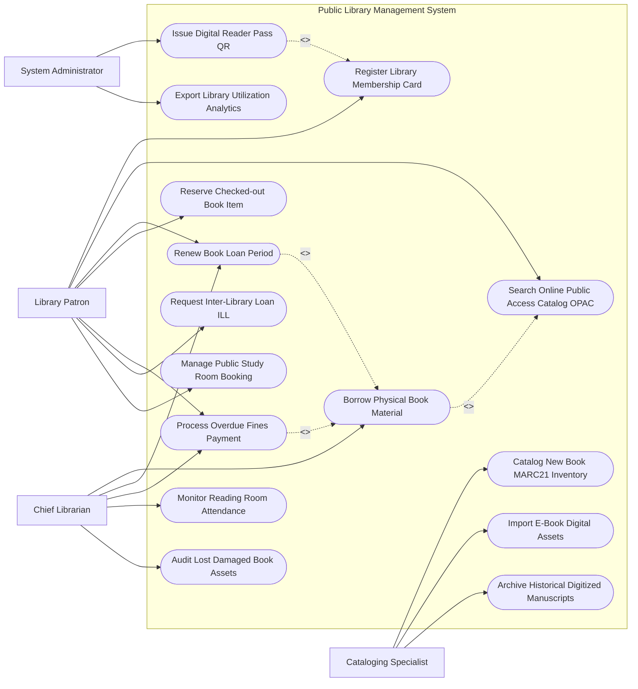

# Use Case Diagram — Public Library Management System

## Mermaid Code

## Actor Table | Bảng Actor

| # | Actor | Actor Type | Role Description | Related Use Cases |
|---|-------|------------|------------------|-------------------|
| 1 | Library Patron | Primary | Độc giả làm thẻ thư viện, tra cứu sách OPAC, mượn trả, gia hạn và gia hạn sách | UC01, UC02, UC04, UC05, UC06, UC09, UC13 |
| 2 | Chief Librarian | Primary | Thủ thư làm thủ tục mượn trả tại quầy, thu tiền phạt và kiểm kê sách rách/mất | UC03, UC04, UC06, UC10, UC12 |
| 3 | Cataloging Specialist | Primary | Cán bộ nhập liệu biên mục sách chuẩn MARC21 và quản lý kho sách số E-Book | UC07, UC08, UC15 |
| 4 | System Administrator | System | Quản trị viên phát hành mã thẻ QR điện tử và trích xuất báo cáo thống kê | UC11, UC14 |

## Use Case Table | Bảng Use Case

| # | UC ID | Use Case Name | Primary Actor | Secondary Actor | Description | Priority |
|---|-------|---------------|---------------|-----------------|-------------|----------|
| 1 | UC01 | Register Library Membership Card | Patron | Admin | Đăng ký thẻ thư viện điện tử tích hợp VNeID và đóng phí thường niên | High |
| 2 | UC02 | Search Online Public Access Catalog OPAC | Patron | - | Tra cứu tên sách, tác giả, thể loại và vị trí giá sách trên hệ thống OPAC | High |
| 3 | UC03 | Borrow Physical Book Material | Patron, Librarian | RFID Reader | Thực hiện thủ tục mượn sách giấy tại quầy thủ thư hoặc cây mượn tự động | High |
| 4 | UC04 | Renew Book Loan Period | Patron, Librarian | - | Gia hạn thời hạn mượn sách trực tuyến thêm 14 ngày nếu không có người đặt | High |
| 5 | UC05 | Reserve Checked-out Book Item | Patron | - | Đặt chỗ trước cuốn sách đang được độc giả khác mượn để xếp hàng nhận sách | Medium |
| 6 | UC06 | Process Overdue Fines Payment | Patron, Librarian | PaymentGW | Tính toán và thu tiền phạt nộp chậm sách quá hạn quy định | High |
| 7 | UC07 | Catalog New Book MARC21 Inventory | Cataloger | ISBNAgency | Biên mục sách mới nhập kho theo chuẩn quốc tế MARC21 và Dewey | High |
| 8 | UC08 | Import E-Book Digital Assets | Cataloger | DRM Engine | Tải lên tài liệu số, sách điện tử E-Book và cấu hình quyền truy cập DRM | Medium |
| 9 | UC09 | Request Inter-Library Loan ILL | Patron | InterLibraryNet | Gửi yêu cầu mượn liên thư viện các cuốn sách hiếm từ thư viện khác | Medium |
| 10 | UC10 | Monitor Reading Room Attendance | Librarian | BarcodeScanner | Giám sát lưu lượng độc giả ra vào phòng đọc tự do qua cổng từ/mã QR | Medium |
| 11 | UC11 | Issue Digital Reader Pass QR | Admin | VNeID | Cấp Mã thẻ độc giả điện tử QR hiển thị trên ứng dụng di động | High |
| 12 | UC12 | Audit Lost Damaged Book Assets | Librarian | - | Ghi nhận và xử lý đền bù các trường hợp độc giả làm mất hoặc làm rách sách | Medium |
| 13 | UC13 | Manage Public Study Room Booking | Patron | - | Đặt trước phòng học nhóm hoặc máy tính nghiên cứu tại thư viện | Low |
| 14 | UC14 | Export Library Utilization Analytics | Admin | CulturalDept | Trích xuất báo cáo tần suất mượn sách và lượt đọc nộp Sở Văn hóa | Low |
| 15 | UC15 | Archive Historical Digitized Manuscripts | Cataloger | - | Số hóa và lưu trữ các bản thảo Hán Nôm, tài liệu cổ quý hiếm | Low |

## Use Case Specification | Đặc tả Use Case

---

### UC01 — Register Library Membership Card

| Field | Detail |
|-------|--------|
| **UC ID** | UC01 |
| **Use Case Name** | Register Library Membership Card |
| **Actor(s)** | Primary: Library Patron / Secondary: System Administrator, VNeID |
| **Description** | Công dân nộp đơn đăng ký thẻ thư viện điện tử trực tuyến hoặc tại quầy, tích hợp định danh VNeID. |
| **Precondition** | 1. Công dân có tài khoản VNeID mức 2 hoặc giấy tờ tùy thân hợp lệ. |
| **Main Flow** | 1. Patron truy cập Cổng Dịch vụ Thẻ Thư viện hoặc Kiosk đăng ký.   2. Patron quét mã QR VNeID để tự động điền thông tin cá nhân (Họ tên, Ngày sinh, CCCD, Địa chỉ, Email).   3. Patron chọn loại thẻ độc giả (Thẻ Đọc, Thẻ Mượn, Thẻ VIP/Nghiên cứu) và tải ảnh chân dung.   4. Patron nộp phí duy trì thẻ thường niên (nếu có) qua cổng thanh toán trực tuyến.   5. System xác thực giao dịch thành công và khởi tạo Thẻ độc giả.   6. System tự động sinh Mã thẻ độc giả điện tử (Reader Pass QR) kèm hạn sử dụng 01 năm (UC11).   7. Patron có thể sử dụng mã QR trên ứng dụng di động để vào cửa và mượn sách ngay lập tức. |
| **Alternative Flow** | **AF1** — Đăng ký thẻ miễn phí cho học sinh/sinh viên/người cao tuổi: Patron tải lên bằng chứng thẻ học sinh/thẻ cao tuổi, System giảm 100% lệ phí làm thẻ. |
| **Exception Flow** | **EX1** — Tài khoản độc giả từng bị khóa do vi phạm làm mất sách: System chặn đăng ký mới, thông báo độc giả phải hoàn tất nộp phạt trước. |
| **Postcondition** | Thẻ độc giả điện tử được kích hoạt, ghi nhận vào CSDL quản lý đọc giả toàn hệ thống. |
| **Business Rule** | **BR1**: Mỗi công dân chỉ được đăng ký duy nhất 01 thẻ độc giả chính thức active trên hệ thống thư viện công cộng. |

---

### UC02 — Search Online Public Access Catalog OPAC

| Field | Detail |
|-------|--------|
| **UC ID** | UC02 |
| **Use Case Name** | Search Online Public Access Catalog OPAC |
| **Actor(s)** | Primary: Library Patron / Secondary: None |
| **Description** | Độc giả tra cứu danh mục tài liệu trực tuyến (OPAC) theo từ khóa, tên sách, tác giả, mã ISBN hoặc mã phân loại Dewey. |
| **Precondition** | 1. Hệ thống danh mục sách đã được biên mục chuẩn MARC21 (UC07). |
| **Main Flow** | 1. Patron truy cập giao diện tìm kiếm OPAC trên Web/App hoặc Kiosk tại thư viện.   2. Patron nhập từ khóa tìm kiếm (Ví dụ: "Lịch sử Việt Nam", "Nguyễn Du", mã ISBN: 978604...).   3. Patron có thể lọc kết quả theo: Loại tài liệu (Sách in, E-book, Tạp chí), Năm xuất bản, Ngôn ngữ, Chi nhánh thư viện.   4. System truy vấn CSDL và trả về danh sách các cuốn sách phù hợp kèm ảnh bìa và tóm tắt nội dung.   5. Patron chọn một cuốn sách cụ thể.   6. System hiển thị chi tiết: Mã phân loại Dewey, Vị trí Kệ sách (Dãy - Kệ - Tầng), Số lượng sách hiện có trên giá và Trạng thái ("Sẵn sàng mượn" hoặc "Đã có người mượn - Hạn trả ngày X").   7. Patron bấm "Lưu vào danh sách cần đọc" hoặc "Đặt chỗ mượn sách" (UC05). |
| **Alternative Flow** | **AF1** — Tra cứu sách điện tử E-book: Nếu kết quả là E-book, System cung cấp nút "Đọc trực tuyến" hoặc "Tải e-book DRM" (UC08). |
| **Exception Flow** | **EX1** — Không tìm thấy kết quả phù hợp: System gợi ý các từ khóa liên quan hoặc đề xuất nộp Đề nghị thư viện mua thêm sách mới. |
| **Postcondition** | Độc giả định vị được chính xác vị trí cuốn sách trên kệ hoặc biết được thời gian sách được trả lại. |
| **Business Rule** | **BR1**: Thời gian phản hồi kết quả tìm kiếm OPAC trên kho dữ liệu 1 triệu cuốn sách không được vượt quá 1 giây. |

---

### UC03 — Borrow Physical Book Material

| Field | Detail |
|-------|--------|
| **UC ID** | UC03 |
| **Use Case Name** | Borrow Physical Book Material |
| **Actor(s)** | Primary: Library Patron, Chief Librarian / Secondary: RFID Self-Check Kiosk |
| **Description** | Thực hiện thủ tục mượn sách giấy trực tiếp tại quầy thủ thư hoặc qua Máy mượn sách tự động RFID Self-Check. |
| **Precondition** | 1. Patron có Thẻ độc giả hợp lệ và không nợ tiền phạt quá hạn (UC06).   2. Sách ở trạng thái "Sẵn sàng mượn". |
| **Main Flow** | 1. Patron mang sách đã chọn từ kệ đến Quầy thủ thư hoặc Trạm tự phục vụ RFID Kiosk.   2. Patron quét Mã QR Thẻ độc giả trên máy quét.   3. System kiểm tra điều kiện mượn: Thẻ còn hạn, số sách đang mượn hiện tại $< 5$ cuốn, không có sách quá hạn.   4. Patron đặt các cuốn sách lên Bàn đọc thẻ RFID (hoặc thủ thư quét mã vạch Barcode gáy sách).   5. System đọc mã chíp RFID trên từng cuốn sách và hiển thị tên sách lên màn hình.   6. System ghi nhận giao dịch mượn sách: Tính Hạn trả sách chuẩn (14 ngày kể từ ngày mượn).   7. System tự động vô hiệu hóa chíp từ bảo vệ (Deactivate RFID Tag) để độc giả mang sách qua cửa từ không bị báo động.   8. System in Biên nhận mượn sách (hoặc gửi Zalo/Email) và cập nhật trạng thái sách thành "Đã mượn". |
| **Alternative Flow** | **AF1** — Mượn sách tại quầy thủ thư thủ công: Librarian quét mã vạch thủ công và bấm nút "Xác nhận mượn" trên màn hình quản trị. |
| **Exception Flow** | **EX1** — Số sách mượn vượt quá hạn mức cho phép (> 5 cuốn): System báo lỗi chặn mượn, yêu cầu Patron trả bớt sách cũ trước khi mượn cuốn mới. |
| **Postcondition** | Sách được chuyển sang trạng thái "Đã mượn", thời hạn trả được ghi nhận vào lịch sử của Patron. |
| **Business Rule** | **BR1**: Mỗi độc giả tiêu chuẩn được mượn tối đa 05 cuốn sách giấy cùng lúc với thời hạn mượn tối đa 14 ngày/lượt. |

---

### UC04 — Renew Book Loan Period

| Field | Detail |
|-------|--------|
| **UC ID** | UC04 |
| **Use Case Name** | Renew Book Loan Period |
| **Actor(s)** | Primary: Library Patron, Chief Librarian / Secondary: None |
| **Description** | Độc giả thực hiện gia hạn thời hạn mượn sách thêm 14 ngày trực tuyến qua App hoặc tại quầy thư viện. |
| **Precondition** | 1. Cuốn sách đang được mượn hợp lệ và chưa quá hạn trả.   2. Cuốn sách chưa vượt quá số lần gia hạn tối đa (tối đa 02 lần gia hạn). |
| **Main Flow** | 1. Patron mở ứng dụng di động Thư viện, vào mục "Sách đang mượn".   2. System hiển thị danh sách các cuốn sách đang mượn kèm Ngày mượn và Hạn trả hiện tại.   3. Patron chọn cuốn sách muốn gia hạn và bấm "Gia hạn mượn".   4. System tự động kiểm tra điều kiện: Sách chưa có ai đăng ký Đặt chỗ trước (UC05) và chưa gia hạn quá 02 lần.   5. System cộng thêm 14 ngày vào Hạn trả sách hiện tại.   6. System phát hành Biên nhận gia hạn thành công và cập nhật hạn trả mới trên hệ thống.   7. System gửi tin nhắn thông báo hạn trả mới cho Patron. |
| **Alternative Flow** | **AF1** — Gia hạn trực tiếp tại quầy: Patron mang sách hoặc thẻ đến quầy, Librarian thực hiện thao tác gia hạn trên phần mềm. |
| **Exception Flow** | **EX1** — Cuốn sách đã có độc giả khác đặt chỗ trước (UC05): System từ chối gia hạn, phát thông báo yêu cầu Patron mang trả sách đúng hạn ban đầu. |
| **Postcondition** | Thời hạn trả sách được kéo dài thêm 14 ngày, độc giả không bị tính phạt quá hạn. |
| **Business Rule** | **BR1**: Mỗi cuốn sách chỉ được phép gia hạn tối đa 02 lần liên tiếp (tổng thời gian mượn tối đa 42 ngày). |

---

### UC06 — Process Overdue Fines Payment

| Field | Detail |
|-------|--------|
| **UC ID** | UC06 |
| **Use Case Name** | Process Overdue Fines Payment |
| **Actor(s)** | Primary: Library Patron, Chief Librarian / Secondary: Online Payment Gateway |
| **Description** | Tính toán số tiền phạt nộp chậm sách quá hạn và xử lý thu tiền phạt trực tuyến hoặc tiền mặt tại quầy. |
| **Precondition** | 1. Patron trả sách quá hạn so với Hạn trả ghi nhận trên hệ thống. |
| **Main Flow** | 1. Khi Patron mang sách quá hạn trả lại thư viện (hoặc hệ thống quét tự động hết hạn).   2. System tính toán số ngày quá hạn: $Số\_ngày\_quá\_hạn = Ngày\_trả\_thực\_tế - Hạn\_trả\_quy\_định$.   3. System tính Tiền phạt quá hạn theo công thức: $Tiền\_phạt = Số\_ngày\_quá\_hạn \times 5,000\,VND/ngày/cuốn$.   4. System tạm thời khóa quyền mượn sách mới của Patron cho đến khi hoàn thành nộp phạt.   5. Patron chọn phương thức thanh toán: Trực tuyến qua Ví MoMo/VNPay/Thẻ ngân hàng hoặc Nộp tiền mặt tại quầy thủ thư.   6. Sau khi nộp tiền thành công: System cập nhật trạng thái "Đã thanh toán tiền phạt".   7. System mở lại quyền mượn sách bình thường cho Patron và xuất hóa đơn thu phạt điện tử. |
| **Alternative Flow** | **AF1** — Phạt làm mất/hỏng sách: System tính $Tiền\_phạt = Giá\_bìa\_sách \times 200\% + Phí\_xử\_lý\_biên\_mục$ (UC12). |
| **Exception Flow** | **EX1** — Patron khiếu nại do lý do bất khả kháng (Nằm viện/Thiên tai): Librarian thẩm định đơn xin miễn giảm, bấm "Miễn phạt quá hạn" và lưu lý do duyệt. |
| **Postcondition** | Tiền phạt quá hạn được nộp vào ngân sách thư viện, thẻ độc giả được khôi phục quyền mượn sách. |
| **Business Rule** | **BR1**: Mức tiền phạt quá hạn tối đa cho một cuốn sách không vượt quá 200% giá bìa của cuốn sách đó. |
