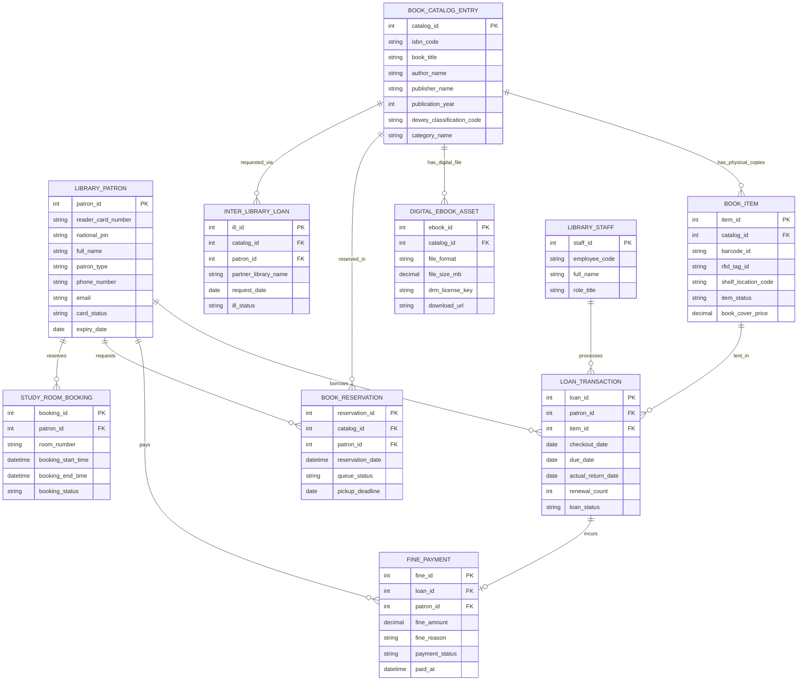

# Conceptual ERD — Public Library Management System

## Mermaid Code

## Entity Description Table | Bảng mô tả Entity

| # | Entity Name | Vietnamese Name | Description | Key Attributes | Main Relationships |
|---|-------------|-----------------|-------------|----------------|-------------------|
| 1 | LIBRARY_PATRON | Độc giả Thư viện | Thông tin thẻ và nhân thân của công dân đăng ký sử dụng thư viện | patron_id, reader_card_number, full_name, patron_type, card_status | Borrows LOAN_TRANSACTION, pays FINE_PAYMENT |
| 2 | BOOK_CATALOG_ENTRY | Biên mục Sách OPAC | Thông tin biểu ghi biên mục xuất bản của cuốn sách theo chuẩn MARC21 | catalog_id, isbn_code, book_title, author_name, dewey_classification_code | Has physical copies BOOK_ITEM, has digital file DIGITAL_EBOOK_ASSET |
| 3 | BOOK_ITEM | Bản sách Vật lý | Thông tin mã vạch Barcode/RFID của từng cuốn sách cụ thể trên kệ | item_id, barcode_id, rfid_tag_id, shelf_location_code, item_status | Belongs to BOOK_CATALOG_ENTRY, lent in LOAN_TRANSACTION |
| 4 | LOAN_TRANSACTION | Giao dịch Mượn Trả Sách | Nhật ký mượn, gia hạn và trả sách của độc giả | loan_id, checkout_date, due_date, actual_return_date, loan_status | Belongs to LIBRARY_PATRON, BOOK_ITEM, incurs FINE_PAYMENT |
| 5 | FINE_PAYMENT | Tiền Phạt Nộp Chậm / Hỏng Sách | Chứng từ thu tiền phạt nộp chậm quá hạn hoặc bồi thường làm hỏng sách | fine_id, fine_amount, fine_reason, payment_status | Belongs to LOAN_TRANSACTION, LIBRARY_PATRON |
| 6 | BOOK_RESERVATION | Đặt chỗ Mượn Sách | Hàng chờ đặt trước các cuốn sách đang được mượn | reservation_id, reservation_date, queue_status, pickup_deadline | Belongs to BOOK_CATALOG_ENTRY, LIBRARY_PATRON |
| 7 | DIGITAL_EBOOK_ASSET | Tài liệu Số / E-Book | Tệp tài liệu số hóa e-Book (PDF/EPUB) kèm khóa quản lý bản quyền DRM | ebook_id, file_format, file_size_mb, drm_license_key | Belongs to BOOK_CATALOG_ENTRY |
| 8 | INTER_LIBRARY_LOAN | Mượn Liên Thư viện (ILL) | Yêu cầu mượn tài liệu từ các thư viện liên kết đối tác ngoài tỉnh | ill_id, partner_library_name, request_date, ill_status | Belongs to BOOK_CATALOG_ENTRY, LIBRARY_PATRON |
| 9 | STUDY_ROOM_BOOKING | Đặt Phòng Học Nhóm | Lịch đăng ký sử dụng phòng nghiên cứu/phòng đọc nhóm tại thư viện | booking_id, room_number, booking_start_time, booking_status | Belongs to LIBRARY_PATRON |
| 10 | LIBRARY_STAFF | Nhân viên Thủ thư | Thông tin cán bộ thủ thư và biên mục xử lý nghiệp vụ thư viện | staff_id, employee_code, full_name, role_title | Processes LOAN_TRANSACTION |

## Relationship Description | Mô tả Quan hệ

| # | From Entity | Cardinality | To Entity | Relationship Label | Business Explanation |
|---|-------------|-------------|-----------|-------------------|----------------------|
| 1 | BOOK_CATALOG_ENTRY | one-to-many | BOOK_ITEM | has_physical_copies | Một đầu sách biên mục có nhiều cuốn bản sao vật lý nằm trên các kệ |
| 2 | BOOK_CATALOG_ENTRY | one-to-many | DIGITAL_EBOOK_ASSET | has_digital_file | Một đầu sách có thể có các phiên bản tệp sách điện tử e-Book số hóa |
| 3 | LIBRARY_PATRON | one-to-many | LOAN_TRANSACTION | borrows | Một độc giả thực hiện nhiều lượt giao dịch mượn trả sách trong lịch sử |
| 4 | BOOK_ITEM | one-to-many | LOAN_TRANSACTION | lent_in | Một cuốn sách vật lý được cho mượn qua nhiều đợt giao dịch khác nhau |
| 5 | LOAN_TRANSACTION | one-to-one | FINE_PAYMENT | incurs | Một lượt mượn sách quá hạn phát sinh duy nhất một khoản phạt nộp chậm |
| 6 | LIBRARY_PATRON | one-to-many | FINE_PAYMENT | pays | Một độc giả nộp các khoản tiền phạt nộp chậm cho thư viện |
| 7 | BOOK_CATALOG_ENTRY | one-to-many | BOOK_RESERVATION | reserved_in | Một đầu sách có thể được nhiều độc giả đặt hàng chờ xếp hàng mượn |
| 8 | LIBRARY_PATRON | one-to-many | BOOK_RESERVATION | requests | Một độc giả có thể đặt chỗ trước cho nhiều đầu sách đang mượn |
| 9 | BOOK_CATALOG_ENTRY | one-to-many | INTER_LIBRARY_LOAN | requested_via | Một đầu sách hiếm được mượn thông qua hệ thống mượn liên thư viện |
| 10 | LIBRARY_STAFF | one-to-many | LOAN_TRANSACTION | processes | Một thủ thư xử lý nhiều giao dịch cho mượn và nhận trả sách tại quầy |
