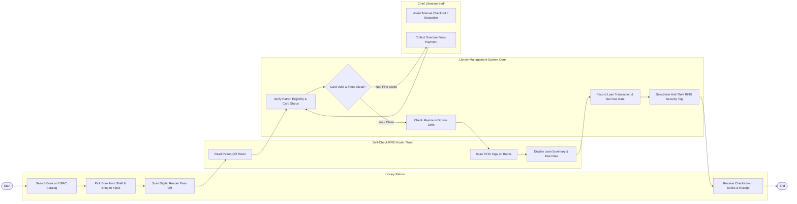

# Swimlane Diagram — Public Library Management System

## Mermaid Code

## Flow Description | Mô tả luồng

| Lane | Actor | Role in Flow |
|------|-------|-------------|
| 1 | Library Patron | Tra cứu vị trí sách trên OPAC, lấy sách từ kệ mang đến trạm mượn, quét mã QR thẻ độc giả và nhận sách đã mượn. |
| 2 | Self-Check RFID Kiosk / Web | Đọc mã QR độc giả, quét chíp RFID trên tập sách mượn và hiển thị tóm tắt hạn trả cho độc giả xác nhận. |
| 3 | Library Management System Core | Xác thực thẻ độc giả, kiểm tra hạn mức mượn sách, khởi tạo giao dịch mượn, tính hạn trả và tự động ngắt chíp từ an ninh RFID. |
| 4 | Chief Librarian Staff | Hỗ trợ mượn sách thủ công khi gặp sự cố thẻ và thực hiện thu tiền phạt quá hạn trực tiếp tại quầy. |
