# Action Tree — Public Library Management System

## Mermaid Code

```mermaid
graph TD
    Root["Public Library Management System"]

    Root --> M1["Patron Membership & Pass Management"]
    Root --> M2["OPAC & Book Cataloging"]
    Root --> M3["Circulation & Loan Operations"]
    Root --> M4["Digital E-Book & DRM Archive"]
    Root --> M5["Inter-Library Loan & Reservations"]
    Root --> M6["Facility & Utilization Analytics"]

    M1 --> A11["Register Digital Membership Card VNeID"]
    M1 --> A12["Issue Digital Reader Pass QR"]
    M1 --> A13["Manage Annual Membership Fees"]
    M1 --> A14["Audit Patron Violation History"]

    M2 --> A21["Catalog New Books MARC21 Format"]
    M2 --> A22["Assign Dewey Classification Codes"]
    M2 --> A23["Print Barcode RFID Shelf Tags"]
    M2 --> A24["Query ISBN Agency Metadata"]

    M3 --> A31["Process RFID Self Check Out"]
    M3 --> A32["Process Book Check In Return"]
    M3 --> A33["Renew Book Loan Period Online"]
    M3 --> A34["Process Overdue Fines Payment"]

    M4 --> A41["Import Digital E-Book Assets"]
    M4 --> A42["Configure DRM Access Licensing"]
    M4 --> A43["Archive Digitized Ancient Manuscripts"]
    M4 --> A44["Stream Online Reader Viewport"]

    M5 --> A51["Reserve Checked-out Book Queue"]
    M5 --> A52["Request Inter-Library Loan ILL"]
    M5 --> A53["Track ILL Item Physical Dispatch"]
    M5 --> A54["Notify Patron Pickup Deadline"]

    M6 --> A61["Audit Reading Room Gate Access"]
    M6 --> A62["Book Public Study Rooms Computers"]
    M6 --> A63["Audit Lost Damaged Book Inventory"]
    M6 --> A64["Export Cultural Dept Analytics"]
```

## Module Description | Mô tả Module

| # | Module | Description | Actions |
|---|--------|-------------|---------|
| 1 | Patron Membership & Pass Management | Quản lý đăng ký thẻ độc giả điện tử tích hợp VNeID, cấp mã QR thẻ đọc, thu phí thường niên và kiểm soát lịch sử vi phạm | Register Digital Membership Card VNeID, Issue Digital Reader Pass QR, Manage Annual Membership Fees, Audit Patron Violation History |
| 2 | OPAC & Book Cataloging | Quản lý biên mục sách chuẩn MARC21/Dewey, kết nối Cục Xuất bản lấy metadata ISBN, in mã vạch và chíp từ RFID | Catalog New Books MARC21 Format, Assign Dewey Classification Codes, Print Barcode RFID Shelf Tags, Query ISBN Agency Metadata |
| 3 | Circulation & Loan Operations | Xử lý mượn/trả sách tự động qua trạm RFID, gia hạn thời gian mượn trực tuyến, tính toán và thu tiền phạt nộp chậm quá hạn | Process RFID Self Check Out, Process Book Check In Return, Renew Book Loan Period Online, Process Overdue Fines Payment |
| 4 | Digital E-Book & DRM Archive | Lưu trữ và quản lý kho sách điện tử e-Book số hóa, cấu hình bản quyền DRM, số hóa sách cổ và cho đọc trực tuyến | Import Digital E-Book Assets, Configure DRM Access Licensing, Archive Digitized Ancient Manuscripts, Stream Online Reader Viewport |
| 5 | Inter-Library Loan & Reservations | Quản lý hàng chờ đặt chỗ mượn sách, mượn liên thư viện giữa các thư viện liên kết và thông báo ngày nhận sách | Reserve Checked-out Book Queue, Request Inter-Library Loan ILL, Track ILL Item Physical Dispatch, Notify Patron Pickup Deadline |
| 6 | Facility & Utilization Analytics | Quản lý kiểm soát cổng ra vào phòng đọc, đặt phòng học nhóm, kiểm kê sách hỏng/mất và xuất báo cáo Sở Văn hóa | Audit Reading Room Gate Access, Book Public Study Rooms Computers, Audit Lost Damaged Book Inventory, Export Cultural Dept Analytics |
