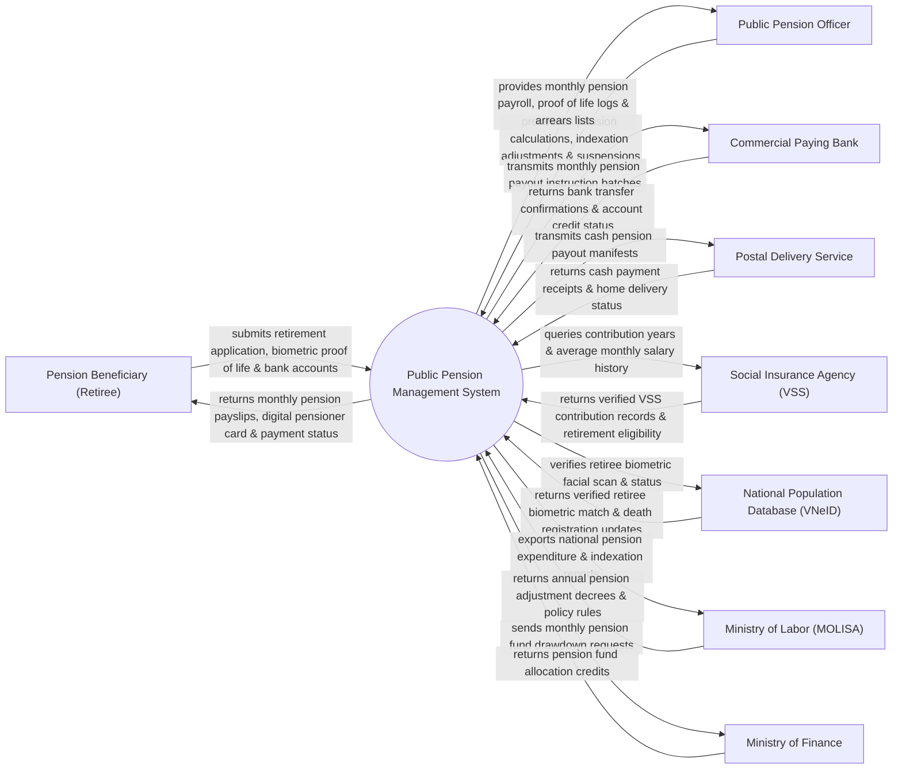

# Context Diagram — Public Pension Management System

## Mermaid Code

## Actor & Interaction Table | Bảng Actor & Tương tác

| # | Actor | Actor Type | Data Sent TO System | Data Received FROM System | Notes |
|---|-------|------------|---------------------|---------------------------|-------|
| 1 | Pension Beneficiary (Retiree) | Primary | Retirement application, facial biometric verification, bank account | Monthly pension payslips, digital pensioner card QR, payment notice | Cán bộ/Công nhân viên chức/Người lao động hưởng lương hưu |
| 2 | Public Pension Officer | Primary | Benefit calculation approvals, annual indexation rates, suspension orders | Monthly pension payroll, biometric verification logs, arrears alerts | Cán bộ Bảo hiểm Xã hội phụ trách chế độ Hưu trí |
| 3 | Commercial Paying Bank | Supporting | Direct deposit confirmations, account credit status | Monthly electronic pension payment instruction files | Ngân hàng thương mại phục vụ chi trả lương hưu qua tài khoản |
| 4 | Postal Delivery Service | Supporting | Home cash delivery receipts, sign-off manifests | Monthly cash pension payout lists for elderly pensioners | Bưu điện Việt Nam thực hiện chi trả lương hưu bằng tiền mặt |
| 5 | Social Insurance Agency (VSS) | Supporting | Verified VSS contribution years, average salary baseline data | Retirement eligibility queries, pension calculation logs | BHXH Việt Nam quản lý CSDL đóng bảo hiểm xã hội |
| 6 | National Population Database (VNeID) | Supporting | Biometric facial match scores, death registration status | Retiree proof of life queries, deceased pensioner verification | CSDL Quốc gia về dân cư xác thực sinh trắc học và báo tử |
| 7 | Ministry of Labor (MOLISA) | Regulatory | Pension adjustment policies, annual indexation percentages | National pension expenditure analytics, retiree demographics | Bộ Lao động - Thương binh & Xã hội ban hành chính sách hưu trí |
| 8 | Ministry of Finance | Regulatory | Monthly pension fund credit allocations | Pension fund drawdown requests, fund balance reconciliation | Bộ Tài chính đảm bảo nguồn kinh phí chi trả lương hưu |

## System Boundary Description | Mô tả Phạm vi Hệ thống

Hệ thống Public Pension Management System (Hệ thống Quản lý và Chi trả Lương hưu Công cộng) chịu trách nhiệm tự động hóa quy trình hưởng chế độ hưu trí toàn quốc: Tính toán mức hưởng lương hưu hàng tháng dựa trên số năm đóng BHXH và bình luận quân tiền lương, tự động điều chỉnh tăng lương hưu theo Nghị định chính phủ (Indexation), xác thực sinh trắc học khuôn mặt từ xa (Biometric Proof of Life) để duy trì nhận lương hưu, lập bảng lương chi trả hàng tháng qua Ngân hàng / Bưu điện, quản lý chế độ tử tuất và truy thu lương hưu chi trả thừa. Tuy nhiên, hệ thống KHÔNG trực tiếp thực hiện việc giao tiền mặt tận nhà và KHÔNG thay thế việc thẩm định sức khỏe mất sức lao động của Hội đồng Y khoa.
