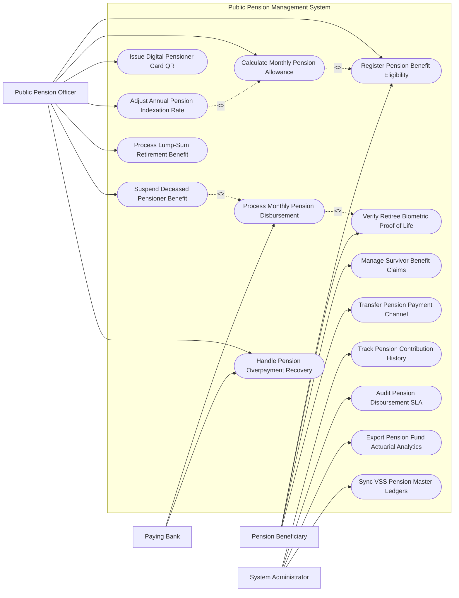

# Use Case Diagram — Public Pension Management System

## Mermaid Code

## Actor Table | Bảng Actor

| # | Actor | Actor Type | Role Description | Related Use Cases |
|---|-------|------------|------------------|-------------------|
| 1 | Pension Beneficiary | Primary | Cụ ông/cụ bà về hưu thực hiện quét mặt xác thực sinh trắc học, nhận lương hưu và xin đổi kênh chi trả | UC01, UC03, UC09, UC10 |
| 2 | Public Pension Officer | Primary | Cán bộ BHXH tính toán mức lương hưu, duyệt tăng lương hàng năm và xử lý tạm dừng/truy thu | UC01, UC02, UC05, UC06, UC08, UC12, UC13 |
| 3 | Paying Bank | Secondary | Ngân hàng chi trả chuyển lương hưu vào tài khoản cá nhân và thu hồi tiền chi trả thừa | UC04, UC13 |
| 4 | System Administrator | System | Quản trị viên đối soát CSDL BHXH, kiểm toán SLA và trích xuất báo cáo cân đối quỹ hưu trí | UC07, UC11, UC14, UC15 |

## Use Case Table | Bảng Use Case

| # | UC ID | Use Case Name | Primary Actor | Secondary Actor | Description | Priority |
|---|-------|---------------|---------------|-----------------|-------------|----------|
| 1 | UC01 | Register Pension Benefit Eligibility | Retiree | Officer, VSS | Tiếp nhận hồ sơ đăng ký hưởng chế độ hưu trí và thẩm định điều kiện nghỉ hưu | High |
| 2 | UC02 | Calculate Monthly Pension Allowance | Officer | VSS | Tự động tính tỷ lệ % lương hưu và số tiền lương hưu hàng tháng được hưởng | High |
| 3 | UC03 | Verify Retiree Biometric Proof of Life | Retiree | VNeID | Quét khuôn mặt sinh trắc học định kỳ từ xa qua App di động để xác nhận còn sống | High |
| 4 | UC04 | Process Monthly Pension Disbursement | Bank | Officer | Lập bảng chi trả và chuyển khoản lương hưu hàng tháng cho người hưởng | High |
| 5 | UC05 | Issue Digital Pensioner Card QR | Officer | Retiree | Cấp Thẻ hưu trí điện tử tích hợp Mã QR thông tin bảo hiểm trên VNeID | High |
| 6 | UC06 | Adjust Annual Pension Indexation Rate | Officer | MOLISA | Tự động điều chỉnh tăng tỷ lệ lương hưu toàn bộ đối tượng theo Nghị định | High |
| 7 | UC07 | Track Pension Contribution History | Admin | VSS | Trích xuất chi tiết lịch sử đóng BHXH qua các thời kỳ công tác của người lao động | Medium |
| 8 | UC08 | Process Lump-Sum Retirement Benefit | Officer | Retiree | Giải quyết trợ cấp BHXH một lần đối với trường hợp không đủ điều kiện hưởng lương hưu | High |
| 9 | UC09 | Manage Survivor Benefit Claims | Retiree | Officer | Giải quyết chế độ trợ cấp mai táng phí và trợ cấp tuất hàng tháng cho thân nhân | High |
| 10 | UC10 | Transfer Pension Payment Channel | Retiree | Bank, Post | Đăng ký thay đổi hình thức nhận lương hưu (từ Tiền mặt sang Ngân hàng hoặc ngược lại) | Medium |
| 11 | UC11 | Audit Pension Disbursement SLA | Admin | StateAudit | Kiểm toán thời gian chi trả lương hưu đảm bảo đúng ngày 01 đến ngày 05 hàng tháng | High |
| 12 | UC12 | Suspend Deceased Pensioner Benefit | Officer | VNeID | Tự động tạm dừng chi trả lương hưu khi ghi nhận dữ liệu người hưởng qua đời | High |
| 13 | UC13 | Handle Pension Overpayment Recovery | Officer | Bank | Xử lý truy thu số tiền lương hưu đã chi trả thừa sau khi người hưởng qua đời | High |
| 14 | UC14 | Export Pension Fund Actuarial Analytics | Admin | MOLISA | Phân tích cân đối thu chi Quỹ Hưu trí và dự báo định phí hưu trí quốc gia | Low |
| 15 | UC15 | Sync VSS Pension Master Ledgers | System | VSS | Đồng bộ dữ liệu chi trả lương hưu thời gian thực về CSDL BHXH Việt Nam | High |

## Use Case Specification | Đặc tả Use Case

---

### UC01 — Register Pension Benefit Eligibility

| Field | Detail |
|-------|--------|
| **UC ID** | UC01 |
| **Use Case Name** | Register Pension Benefit Eligibility |
| **Actor(s)** | Primary: Pension Beneficiary / Secondary: Public Pension Officer, VSS |
| **Description** | Người lao động đủ tuổi nghỉ hưu nộp hồ sơ xin hưởng chế độ hưu trí hàng tháng trực tuyến hoặc tại cơ quan BHXH. |
| **Precondition** | 1. Nam đủ 61 tuổi 3 tháng, Nữ đủ 56 tuổi 8 tháng (theo lộ trình tuổi nghỉ hưu).   2. Đã đóng BHXH tối thiểu 15-20 năm theo quy định. |
| **Main Flow** | 1. Retiree đăng nhập Cổng Dịch vụ công BHXH Việt Nam bằng VNeID.   2. Retiree nộp Đơn đề nghị hưởng chế độ hưu trí (Mẫu 14-HSB).   3. System tự động liên kết CSDL BHXH (VSS) trích xuất Quá trình đóng BHXH (Số năm, số tháng, tiền lương đóng BHXH từng thời kỳ).   4. System kiểm tra điều kiện: $Tuổi\_nghỉ\_hưu \ge Quy\_định$ và $Số\_năm\_đóng\_BHXH \ge 15\,năm$.   5. System chuyển hồ sơ sang Phân hệ Tính toán lương hưu (UC02).   6. PensionOfficer rà soát kết quả và ký duyệt Quyết định hưởng chế độ hưu trí hàng tháng.   7. System phát hành Quyết định điện tử và cấp Thẻ hưu trí điện tử QR (UC05) cho Retiree. |
| **Alternative Flow** | **AF1** — Nghỉ hưu trước tuổi do suy giảm khả năng lao động: Retiree nộp bổ sung Biên bản giám định y khoa kết luận suy giảm từ 61% trở lên. |
| **Exception Flow** | **EX1** — Chưa đủ số năm đóng BHXH: System báo không đủ điều kiện hưởng lương hưu hàng tháng, hướng dẫn đóng BHXH tự nguyện cho đủ hoặc chuyển sang hưởng trợ cấp 1 lần (UC08). |
| **Postcondition** | Quyết định hưởng lương hưu có hiệu lực, người hưởng được đưa vào danh sách chi trả hàng tháng (UC04). |
| **Business Rule** | **BR1**: Thời gian giải quyết chế độ hưu trí không quá 12 ngày làm việc kể từ ngày nhận đủ hồ sơ hợp lệ. |

---

### UC02 — Calculate Monthly Pension Allowance

| Field | Detail |
|-------|--------|
| **UC ID** | UC02 |
| **Use Case Name** | Calculate Monthly Pension Allowance |
| **Actor(s)** | Primary: Public Pension Officer / Secondary: VSS |
| **Description** | Hệ thống tự động tính toán tỷ lệ % hưởng lương hưu và số tiền lương hưu hàng tháng chính xác cho người lao động. |
| **Precondition** | 1. Hồ sơ đăng ký hưởng hưu trí (UC01) đã được xác minh đủ điều kiện nghỉ hưu. |
| **Main Flow** | 1. System lấy Tổng thời gian đóng BHXH của người lao động ($Năm, Tháng$).   2. System tính Mức bình quân tiền lương tháng đóng BHXH ($Mbqtl$) theo hệ số trượt giá do Bộ LĐ-TB&XH quy định.   3. System tính Tỷ lệ phần trăm hưởng lương hưu ($Rate\%$):   - Nữ: 15 năm đầu tính 45%, mỗi năm sau cộng 2% (Tối đa 75%).   - Nam: 20 năm đầu tính 45%, mỗi năm sau cộng 2% (Tối đa 75%).   4. System tính Lương hưu hàng tháng: $Lương\_hưu = Mbqtl \times Rate\%$.   5. Nếu nghỉ hưu trước tuổi: System trừ 2% cho mỗi năm nghỉ hưu trước tuổi.   6. System tính Trợ cấp một lần khi nghỉ hưu (nếu thời gian đóng BHXH $> 30$ năm đối với nữ hoặc $> 35$ năm đối với nam).   7. PensionOfficer thẩm định bảng tính lương hưu và ký số phê duyệt. |
| **Alternative Flow** | **AF1** — Người lao động có thời gian làm công việc nặng nhọc, độc hại: System tính quy đổi thời gian làm việc để không bị trừ tỷ lệ % nghỉ hưu trước tuổi. |
| **Exception Flow** | **EX1** — Mức lương hưu tính ra thấp hơn mức lương cơ sở: System tự động điều chỉnh mức lương hưu bằng mức lương cơ sở theo quy định nhà nước. |
| **Postcondition** | Số tiền lương hưu hàng tháng chính thức được phê duyệt, lưu vào CSDL chi trả lương hưu. |
| **Business Rule** | **BR1**: Tỷ lệ hưởng lương hưu hàng tháng tối đa là 75% mức bình quân tiền lương tháng đóng BHXH. |

---

### UC03 — Verify Retiree Biometric Proof of Life

| Field | Detail |
|-------|--------|
| **UC ID** | UC03 |
| **Use Case Name** | Verify Retiree Biometric Proof of Life |
| **Actor(s)** | Primary: Pension Beneficiary / Secondary: VNeID |
| **Description** | Người hưởng lương hưu thực hiện quét khuôn mặt sinh trắc học từ xa qua ứng dụng di động định kỳ để chứng minh còn sống và duy trì nhận lương. |
| **Precondition** | 1. Retiree đang trong danh sách hưởng lương hưu hàng tháng.   2. Đến chu kỳ xác thực sinh trắc học định kỳ (6 tháng/lần). |
| **Main Flow** | 1. System gửi thông báo nhắc lịch xác thực sinh trắc học qua App/SMS cho Retiree.   2. Retiree mở ứng dụng VSSID / VNeID trên điện thoại thông minh.   3. Retiree thực hiện Quét khuôn mặt (FaceID / Liveness Detection) theo hướng dẫn trên màn hình.   4. System gửi dữ liệu khuôn mặt sang CSDL Quốc gia về Dân cư (VNeID) để đối soát sinh trắc học.   5. VNeID trả về kết quả: "Khớp sinh trắc học 100% - Xác nhận còn sống (Proof of Life Validated)".   6. System tự động gia hạn trạng thái "Đủ điều kiện nhận lương hưu" thêm 06 tháng.   7. Retiree nhận thông báo xác thực thành công và tâm lý yên tâm nhận lương hưu qua tài khoản. |
| **Alternative Flow** | **AF1** — Xác thực trực tiếp tại nhà đối với người già yếu ốm đau: Nhân viên Bưu điện/Cán bộ BHXH đến tận nhà chụp ảnh xác thực cho cụ ông/cụ bà. |
| **Exception Flow** | **EX1** — Quá thời hạn 60 ngày không thực hiện xác thực sinh trắc học: System tự động chuyển trạng thái sang "Tạm dừng chi trả" (UC12) để chống trục lợi quỹ. |
| **Postcondition** | Đảm bảo lương hưu được chi trả đúng người, đúng đối tượng, ngăn chặn tuyệt đối thất thoát quỹ hưu trí. |
| **Business Rule** | **BR1**: Mọi người hưởng lương hưu qua tài khoản ngân hàng bắt buộc phải xác thực sinh trắc học định kỳ tối thiểu 06 tháng/lần. |

---

### UC04 — Process Monthly Pension Disbursement

| Field | Detail |
|-------|--------|
| **UC ID** | UC04 |
| **Use Case Name** | Process Monthly Pension Disbursement |
| **Actor(s)** | Primary: Paying Bank / Secondary: Public Pension Officer |
| **Description** | Lập danh sách chi trả và chuyển khoản lương hưu hàng tháng đồng loạt vào tài khoản ngân hàng của tất cả người hưởng từ ngày 01 đến 05 hàng tháng. |
| **Precondition** | 1. Bảng lương hưu tháng mới đã được duyệt và xác thực trạng thái còn sống (UC03).   2. Bộ Tài chính đã cấp hạn mức kinh phí chi trả hưu trí. |
| **Main Flow** | 1. System chạy tiến trình lập Bảng tổng hợp chi trả lương hưu toàn quốc đầu tháng.   2. System tự động lọc bỏ các trường hợp bị tạm dừng (UC12) hoặc đã báo tử.   3. System áp dụng số tiền lương hưu đã được điều chỉnh tăng (UC06).   4. System đóng gói Danh sách chi trả tiền lương hưu điện tử gửi sang Ngân hàng thương mại (Paying Bank).   5. Paying Bank chạy lệnh chuyển tiền tự động (Bulk Payment Transfer) vào tài khoản cá nhân của Retiree.   6. Retiree nhận được tin nhắn báo có tiền lương hưu vào tài khoản ngân hàng.   7. Paying Bank gửi Báo cáo kết quả chi trả thành công (Bank Disbursement Log) về cho System.   8. System tự động gạch nợ kỳ lương hưu tháng và xuất phiếu báo lương điện tử. |
| **Alternative Flow** | **AF1** — Chi trả bằng tiền mặt qua Bưu điện: System xuất danh sách cho Bưu điện tổ chức điểm chi trả tiền mặt tại UBND xã/phường cho cụ ông/cụ bà không dùng thẻ ngân hàng. |
| **Exception Flow** | **EX1** — Chuyển khoản thất bại do tài khoản ngân hàng bị đóng: System báo trạng thái "Tiền bị đẩy về", chuyển sang danh sách chi trả bổ sung hoặc tiền mặt. |
| **Postcondition** | Hàng triệu người hưởng nhận được tiền lương hưu đúng ngày quy định đầu tháng. |
| **Business Rule** | **BR1**: Việc chi trả lương hưu qua tài khoản ngân hàng phải hoàn thành trước ngày 05 hàng tháng. |

---

### UC06 — Adjust Annual Pension Indexation Rate

| Field | Detail |
|-------|--------|
| **UC ID** | UC06 |
| **Use Case Name** | Adjust Annual Pension Indexation Rate |
| **Actor(s)** | Primary: Public Pension Officer / Secondary: Ministry of Labor (MOLISA) |
| **Description** | Tự động cập nhật tỷ lệ điều chỉnh tăng lương hưu hàng năm theo Nghị định của Chính phủ cho toàn bộ người đang hưởng lương hưu. |
| **Precondition** | 1. Chính phủ ban hành Nghị định điều chỉnh lương hưu, trợ cấp bảo hiểm xã hội (Ví dụ: Tăng 15% lương hưu). |
| **Main Flow** | 1. PensionOfficer nhập Tỷ lệ điều chỉnh tăng lương hưu mới (Ví dụ: 15%), Ngày có hiệu lực và Số hiệu Nghị định Chính phủ vào hệ thống.   2. System quét toàn bộ CSDL Người đang hưởng lương hưu active.   3. System áp dụng công thức điều chỉnh: $Lương\_hưu\_mới = Lương\_hưu\_hiện\_hưởng \times (1 + Tỷ\_lệ\_tăng\%)$.   4. System tính toán số tiền lương hưu mới cho từng người hưởng và số tiền truy lĩnh bổ sung (nếu Nghị định có hiệu lực hồi truy).   5. PensionOfficer phê duyệt Kết quả điều chỉnh tăng lương hưu toàn quốc.   6. System tự động cập nhật mức lương hưu mới vào Bảng chi trả hàng tháng (UC04).   7. System phát hành Thông báo thay đổi mức hưởng lương hưu gửi tới từng Retiree. |
| **Alternative Flow** | **AF1** — Điều chỉnh tăng thêm cho người có mức lương hưu thấp (dưới 3,500,000 VND): System tự động cộng thêm số tiền cố định (Ví dụ: Cộng thêm 300,000 VND/tháng) theo chính sách an sinh. |
| **Exception Flow** | **EX1** — Lỗi dữ liệu lương hưu cũ: System đánh dấu hồ sơ bất thường, chuyển sang danh sách điều chỉnh thủ công cho cán bộ nghiệp vụ. |
| **Postcondition** | Mức lương hưu toàn dân được tự động tăng đồng loạt đúng chính sách an sinh của Nhà nước. |
| **Business Rule** | **BR1**: Việc điều chỉnh tăng lương hưu tự động phải đảm bảo chính xác 100% đối với hàng triệu hồ sơ người hưởng. |
