# Conceptual ERD — Public Pension Management System

## Mermaid Code

```mermaid
erDiagram
    PENSION_BENEFICIARY {
        int beneficiary_id PK
        string national_pin
        string full_name
        date date_of_birth
        string gender
        string pensioner_card_number
        string bank_account_number
        string bank_name
        string payment_channel_type
        string current_status
    }

    PENSION_CONTRIBUTION_HISTORY {
        int contribution_id PK
        int beneficiary_id FK
        int total_years_contributed
        int total_months_contributed
        decimal average_monthly_salary_baseline
        string vss_insurance_book_no
    }

    PENSION_CALCULATION {
        int calculation_id PK
        int beneficiary_id FK
        decimal pension_rate_percentage
        decimal initial_monthly_allowance
        decimal current_monthly_allowance
        date approval_date
        string decision_number
    }

    PENSION_PAYMENT_BATCH {
        int batch_id PK
        string batch_code
        int payment_month
        int payment_year
        int total_pensioners_count
        decimal total_disbursement_amount
        string batch_status
    }

    PENSION_DISBURSEMENT_RECORD {
        int disbursement_id PK
        int batch_id FK
        int beneficiary_id FK
        decimal monthly_pension_amount
        decimal arrears_adjusted_amount
        string payment_status
        datetime disbursed_timestamp
    }

    PROOF_OF_LIFE_LOG {
        int proof_id PK
        int beneficiary_id FK
        string verification_method
        decimal facial_biometric_score
        date valid_until_date
        datetime verified_timestamp
    }

    SURVIVOR_CLAIM {
        int claim_id PK
        int beneficiary_id FK
        string relative_full_name
        string relative_relationship
        decimal funeral_allowance_amount
        decimal monthly_survivor_allowance
        string claim_status
    }

    PENSION_CHANNEL_TRANSFER {
        int transfer_id PK
        int beneficiary_id FK
        string old_channel
        string new_channel
        date effective_date
        string approval_status
    }

    PENSION_OFFICER {
        int officer_id PK
        string employee_code
        string full_name
        string vss_office_branch
    }

    PENSION_AUDIT_LOG {
        int audit_id PK
        int beneficiary_id FK
        string action_taken
        string performed_by
        datetime timestamp
    }

    PENSION_BENEFICIARY ||--o| PENSION_CONTRIBUTION_HISTORY : "has_history"
    PENSION_BENEFICIARY ||--o| PENSION_CALCULATION : "calculated_in"
    PENSION_BENEFICIARY ||--o{ PENSION_DISBURSEMENT_RECORD : "receives_payout"
    PENSION_PAYMENT_BATCH ||--o{ PENSION_DISBURSEMENT_RECORD : "contains"
    PENSION_BENEFICIARY ||--o{ PROOF_OF_LIFE_LOG : "validates_life"
    PENSION_BENEFICIARY ||--o| SURVIVOR_CLAIM : "claims_survivor"
    PENSION_BENEFICIARY ||--o{ PENSION_CHANNEL_TRANSFER : "changes_channel"
    PENSION_OFFICER ||--o{ PENSION_CALCULATION : "approves"
    PENSION_BENEFICIARY ||--o{ PENSION_AUDIT_LOG : "tracked_in"
```

## Entity Description Table | Bảng mô tả Entity

| # | Entity Name | Vietnamese Name | Description | Key Attributes | Main Relationships |
|---|-------------|-----------------|-------------|----------------|-------------------|
| 1 | PENSION_BENEFICIARY | Người Hưởng Lương Hưu | Thông tin hồ sơ cán bộ, công nhân viên chức nghỉ hưu nhận lương hưu | beneficiary_id, national_pin, full_name, pensioner_card_number, current_status | Has HISTORY, receives DISBURSEMENT, validates PROOF |
| 2 | PENSION_CONTRIBUTION_HISTORY | Lịch sử Đóng BHXH | Tổng số năm đóng BHXH và mức bình quân tiền lương làm căn cứ tính lương hưu | contribution_id, total_years_contributed, average_monthly_salary_baseline | Belongs to PENSION_BENEFICIARY |
| 3 | PENSION_CALCULATION | Quyết định Mức Hưởng Lương Hưu | Chi tiết quyết định phê duyệt tỷ lệ % hưởng và số tiền lương hưu hàng tháng | calculation_id, pension_rate_percentage, current_monthly_allowance | Belongs to PENSION_BENEFICIARY, approved by OFFICER |
| 4 | PENSION_PAYMENT_BATCH | Bảng Lương Hưu Hàng Tháng | Bảng tổng hợp dữ liệu chi trả lương hưu toàn quốc/tỉnh theo tháng | batch_id, batch_code, payment_month, total_disbursement_amount | Contains PENSION_DISBURSEMENT_RECORD |
| 5 | PENSION_DISBURSEMENT_RECORD | Giao dịch Chi trả Lương hưu | Chi tiết chứng từ chuyển khoản hoặc nhận tiền mặt lương hưu của từng cá nhân | disbursement_id, monthly_pension_amount, payment_status, disbursed_timestamp | Belongs to PENSION_PAYMENT_BATCH, PENSION_BENEFICIARY |
| 6 | PROOF_OF_LIFE_LOG | Nhật ký Xác thực Sinh trắc học | Kết quả quét khuôn mặt định kỳ xác nhận người hưởng còn sống qua VNeID | proof_id, verification_method, facial_biometric_score, valid_until_date | Belongs to PENSION_BENEFICIARY |
| 7 | SURVIVOR_CLAIM | Hồ sơ Chế độ Tử tuất | Thông tin giải quyết mai táng phí và trợ cấp tuất hàng tháng khi người hưởng mất | claim_id, relative_full_name, funeral_allowance_amount, claim_status | Belongs to PENSION_BENEFICIARY |
| 8 | PENSION_CHANNEL_TRANSFER | Thay đổi Kênh Chi trả | Hồ sơ xin chuyển đổi hình thức nhận lương hưu (Tiền mặt / Thẻ Ngân hàng) | transfer_id, old_channel, new_channel, effective_date | Belongs to PENSION_BENEFICIARY |
| 9 | PENSION_OFFICER | Cán bộ BHXH Hưu trí | Thông tin chuyên viên cơ quan Bảo hiểm Xã hội tính toán và duyệt chi trả | officer_id, employee_code, full_name, vss_office_branch | Approves PENSION_CALCULATION |
| 10 | PENSION_AUDIT_LOG | Nhật ký Kiểm toán Hưu trí | Lưu lại lịch sử duyệt lương, tăng lương hưu, tạm dừng và truy thu lương chi thừa | audit_id, action_taken, performed_by, timestamp | Belongs to PENSION_BENEFICIARY |

## Relationship Description | Mô tả Quan hệ

| # | From Entity | Cardinality | To Entity | Relationship Label | Business Explanation |
|---|-------------|-------------|-----------|-------------------|----------------------|
| 1 | PENSION_BENEFICIARY | one-to-one | PENSION_CONTRIBUTION_HISTORY | has_history | Mỗi người hưởng lương hưu liên kết duy nhất với một lịch sử đóng BHXH |
| 2 | PENSION_BENEFICIARY | one-to-one | PENSION_CALCULATION | calculated_in | Mỗi người hưởng lương hưu được phê duyệt một quyết định tính lương hưu chính |
| 3 | PENSION_BENEFICIARY | one-to-many | PENSION_DISBURSEMENT_RECORD | receives_payout | Một người hưởng nhận khoản chi trả lương hưu hàng tháng qua nhiều đợt chi |
| 4 | PENSION_PAYMENT_BATCH | one-to-many | PENSION_DISBURSEMENT_RECORD | contains | Bảng lương hưu tháng bao gồm danh sách chứng từ chi trả cho hàng ngàn người |
| 5 | PENSION_BENEFICIARY | one-to-many | PROOF_OF_LIFE_LOG | validates_life | Một người hưởng thực hiện xác thực sinh trắc học khuôn mặt định kỳ nhiều lần |
| 6 | PENSION_BENEFICIARY | one-to-one | SURVIVOR_CLAIM | claims_survivor | Một người hưởng khi qua đời phát sinh một hồ sơ giải quyết chế độ tử tuất |
| 7 | PENSION_BENEFICIARY | one-to-many | PENSION_CHANNEL_TRANSFER | changes_channel | Một người hưởng có thể đăng ký thay đổi kênh chi trả lương hưu trong đời |
| 8 | PENSION_OFFICER | one-to-many | PENSION_CALCULATION | approves | Một cán bộ BHXH thẩm định và duyệt quyết định lương hưu cho nhiều người |
| 9 | PENSION_BENEFICIARY | one-to-many | PENSION_AUDIT_LOG | tracked_in | Mọi thao tác nghiệp vụ hưu trí được ghi lại nhật ký kiểm toán bất biến |
