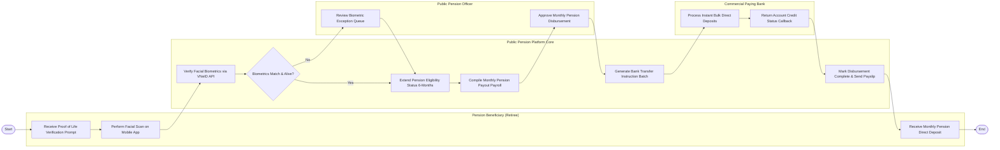

# Swimlane Diagram — Public Pension Management System

## Mermaid Code

## Flow Description | Mô tả luồng

| Lane | Actor | Role in Flow |
|------|-------|-------------|
| 1 | Pension Beneficiary (Retiree) | Nhận thông báo nhắc lịch xác thực sinh trắc học, thực hiện quét khuôn mặt trên ứng dụng di động và nhận tiền lương hưu. |
| 2 | Public Pension Platform Core | Truy vấn CSDL VNeID đối soát khuôn mặt, gia hạn trạng thái còn sống, lập bảng lương hưu hàng tháng và xuất lệnh chuyển tiền. |
| 3 | Public Pension Officer | Rà soát danh sách ngoại lệ không xác thực được sinh trắc học và phê duyệt bảng chi trả lương hưu hàng tháng. |
| 4 | Commercial Paying Bank | Thực hiện lệnh chuyển khoản tự động số lượng lớn vào tài khoản cá nhân người hưởng và trả về tín hiệu báo có. |
