# Action Tree — Public Pension Management System

## Mermaid Code

```mermaid
graph TD
    Root["Public Pension Management System"]

    Root --> M1["Pension Qualification & Calculation"]
    Root --> M2["Biometric Verification & Proof of Life"]
    Root --> M3["Monthly Disbursement & Bank Transfer"]
    Root --> M4["Survivor Benefits & Overpayment Control"]
    Root --> M5["Payment Channel & Beneficiary Support"]
    Root --> M6["Actuarial Analytics & VSS Sync"]

    M1 --> A11["Register Pension Benefit Eligibility"]
    M1 --> A12["Calculate Monthly Allowance VSS Base"]
    M1 --> A13["Adjust Annual Indexation Rate MOLISA"]
    M1 --> A14["Process Lump-Sum Retirement Benefit"]

    M2 --> A21["Verify Facial Biometrics VNeID API"]
    M2 --> A22["Schedule 6-Month Proof Life Prompts"]
    M2 --> A23["Issue Digital Pensioner Card QR"]
    M2 --> A24["Conduct Home Verification Elderly"]

    M3 --> A31["Compile Monthly Pension Payroll Batch"]
    M3 --> A32["Process Bank Bulk Direct Deposits"]
    M3 --> A33["Generate Postal Cash Payout Manifests"]
    M3 --> A34["Issue Electronic Pension Payslips"]

    M4 --> A41["Suspend Deceased Pensioner Benefit"]
    M4 --> A42["Process Funeral Allowance Claims"]
    M4 --> A43["Calculate Monthly Survivor Allowance"]
    M4 --> A44["Recover Pension Overpayment Bank"]

    M5 --> A51["Process Payment Channel Transfers"]
    M5 --> A52["Update Retiree Bank Account Details"]
    M5 --> A53["Manage Pensioner Contact Demographics"]
    M5 --> A54["Resolve Pension Discrepancy Claims"]

    M6 --> A61["Sync Master Database VSS Insurance"]
    M6 --> A62["Export Pension Fund Actuarial Metrics"]
    M6 --> A63["Log System Immutable Audit Ledgers"]
    M6 --> A64["Export Finance Ministry Expenditure"]
```

## Module Description | Mô tả Module

| # | Module | Description | Actions |
|---|--------|-------------|---------|
| 1 | Pension Qualification & Calculation | Tiếp nhận đăng ký hưu trí, tự động tính tỷ lệ % lương hưu dựa trên lịch sử BHXH, điều chỉnh tăng lương hàng năm và tính trợ cấp 1 lần | Register Pension Benefit Eligibility, Calculate Monthly Allowance VSS Base, Adjust Annual Indexation Rate MOLISA, Process Lump-Sum Retirement Benefit |
| 2 | Biometric Verification & Proof of Life | Xác thực sinh trắc học khuôn mặt từ xa qua VNeID để chứng minh còn sống, cấp thẻ hưu trí QR và xác thực tại nhà cho người già | Verify Facial Biometrics VNeID API, Schedule 6-Month Proof Life Prompts, Issue Digital Pensioner Card QR, Conduct Home Verification Elderly |
| 3 | Monthly Disbursement & Bank Transfer | Lập bảng chi trả lương hưu hàng tháng, chuyển khoản tự động qua Ngân hàng, xuất danh sách chi tiền mặt bưu điện và phát hành phiếu báo lương | Compile Monthly Pension Payroll Batch, Process Bank Bulk Direct Deposits, Generate Postal Cash Payout Manifests, Issue Electronic Pension Payslips |
| 4 | Survivor Benefits & Overpayment Control | Tạm dừng chi trả khi có báo tử, giải quyết trợ cấp mai táng phí và tuất hàng tháng cho thân nhân, xử lý truy thu lương hưu chi thừa | Suspend Deceased Pensioner Benefit, Process Funeral Allowance Claims, Calculate Monthly Survivor Allowance, Recover Pension Overpayment Bank |
| 5 | Payment Channel & Beneficiary Support | Giải quyết xin chuyển đổi hình thức nhận lương hưu (Tiền mặt sang Thẻ ngân hàng), cập nhật tài khoản và giải quyết khiếu nại | Process Payment Channel Transfers, Update Retiree Bank Account Details, Manage Pensioner Contact Demographics, Resolve Pension Discrepancy Claims |
| 6 | Actuarial Analytics & VSS Sync | Đồng bộ CSDL BHXH Việt Nam, phân tích định phí cân đối Quỹ Hưu trí quốc gia và trích xuất báo cáo kinh phí nộp Bộ Tài chính | Sync Master Database VSS Insurance, Export Pension Fund Actuarial Metrics, Log System Immutable Audit Ledgers, Export Finance Ministry Expenditure |
