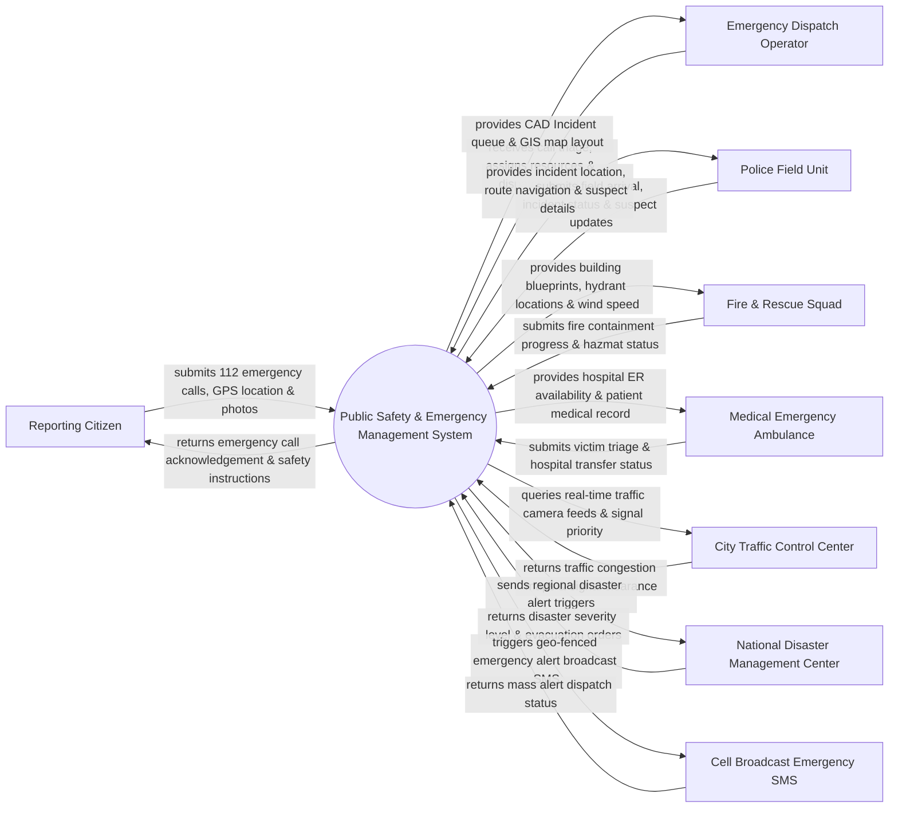

# Context Diagram — Public Safety & Emergency Management System

## Mermaid Code

## Actor & Interaction Table | Bảng Actor & Tương tác

| # | Actor | Actor Type | Data Sent TO System | Data Received FROM System | Notes |
|---|-------|------------|---------------------|---------------------------|-------|
| 1 | Reporting Citizen | Primary | Emergency Call (112/113/114/115), GPS coordinates, live photos | Incident receipt confirmation, safety instructions, ETA of responders | Công dân báo sự cố khẩn cấp (cháy, tai nạn, tội phạm, cứu nạn) |
| 2 | Emergency Dispatch Operator | Primary | Incident categorization, severity level, unit dispatch orders | Computer-Aided Dispatch (CAD) interface, unit GPS map, queue | Điện thoại viên trung tâm điều hành tiếp nhận và điều phối |
| 3 | Police Field Unit | Primary | Arrival confirmation, suspect details, scene status report | Incident address, navigation route, suspect description | Lực lượng Cảnh sát phản ứng nhanh (113) |
| 4 | Fire & Rescue Squad | Primary | Fire containment status, hazmat evaluation, casualty count | Building blueprints, nearest fire hydrant locations, wind vector | Lực lượng Phòng cháy chữa cháy & Cứu nạn cứu hộ (114) |
| 5 | Medical Emergency Ambulance | Primary | Patient vital triage status, hospital destination confirmation | Emergency Room (ER) bed availability, patient health profile | Lực lượng Cấp cứu y tế (115) |
| 6 | City Traffic Control Center | Supporting | Live CCTV stream feeds, traffic congestion status | Emergency vehicle priority signal requests | Trung tâm điều khiển giao thông thành phố điều khiển đèn ưu tiên |
| 7 | National Disaster Management Center | Regulatory | Regional disaster warnings, evacuation guidelines | Citywide incident aggregation, resource deployment stats | Ban chỉ đạo Quốc gia về Phòng chống thiên tai |
| 8 | Cell Broadcast Emergency SMS | Supporting | Delivery logs, broadcast network status | Geo-fenced emergency warning message content | Hệ thống tin nhắn cảnh báo khẩn cấp hàng loạt qua sóng di động |

## System Boundary Description | Mô tả Phạm vi Hệ thống

Hệ thống Public Safety & Emergency Management System (Hệ thống An toàn Công cộng và Quản lý Khẩn cấp - Trung tâm 112 Tổng hợp) chịu trách nhiệm tiếp nhận, phân loại và điều phối ứng cứu cho tất cả các tình huống khẩn cấp (Cảnh sát 113, PCCC 114, Cấp cứu 115, Cứu nạn thiên tai). Hệ thống tự động hóa khầu định vị cuộc gọi GPS, điều phối xe ứng cứu thông minh qua GIS, phát cảnh báo khẩn cấp diện rộng (Cell Broadcast) và kết nối camera giám sát đô thị. Tuy nhiên, hệ thống KHÔNG trực tiếp sở hữu thiết bị hạ tầng phần cứng viễn thông mạng di động và KHÔNG thay thế công tác chỉ huy tác chiến trực tiếp tại hiện trường của lực lượng vũ trang.
