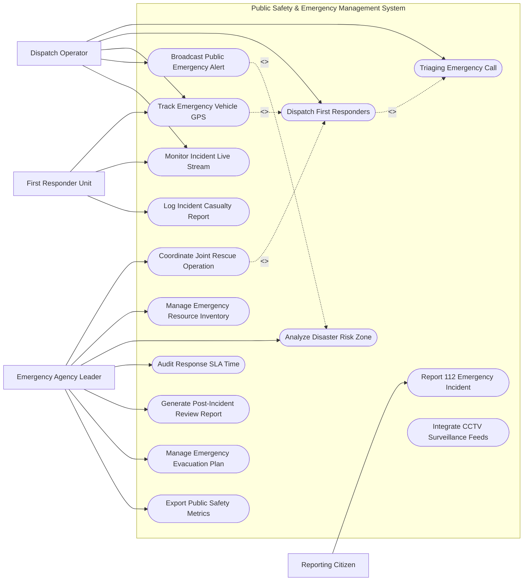

# Use Case Diagram — Public Safety & Emergency Management System

## Mermaid Code

## Actor Table | Bảng Actor

| # | Actor | Actor Type | Role Description | Related Use Cases |
|---|-------|------------|------------------|-------------------|
| 1 | Reporting Citizen | Primary | Người dân gọi điện, gửi tọa độ và hình ảnh báo sự cố khẩn cấp | UC01 |
| 2 | Dispatch Operator | Primary | Điện thoại viên phân loại cuộc gọi khẩn cấp, điều xe và phát cảnh báo | UC02, UC03, UC04, UC05, UC06 |
| 3 | First Responder Unit | Primary | Đội công an, PCCC, cấp cứu di chuyển đến hiện trường và báo cáo | UC04, UC06, UC09 |
| 4 | Emergency Agency Leader | Primary | Lãnh đạo trung tâm chỉ huy điều phối liên ngành, đánh giá SLA | UC07, UC08, UC10, UC11, UC12, UC14, UC15 |

## Use Case Table | Bảng Use Case

| # | UC ID | Use Case Name | Primary Actor | Secondary Actor | Description | Priority |
|---|-------|---------------|---------------|-----------------|-------------|----------|
| 1 | UC01 | Report 112 Emergency Incident | Citizen | - | Báo sự cố qua cuộc gọi 112 hoặc ứng dụng cảnh báo khẩn cấp | High |
| 2 | UC02 | Triaging Emergency Call | Dispatcher | - | Phân loại loại hình sự cố (Cháy, Tội phạm, Cấp cứu) và độ khẩn cấp | High |
| 3 | UC03 | Dispatch First Responders | Dispatcher | FirstResponder | Lập lệnh điều động các lực lượng ứng cứu gần hiện trường nhất | High |
| 4 | UC04 | Track Emergency Vehicle GPS | Dispatcher, Responder | GIS Engine | Theo dõi thời gian thực vị trí và lộ trình xe ứng cứu qua GPS | High |
| 5 | UC05 | Broadcast Public Emergency Alert | Dispatcher | SMS Gateway | Phát tin nhắn cảnh báo khẩn cấp diện rộng (Cell Broadcast) | High |
| 6 | UC06 | Monitor Incident Live Stream | Dispatcher, Responder | CCTV System | Xem trực tiếp camera giao thông/đô thị tại khu vực xảy ra sự cố | Medium |
| 7 | UC07 | Coordinate Joint Rescue Operation | AgencyLead | FirstResponder | Phối hợp tác chiến đa lực lượng (Công an + PCCC + Y tế + Quân đội) | High |
| 8 | UC08 | Manage Emergency Resource Inventory | AgencyLead | - | Quản lý phương tiện, thiết bị cứu hộ, xe chữa cháy và túi máu | Medium |
| 9 | UC09 | Log Incident Casualty Report | FirstResponder | - | Ghi nhận số lượng nạn nhân, mức độ thương vong và hư hại tài sản | High |
| 10 | UC10 | Analyze Disaster Risk Zone | AgencyLead | Weather API | Phân tích vùng nguy cơ bão lũ, sạt lở đất hoặc rò rỉ hóa chất | Medium |
| 11 | UC11 | Audit Response SLA Time | AgencyLead | - | Kiểm toán thời gian phản hồi ứng cứu từ lúc nhận cuộc gọi đến khi tới hiện trường | High |
| 12 | UC12 | Generate Post-Incident Review Report | AgencyLead | - | Lập báo cáo tổng kết và rút kinh nghiệm sau mỗi vụ việc khẩn cấp | Medium |
| 13 | UC13 | Integrate CCTV Surveillance Feeds | SysAdmin | CCTV System | Tích hợp nguồn dữ liệu camera AI phát hiện đám cháy/tai nạn tự động | Medium |
| 14 | UC14 | Manage Emergency Evacuation Plan | AgencyLead | - | Lập sơ đồ và phương án sơ tán dân cư khẩn cấp khi có thảm họa | High |
| 15 | UC15 | Export Public Safety Metrics | SysAdmin | - | Trích xuất báo cáo thống kê tình hình an ninh trật tự và sự cố đô thị | Low |

## Use Case Specification | Đặc tả Use Case

---

### UC01 — Report 112 Emergency Incident

| Field | Detail |
|-------|--------|
| **UC ID** | UC01 |
| **Use Case Name** | Report 112 Emergency Incident |
| **Actor(s)** | Primary: Reporting Citizen / Secondary: None |
| **Description** | Công dân gọi điện tổng đài 112 khẩn cấp hoặc gửi tọa độ GPS, hình ảnh sự cố qua ứng dụng di động An toàn Công cộng. |
| **Precondition** | 1. Có tín hiệu sóng di động hoặc kết nối Internet. |
| **Main Flow** | 1. Citizen thực hiện cuộc gọi khẩn cấp tới 112 hoặc bấm nút SOS trên ứng dụng.   2. System tự động kích hoạt định vị vị trí tọa độ GPS/trạm phát sóng di động (Cell Tower Triangulation).   3. System kết nối cuộc gọi tới Điện thoại viên trung tâm CAD (UC02).   4. Nếu qua ứng dụng: Citizen chọn loại sự cố (Cháy, Tai nạn, Tội phạm) và tải hình ảnh/video trực tiếp.   5. System sinh Mã sự cố khẩn cấp duy nhất (Incident Ticket ID) và phát âm thanh cảnh báo trên màn hình chỉ huy.   6. System gửi tin nhắn tự động xác nhận đã tiếp nhận sự cố cho Citizen kèm mã theo dõi. |
| **Alternative Flow** | **AF1** — Cuộc gọi từ người khuyết tật/nói ngọng: Citizen bấm nút "Báo sự cố im lặng" trên ứng dụng, System tự động gửi tọa độ GPS và thông điệp SOS khẩn cấp tới điện thoại viên mà không cần thoại voice. |
| **Exception Flow** | **EX1** — Cuộc gọi quấy phá/báo tin giả: System nhận diện số điện thoại trong danh sách cảnh báo quấy rối, cảnh báo điện thoại viên khóa tạm thời số điện thoại vi phạm. |
| **Postcondition** | Sự cố được tạo ở trạng thái "Mới tiếp nhận - Chờ phân loại triage", tọa độ hiện trường hiển thị trên bản đồ GIS. |
| **Business Rule** | **BR1**: Thời gian kết nối cuộc gọi khẩn cấp 112 đến điện thoại viên không được vượt quá 3 giây. |

---

### UC02 — Triaging Emergency Call

| Field | Detail |
|-------|--------|
| **UC ID** | UC02 |
| **Use Case Name** | Triaging Emergency Call |
| **Actor(s)** | Primary: Dispatch Operator / Secondary: None |
| **Description** | Điện thoại viên tiếp nhận thông tin sự cố, đánh giá mức độ nghiêm trọng và phân loại loại hình ưu tiên xử lý. |
| **Precondition** | 1. Sự cố mới được khởi tạo từ cuộc gọi công dân (UC01).   2. Dispatcher đang trong phiên làm việc trên giao diện CAD. |
| **Main Flow** | 1. Dispatcher nghe cuộc gọi và xem tọa độ gợi ý trên bản đồ GIS.   2. Dispatcher hỏi thông tin cơ bản: Vị trí chính xác, Loại sự cố, Số người bị thương/mắc kẹt.   3. Dispatcher chọn nhóm sự cố chính: "Hỏa hoạn", "Tai nạn giao thông nghiêm trọng", "Tội phạm có vũ khí", "Cứu nạn sông nước".   4. Dispatcher gán Mức độ ưu tiên: Code Red (Nguy hiểm tính mạng), Code Yellow (Nghiêm trọng), Code Green (Bình thường).   5. System tự động khuyến nghị số lượng lực lượng cần điều động (Ví dụ: Code Red Hỏa hoạn = 3 xe chữa cháy + 1 xe thang + 2 xe cấp cứu).   6. Dispatcher chuyển phiếu sự cố sang bước điều động (UC03). |
| **Alternative Flow** | **AF1** — Sự cố trùng lặp (Nhiều người cùng gọi báo 1 đám cháy): Dispatcher gộp cuộc gọi mới vào Mã sự cố đã có, tránh tạo nhiều vé sự cố trùng lặp. |
| **Exception Flow** | **EX1** — Thông tin vị trí công dân cung cấp sai lệch với GPS: Dispatcher bật tính năng định vị vị trí camera giao thông lân cận để xác minh lại mốc địa lý thực tế. |
| **Postcondition** | Sự cố được gán mã ưu tiên Code Red/Yellow/Green và phân bổ vào hàng đợi điều động khẩn cấp. |
| **Business Rule** | **BR1**: Thời gian phân loại triage sự cố khẩn cấp không được vượt quá 30 giây kể từ khi nghe máy. |

---

### UC03 — Dispatch First Responders

| Field | Detail |
|-------|--------|
| **UC ID** | UC03 |
| **Use Case Name** | Dispatch First Responders |
| **Actor(s)** | Primary: Dispatch Operator / Secondary: First Responder Unit |
| **Description** | Tìm kiếm các đội ứng cứu gần nhất trên bản đồ GIS và phát lệnh điều động xe/lực lượng tới hiện trường. |
| **Precondition** | 1. Sự cố đã được phân loại ưu tiên (UC02).   2. Trạng thái vị trí GPS của các đội ứng cứu được cập nhật liên tục. |
| **Main Flow** | 1. System hiển thị danh sách các đội ứng cứu (Công an, PCCC, Cấp cứu) đang ở trạng thái "Sẵn sàng" trong bán kính gần nhất.   2. Dispatcher xem thời gian dự kiến tới hiện trường (ETA) do hệ thống tính toán dựa trên luồng giao thông.   3. Dispatcher chọn các đơn vị ứng cứu cụ thể và bấm "Phát lệnh xuất xe".   4. System truyền thông điệp lệnh điều động tới màn hình chỉ huy trên xe ứng cứu và thiết bị di động của các chiến sĩ.   5. Đội ứng cứu bấm "Xác nhận nhận lệnh - Đang xuất xe".   6. System tự động bật chế độ theo dõi GPS thời gian thực (UC04) và cập nhật trạng thái sự cố sang "Đang trên đường đến hiện trường". |
| **Alternative Flow** | **AF1** — Đơn vị gần nhất bận: System tự động gợi ý đơn vị ở khu vực lân cận tiếp theo có thời gian di chuyển tối ưu nhất. |
| **Exception Flow** | **EX1** — Đội ứng cứu không bấm xác nhận quá 45 giây: System báo động đỏ âm thanh trên bàn làm việc của Dispatcher, yêu cầu gọi trực tiếp qua đàm vô tuyến. |
| **Postcondition** | Lệnh xuất xe được ban hành chính thức, các đội ứng cứu di chuyển tới hiện trường dưới sự giám sát GPS. |
| **Business Rule** | **BR1**: Thời gian từ khi chốt phân loại đến khi xe ứng cứu xuất phát rời đồn/đội không được quá 60 giây. |

---

### UC04 — Track Emergency Vehicle GPS

| Field | Detail |
|-------|--------|
| **UC ID** | UC04 |
| **Use Case Name** | Track Emergency Vehicle GPS |
| **Actor(s)** | Primary: Dispatch Operator, First Responder Unit / Secondary: None |
| **Description** | Giám sát vị trí GPS thời gian thực của các xe ứng cứu, tự động tính toán lộ trình tối ưu và yêu cầu ưu tiên tín hiệu đèn giao thông. |
| **Precondition** | 1. Lệnh điều động xe đã được kích hoạt (UC03).   2. Thiết bị GPS trên xe ứng cứu đang hoạt động bình thường. |
| **Main Flow** | 1. Thiết bị GPS trên xe ứng cứu truyền tọa độ (với tần suất 1 giây/lần) về trung tâm CAD.   2. System hiển thị biểu tượng xe di chuyển thời gian thực trên bản đồ bản đồ GIS.   3. System tự động tính toán Lộ trình di chuyển ngắn nhất và ít tắc đường nhất.   4. System gửi lộ trình tới màn hình dẫn đường trên xe ứng cứu.   5. System gửi yêu cầu tự động tới Trung tâm Điều khiển Giao thông (Traffic Center) để bật làn sóng xanh (ưu tiên đèn xanh) tại các ngã tư xe sắp đi qua.   6. Khi xe cách hiện trường 50m, System tự động chuyển trạng thái sự cố sang "Đã tới hiện trường". |
| **Alternative Flow** | **AF1** — Tuyến đường dự kiến bị tắc nghẽn đột xuất: System phát hiện tốc độ xe giảm < 10km/h, tự động tính toán tuyến đường vòng tránh khác và cảnh báo tài xế. |
| **Exception Flow** | **EX1** — Tín hiệu GPS xe bị mất (vào hầm/vùng mất sóng): System ước tính vị trí xe theo thuật toán Dead Reckoning dựa trên tốc độ và hướng di chuyển gần nhất. |
| **Postcondition** | Vị trí xe ứng cứu được ghi nhật ký hành trình chính xác, đảm bảo thời gian tiếp cận hiện trường nhanh nhất. |
| **Business Rule** | **BR1**: Độ chễ hiển thị vị trí xe GPS trên bản đồ trung tâm chỉ huy không được vượt quá 1.5 giây. |

---

### UC05 — Broadcast Public Emergency Alert

| Field | Detail |
|-------|--------|
| **UC ID** | UC05 |
| **Use Case Name** | Broadcast Public Emergency Alert |
| **Actor(s)** | Primary: Dispatch Operator / Secondary: Cell Broadcast SMS Provider |
| **Description** | Phát tin nhắn thông báo cảnh báo khẩn cấp diện rộng tới toàn bộ các thuê bao di động nằm trong tọa độ vùng nguy hiểm. |
| **Precondition** | 1. Xảy ra thảm họa thiên tai, rò rỉ hóa chất độc hại, cháy lớn hoặc sự cố an ninh nghiêm trọng.   2. Được sự đồng ý phê duyệt của Lãnh đạo trung tâm chỉ huy. |
| **Main Flow** | 1. Dispatcher hoặc AgencyLead khoanh vùng khu vực nguy hiểm trên bản đồ GIS (Geo-fencing).   2. Dispatcher chọn mẫu tin nhắn cảnh báo khẩn cấp (Ví dụ: "CẢNH BÁO CHÁY LỚN: Yêu cầu cư dân khu vực X sơ tán ngay theo hướng Y").   3. AgencyLead thực hiện duyệt lệnh phát cảnh báo bằng chữ ký số.   4. System truyền thông điệp cảnh báo tới hệ thống Cell Broadcast của các nhà mạng viễn thông.   5. Tất cả điện thoại di động nằm trong vùng địa lý khoanh vùng đồng loạt phát âm thanh báo động khẩn cấp và hiển thị nội dung cảnh báo.   6. System thống kê số lượng thuê bao đã nhận được tin nhắn cảnh báo theo thời gian thực. |
| **Alternative Flow** | **AF1** — Cảnh báo theo thời tiết thiên tai tự động: System kết nối dữ liệu báo bão từ Trung tâm Khí tượng, tự động khoanh vùng dự báo và đề xuất nội dung cảnh báo cho chỉ huy duyệt. |
| **Exception Flow** | **EX1** — Nghẽn mạng viễn thông: Thuật toán Cell Broadcast truyền tin qua kênh điều khiển (Control Channel) không phụ thuộc vào hạ tầng thoại/data nên vẫn phát thành công ngay cả khi nghẽn mạng. |
| **Postcondition** | Người dân trong vùng nguy hiểm nhận được cảnh báo kịp thời để chủ động phòng tránh và sơ tán. |
| **Business Rule** | **BR1**: Tin nhắn Cell Broadcast cảnh báo khẩn cấp phải đến được điện thoại người dân trong vùng khoanh vùng trong vòng tối đa 10 giây. |
