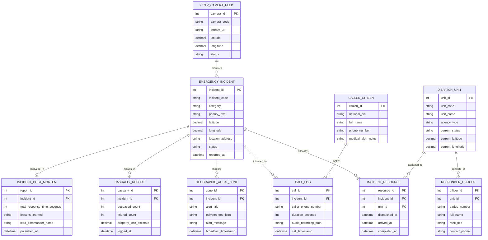

# Conceptual ERD — Public Safety & Emergency Management System

## Mermaid Code

## Entity Description Table | Bảng mô tả Entity

| # | Entity Name | Vietnamese Name | Description | Key Attributes | Main Relationships |
|---|-------------|-----------------|-------------|----------------|-------------------|
| 1 | EMERGENCY_INCIDENT | Sự cố Khẩn cấp | Thông tin hồ sơ vụ việc khẩn cấp (vị trí, loại hình, mức độ ưu tiên) | incident_id, incident_code, category, priority_level, status | Initiated by CALL_LOG, allocates INCIDENT_RESOURCE |
| 2 | CALL_LOG | Nhật ký Cuộc gọi Báo án | Thông tin cuộc gọi khẩn cấp 112/113/114/115 từ công dân | call_id, caller_phone_number, duration_seconds, audio_recording_path | Belongs to EMERGENCY_INCIDENT, CALLER_CITIZEN |
| 3 | CALLER_CITIZEN | Công dân Báo tin | Thông tin người gọi điện báo sự cố khẩn cấp | citizen_id, national_pin, full_name, phone_number | Makes CALL_LOG |
| 4 | DISPATCH_UNIT | Đơn vị / Xe Ứng cứu | Thông tin lực lượng ứng cứu (xe chữa cháy, xe cấp cứu, tổ công an) | unit_id, unit_code, agency_type, current_status | Assigned to INCIDENT_RESOURCE, consists of OFFICER |
| 5 | RESPONDER_OFFICER | Chiến sĩ / Cán bộ Ứng cứu | Thông tin cán bộ chiến sĩ tham gia trực tiếp ứng cứu sự cố | officer_id, badge_number, full_name, rank_title | Belongs to DISPATCH_UNIT |
| 6 | INCIDENT_RESOURCE | Phân bổ Lực lượng Sự cố | Nhật ký thời gian điều động, thời gian đến hiện trường của từng xe | resource_id, dispatched_at, arrived_at, completed_at | Belongs to EMERGENCY_INCIDENT, DISPATCH_UNIT |
| 7 | GEOGRAPHIC_ALERT_ZONE | Vùng Cảnh báo Khẩn cấp | Vùng khoanh vùng địa lý để phát tin nhắn SMS khẩn cấp diện rộng | zone_id, polygon_geo_json, alert_message, broadcast_timestamp | Belongs to EMERGENCY_INCIDENT |
| 8 | CASUALTY_REPORT | Báo cáo Thương vong Tài sản | Thống kê số người chết, bị thương và thiệt hại tài sản tại hiện trường | casualty_id, deceased_count, injured_count, property_loss_estimate | Belongs to EMERGENCY_INCIDENT |
| 9 | CCTV_CAMERA_FEED | Camera Giám sát Đô thị | Nguồn luồng video camera giao thông/đô thị kết nối khu vực | camera_id, camera_code, stream_url, latitude, longitude | Monitors EMERGENCY_INCIDENT |
| 10 | INCIDENT_POST_MORTEM | Báo cáo Tổng kết Sự cố | Báo cáo đánh giá rút kinh nghiệm và kiểm toán thời gian phản hồi SLA | report_id, total_response_time_seconds, lessons_learned | Belongs to EMERGENCY_INCIDENT |

## Relationship Description | Mô tả Quan hệ

| # | From Entity | Cardinality | To Entity | Relationship Label | Business Explanation |
|---|-------------|-------------|-----------|-------------------|----------------------|
| 1 | EMERGENCY_INCIDENT | one-to-many | CALL_LOG | initiated_by | Một sự cố khẩn cấp có thể có nhiều cuộc gọi từ nhiều người dân báo tin |
| 2 | CALLER_CITIZEN | one-to-many | CALL_LOG | makes | Một công dân có thể thực hiện nhiều cuộc gọi báo tin khẩn cấp |
| 3 | EMERGENCY_INCIDENT | one-to-many | INCIDENT_RESOURCE | allocates | Một sự cố được điều động phân bổ nhiều lực lượng/phương tiện ứng cứu |
| 4 | DISPATCH_UNIT | one-to-many | INCIDENT_RESOURCE | assigned_to | Một đơn vị ứng cứu có thể được phân công tham gia nhiều sự cố lịch sử |
| 5 | DISPATCH_UNIT | one-to-many | RESPONDER_OFFICER | consists_of | Một đơn vị ứng cứu bao gồm nhiều cán bộ chiến sĩ tham gia |
| 6 | EMERGENCY_INCIDENT | one-to-many | GEOGRAPHIC_ALERT_ZONE | triggers | Một sự cố nghiêm trọng có thể kích hoạt nhiều đợt khoanh vùng cảnh báo |
| 7 | EMERGENCY_INCIDENT | one-to-many | CASUALTY_REPORT | results_in | Một sự cố ghi nhận các bản cập nhật báo cáo thiệt hại thương vong |
| 8 | EMERGENCY_INCIDENT | one-to-one | INCIDENT_POST_MORTEM | analyzed_in | Một sự cố sau khi hoàn thành sinh ra một báo cáo kiểm toán tổng kết |
| 9 | CCTV_CAMERA_FEED | one-to-many | EMERGENCY_INCIDENT | monitors | Một camera giao thông có thể được sử dụng quan sát nhiều sự cố khu vực |
