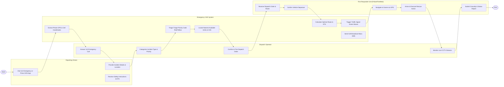

# Swimlane Diagram — Public Safety & Emergency Management System

## Mermaid Code

## Flow Description | Mô tả luồng

| Lane | Actor | Role in Flow |
|------|-------|-------------|
| 1 | Reporting Citizen | Gọi 112 hoặc bấm SOS trên ứng dụng, cung cấp địa điểm và mô tả sự cố khẩn cấp, nhận hướng dẫn an toàn. |
| 2 | Emergency CAD System | Tự động định vị GPS cuộc gọi, phân loại ưu tiên, tìm đơn vị gần nhất trên GIS, dẫn đường xe, ưu tiên đèn giao thông và phát tin khẩn cấp. |
| 3 | Dispatch Operator | Nghe cuộc gọi khẩn cấp, xác định loại sự cố và mức độ nguy hiểm, phê duyệt lệnh xuất xe và theo dõi camera khu vực. |
| 4 | First Responder Unit | Nhận lệnh điều động và lộ trình dẫn đường, xuất xe di chuyển tới hiện trường, thực hiện cứu hộ và cập nhật báo cáo thương vong. |
