# Action Tree — Public Safety & Emergency Management System

## Mermaid Code

```mermaid
graph TD
    Root["Public Safety & Emergency Management System"]

    Root --> M1["Incident Intake & Call Triage"]
    Root --> M2["Resource Dispatch & Navigation"]
    Root --> M3["Multi-Agency Coordination"]
    Root --> M4["Public Alerting & Mass Broadcast"]
    Root --> M5["Sensor & CCTV Integration"]
    Root --> M6["Analytics & Response SLA Audit"]

    M1 --> A11["Receive 112 Voice & App SOS Calls"]
    M1 --> A12["Extract GPS Cell Tower Location"]
    M1 --> A13["Triage Incident Severity Level"]
    M1 --> A14["Detect Duplicate Incident Calls"]

    M2 --> A21["Locate Nearest Available Units GIS"]
    M2 --> A22["Issue Vehicle Departure Dispatch"]
    M2 --> A23["Calculate Real-time Optimal Route"]
    M2 --> A24["Trigger Traffic Green Wave Priority"]

    M3 --> A31["Coordinate Police Fire Medical Units"]
    M3 --> A32["Share Live Scene Status Updates"]
    M3 --> A33["Manage Emergency Resource Inventory"]
    M3 --> A34["Log Field Casualty & Loss Data"]

    M4 --> A41["Define Geofenced Danger Zone"]
    M4 --> A42["Broadcast Cell Broadcast SMS Alert"]
    M4 --> A43["Push Evacuation Route Instructions"]
    M4 --> A44["Track Mass Alert Delivery Metrics"]

    M5 --> A51["Stream Citywide CCTV Traffic Feeds"]
    M5 --> A52["Detect Smoke Fire via AI Camera"]
    M5 --> A53["Integrate Flood Sensor Telemetry"]
    M5 --> A54["Query Building Hydrant Blueprints"]

    M6 --> A61["Audit Call to Scene Response SLA"]
    M6 --> A62["Generate Post-Incident Review"]
    M6 --> A63["Analyze Crime & Incident Hotspots"]
    M6 --> A64["Export Public Safety Metrics"]
```

## Module Description | Mô tả Module

| # | Module | Description | Actions |
|---|--------|-------------|---------|
| 1 | Incident Intake & Call Triage | Tiếp nhận cuộc gọi 112 khẩn cấp, tự động định vị GPS vị trí báo án và phân loại mức độ khẩn cấp | Receive 112 Voice & App SOS Calls, Extract GPS Cell Tower Location, Triage Incident Severity Level, Detect Duplicate Incident Calls |
| 2 | Resource Dispatch & Navigation | Tìm kiếm xe/đội ứng cứu gần nhất trên bản đồ GIS, phát lệnh xuất xe, dẫn đường và ưu tiên đèn giao thông | Locate Nearest Available Units GIS, Issue Vehicle Departure Dispatch, Calculate Real-time Optimal Route, Trigger Traffic Green Wave Priority |
| 3 | Multi-Agency Coordination | Điều phối phối hợp tác chiến giữa Công an, PCCC và Cấp cứu y tế, quản lý thiết bị và báo cáo thương vong | Coordinate Police Fire Medical Units, Share Live Scene Status Updates, Manage Emergency Resource Inventory, Log Field Casualty & Loss Data |
| 4 | Public Alerting & Mass Broadcast | Khoanh vùng nguy hiểm địa lý (Geo-fencing) và phát tin nhắn thông báo cảnh báo khẩn cấp diện rộng | Define Geofenced Danger Zone, Broadcast Cell Broadcast SMS Alert, Push Evacuation Route Instructions, Track Mass Alert Delivery Metrics |
| 5 | Sensor & CCTV Integration | Kết nối luồng camera giám sát giao thông đô thị, phát hiện cháy/ngập bằng AI và tra cứu sơ đồ PCCC | Stream Citywide CCTV Traffic Feeds, Detect Smoke Fire via AI Camera, Integrate Flood Sensor Telemetry, Query Building Hydrant Blueprints |
| 6 | Analytics & Response SLA Audit | Kiểm toán thời gian phản hồi ứng cứu SLA, lập báo cáo rút kinh nghiệm vụ việc và phân tích vùng nguy cơ | Audit Call to Scene Response SLA, Generate Post-Incident Review, Analyze Crime & Incident Hotspots, Export Public Safety Metrics |
