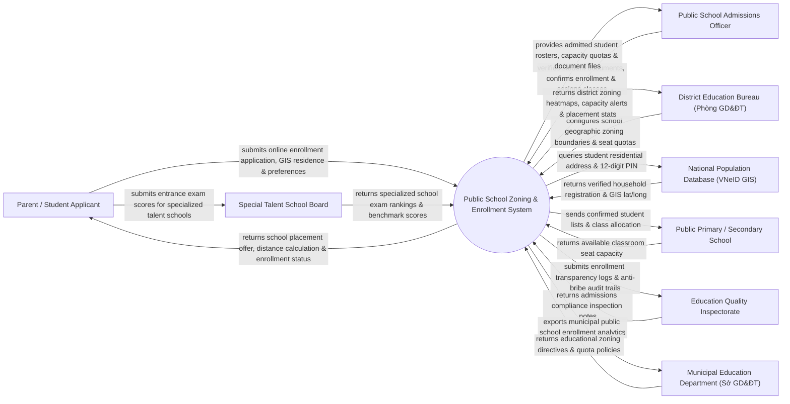

# Context Diagram — Public School Zoning & Enrollment System

## Mermaid Code

## Actor & Interaction Table | Bảng Actor & Tương tác

| # | Actor | Actor Type | Data Sent TO System | Data Received FROM System | Notes |
|---|-------|------------|---------------------|---------------------------|-------|
| 1 | Parent / Student Applicant | Primary | Online enrollment form, VNeID household GIS location, school choices | School placement offer, GIS distance, enrollment admission confirmation | Phụ huynh và học sinh nộp hồ sơ tuyển sinh mầm non, lớp 1, lớp 6, lớp 10 |
| 2 | Public School Admissions Officer | Primary | Document verification status, class assignment, seat confirmation | Admitted student rosters, capacity quotas, verified document files | Hội đồng tuyển sinh các trường phổ thông công lập |
| 3 | District Education Bureau (Phòng GD&ĐT) | Primary | School geographic zoning polygons, seat quotas, priority rules | District zoning heatmaps, capacity alerts, placement stats | Phòng Giáo dục & Đào tạo Quận/Huyện quản lý phân tuyến |
| 4 | National Population Database (VNeID GIS) | Supporting | Verified household registration address, GPS coordinates | Student PIN identity verification query requests | Cơ sở dữ liệu quốc gia về dân cư xác thực nơi cư trú thực tế |
| 5 | Public Primary / Secondary School | Supporting | Available classroom seat capacity, teacher count | Confirmed student intake lists, class allocation manifests | Các trường mầm non, tiểu học, THCS, THPT công lập |
| 6 | Special Talent School Board | Supporting | Specialized school exam rankings, benchmark admission scores | Talent applicant list, entrance exam score imports | Hội đồng tuyển sinh các trường chuyên / năng khiếu |
| 7 | Education Quality Inspectorate | Regulatory | Admissions compliance inspection notes | Enrollment transparency logs, anti-bribe audit trails | Thanh tra Giáo dục kiểm tra chống chạy trường, chạy tuyến |
| 8 | Municipal Education Department (Sở GD&ĐT) | Regulatory | Educational zoning directives, municipal quota policies | Municipal public school enrollment analytics, BI dashboards | Sở Giáo dục & Đào tạo chỉ đạo công tác tuyển sinh toàn tỉnh/thành |

## System Boundary Description | Mô tả Phạm vi Hệ thống

Hệ thống Public School Zoning & Enrollment System (Hệ thống Phân tuyến và Tuyển sinh Trường Công lập / Tuyển sinh Đã ngoại) chịu trách nhiệm tự động hóa quy trình tuyển sinh đầu cấp (Mầm non, Lớp 1, Lớp 6, Lớp 10): Xác thực nơi cư trú thực tế của học sinh bằng bản đồ GIS kết nối VNeID, tự động phân tuyến trường học gần nhà nhất (tránh "chạy tuyến"), quản lý chỉ tiêu tuyển sinh từng trường, tổ chức phân bổ học sinh tự động, tiếp nhận kết quả thi tuyển sinh trường chuyên và công khai kết quả tuyển sinh. Tuy nhiên, hệ thống KHÔNG trực tiếp tổ chức coi thi/chấm thi giấy và KHÔNG thay thế việc giảng dạy tại nhà trường.
