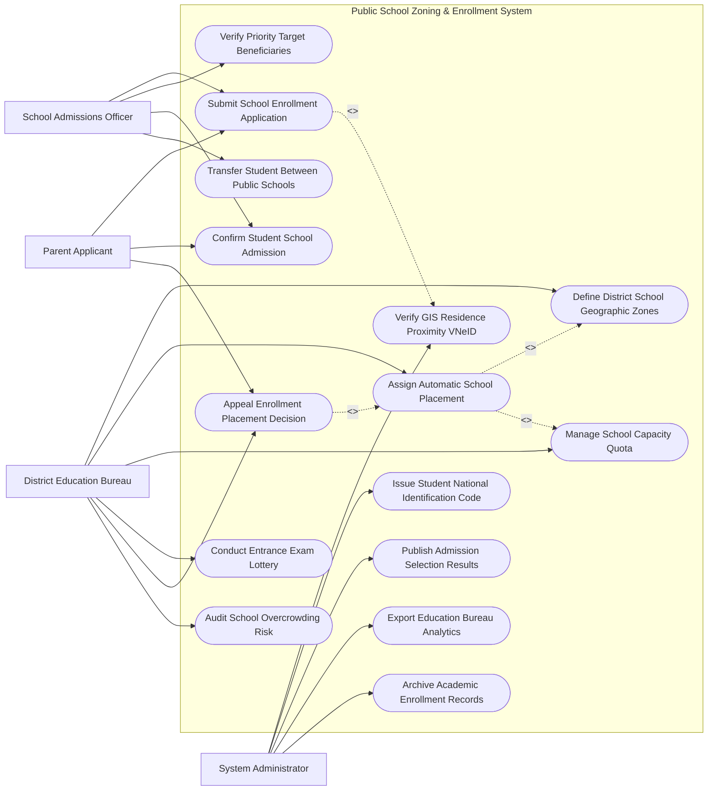

# Use Case Diagram — Public School Zoning & Enrollment System

## Mermaid Code

## Actor Table | Bảng Actor

| # | Actor | Actor Type | Role Description | Related Use Cases |
|---|-------|------------|------------------|-------------------|
| 1 | Parent Applicant | Primary | Phụ huynh nộp hồ sơ tuyển sinh trực tuyến, xác nhận nhập học và nộp đơn phúc khảo/khiếu nại | UC01, UC08, UC09 |
| 2 | School Admissions Officer | Primary | Cán bộ tuyển sinh nhà trường duyệt hồ sơ, kiểm tra đối tượng ưu tiên và chuyển trường | UC01, UC05, UC08, UC10 |
| 3 | District Education Bureau | Primary | Phòng GD&ĐT vẽ bản đồ phân tuyến địa lý, phân bổ chỉ tiêu, duyệt danh sách trúng tuyển | UC03, UC04, UC06, UC07, UC09, UC11 |
| 4 | System Administrator | System | Quản trị viên đối soát GIS VNeID, cấp mã định danh học sinh, công khai kết quả và xuất báo cáo | UC02, UC12, UC13, UC14, UC15 |

## Use Case Table | Bảng Use Case

| # | UC ID | Use Case Name | Primary Actor | Secondary Actor | Description | Priority |
|---|-------|---------------|---------------|-----------------|-------------|----------|
| 1 | UC01 | Submit School Enrollment Application | Parent | School, VNeID | Nộp hồ sơ đăng ký tuyển sinh đầu cấp (Lớp 1, 6, 10) trực tuyến kèm nguyện vọng | High |
| 2 | UC02 | Verify GIS Residence Proximity VNeID | System | VNeID GIS | Tự động đo khoảng cách đường bộ từ nhà học sinh tới các trường học bằng GIS | High |
| 3 | UC03 | Define District School Geographic Zones | Bureau | GIS Engine | Vẽ vùng ranh giới phân tuyến địa lý (Zoning Polygons) cho từng trường công lập | High |
| 4 | UC04 | Assign Automatic School Placement | Bureau | System | Thuật toán tự động phân bổ học sinh vào trường đúng tuyến địa lý gần nhà nhất | High |
| 5 | UC05 | Verify Priority Target Beneficiaries | School | - | Xác minh cộng điểm ưu tiên (Con thương binh, hộ nghèo, học sinh giỏi quốc gia) | High |
| 6 | UC06 | Manage School Capacity Quota | Bureau | School | Phê duyệt chỉ tiêu tuyển sinh (Số lớp, số học sinh/lớp) của từng trường công | High |
| 7 | UC07 | Conduct Entrance Exam Lottery | Bureau | - | Tổ chức bốc thăm công khai hoặc lọc điểm xét tuyển khi số đăng ký vượt chỉ tiêu | Medium |
| 8 | UC08 | Confirm Student School Admission | Parent | School | Phụ huynh xác nhận nhập học trực tuyến và hoàn tất thủ tục nộp hồ sơ gốc | High |
| 9 | UC09 | Appeal Enrollment Placement Decision | Parent | Bureau | Tiếp nhận và giải quyết khiếu nại/phúc khảo kết quả phân tuyến trường học | Medium |
| 10 | UC10 | Transfer Student Between Public Schools | School | Bureau | Xử lý thủ tục chuyển trường cho học sinh khi gia đình thay đổi nơi cư trú | Medium |
| 11 | UC11 | Audit School Overcrowding Risk | Bureau | Inspectorate | Phân tích rủi ro sĩ số quá tải ($> 45$ học sinh/lớp) và điều chỉnh ranh giới tuyến | High |
| 12 | UC12 | Issue Student National Identification Code | System | MOET | Cấp Mã định danh học sinh toàn quốc (Student ID) thống nhất trên CSDL Bộ GD&ĐT | High |
| 13 | UC13 | Publish Admission Selection Results | System | Parent | Công khai danh sách học sinh trúng tuyển trên Cổng thông tin tuyển sinh | High |
| 14 | UC14 | Export Education Bureau Analytics | Admin | Executive | Trích xuất báo cáo tỷ lệ phân tuyến đúng tuyến và nộp Sở GD&ĐT | Low |
| 15 | UC15 | Archive Academic Enrollment Records | System | Archives | Đóng gói và lưu trữ vĩnh viễn hồ sơ tuyển sinh đầu cấp theo năm học | Low |

## Use Case Specification | Đặc tả Use Case

---

### UC01 — Submit School Enrollment Application

| Field | Detail |
|-------|--------|
| **UC ID** | UC01 |
| **Use Case Name** | Submit School Enrollment Application |
| **Actor(s)** | Primary: Parent Applicant / Secondary: School Admissions Officer, VNeID |
| **Description** | Phụ huynh thực hiện đăng ký tuyển sinh đầu cấp trực tuyến cho con, hệ thống tự động điền nơi cư trú và gợi ý trường đúng tuyến. |
| **Precondition** | 1. Đang trong thời gian mở Cổng đăng ký tuyển sinh đầu cấp theo kế hoạch của Sở GD&ĐT. |
| **Main Flow** | 1. Parent truy cập Cổng Tuyển sinh Đầu cấp Trực tuyến.   2. Parent đăng nhập bằng tài khoản VNeID của Cha/Mẹ hoặc Mã định danh học sinh.   3. System tự động liên kết CSDL Dân cư trích xuất: Họ tên học sinh, Ngày sinh, Số định danh cá nhân, Địa chỉ thường trú và Nơi ở hiện tại.   4. System tự động đo khoảng cách GIS (UC02) và hiển thị "Trường Công lập Đúng tuyến Địa lý" gần nhà nhất.   5. Parent kiểm tra thông tin, chọn Đăng ký đúng tuyến (hoặc chọn Đăng ký nguyện vọng trái tuyến/trường chuyên).   6. Parent tải lên tệp chứng cứ ưu tiên (nếu có: Giấy chứng nhận hộ nghèo, con liệt sĩ).   7. Parent bấm "Nộp hồ sơ": System cấp Mã hồ sơ tuyển sinh (Enrollment Ticket ID) và phát hành Giấy biên nhận hồ sơ điện tử. |
| **Alternative Flow** | **AF1** — Đăng ký trường THPT Chuyên / Năng khiếu: Parent nhập thêm báo điểm thi tuyển sinh lớp 10 các môn chuyên. |
| **Exception Flow** | **EX1** — Nơi ở thực tế chưa được cập nhật trên VNeID: System yêu cầu nộp Giấy xác nhận thông tin về cư trú (Mẫu CT07) kèm bản đồ định vị. |
| **Postcondition** | Hồ sơ tuyển sinh được ghi nhận vào Sổ tiếp nhận, sẵn sàng cho khâu phân bổ tự động (UC04). |
| **Business Rule** | **BR1**: Mỗi học sinh chỉ được nộp 01 hồ sơ đăng ký tuyển sinh đúng tuyến vào 01 trường công lập theo ranh giới địa lý. |

---

### UC02 — Verify GIS Residence Proximity VNeID

| Field | Detail |
|-------|--------|
| **UC ID** | UC02 |
| **Use Case Name** | Verify GIS Residence Proximity VNeID |
| **Actor(s)** | Primary: System Administrator / Secondary: VNeID GIS Engine |
| **Description** | Hệ thống tự động tính toán khoảng cách đường bộ thực tế từ tọa độ nhà học sinh tới các trường công lập bằng bản đồ GIS. |
| **Precondition** | 1. Địa chỉ nhà học sinh được xác thực từ CSDL VNeID. |
| **Main Flow** | 1. System trích xuất tọa độ GPS (Latitude, Longitude) nhà học sinh từ CSDL VNeID GIS.   2. System lấy tọa độ GPS vị trí của các trường mầm non, tiểu học, THCS trong Quận/Huyện.   3. System sử dụng thuật toán Dijkstra trên bản đồ giao thông đường bộ tính khoảng cách thực tế ($Distance\_km$).   4. System kiểm tra xem tọa độ nhà học sinh có nằm trong Đa giác phân tuyến (Zoning Polygon - UC03) của trường A hay không.   5. If Nằm trong polygon và $Distance \le 2.0\,km$: System xếp loại "Đúng tuyến tuyệt đối (Độ ưu tiên 1)".   6. If Nằm ngoài polygon nhưng $Distance$ gần nhất: System xếp loại "Đúng tuyến mở rộng (Độ ưu tiên 2)".   7. System trả kết quả khoảng cách và độ ưu tiên về màn hình đăng ký tuyển sinh (UC01). |
| **Alternative Flow** | **AF1** — Học sinh sống tại vùng giáp ranh giữa 2 quận: System tự động đề xuất 2 trường gần nhất thuộc cả 2 quận cho phụ huynh lựa chọn. |
| **Exception Flow** | **EX1** — Tọa độ nhà nằm trong khu vực chưa có tên đường trên bản đồ: System yêu cầu phụ huynh ghim vị trí chính xác trên bản đồ vệ tinh. |
| **Postcondition** | Khoảng cách GIS chính xác được ghi nhận làm căn cứ minh bạch để xét tuyển đúng tuyến, phòng chống tiêu cực. |
| **Business Rule** | **BR1**: Khoảng cách phân tuyến phải được tính theo đường giao thông thực tế di chuyển, không tính theo đường chim bay. |

---

### UC03 — Define District School Geographic Zones

| Field | Detail |
|-------|--------|
| **UC ID** | UC03 |
| **Use Case Name** | Define District School Geographic Zones |
| **Actor(s)** | Primary: District Education Bureau (Phòng GD&ĐT) / Secondary: GIS Engine |
| **Description** | Cán bộ Phòng Giáo dục vẽ ranh giới tuyến địa lý (Zoning Polygons) cho từng trường công lập trên bản đồ GIS trước mùa tuyển sinh. |
| **Precondition** | 1. Đã có thống kê số lượng trẻ trong độ tuổi đến trường trên từng Tổ dân phố/Phường. |
| **Main Flow** | 1. Bureau Trưởng phòng mở Bản đồ Phân tuyến Tuyển sinh Giáo dục Quận/Huyện.   2. System hiển thị mật độ trẻ em độ tuổi đến trường theo từng Phường/Tổ dân phố.   3. Bureau chọn trường Tiểu học/THCS A và số chỉ tiêu tuyển sinh được giao (Ví dụ: 400 học sinh).   4. Bureau dùng công cụ vẽ bản đồ GIS khoanh vùng Đa giác phân tuyến (Polygon Zone) bao gồm các Tổ dân phố 1, 2, 3, 4.   5. System tự động tính tổng số trẻ trong đa giác vừa vẽ ($Total\_Children$).   6. If $Total\_Children \le Capacity\_Quota$: System báo nhãn Màu Xanh "Cân đối chỉ tiêu".   7. If $Total\_Children > Capacity\_Quota$: System báo nhãn Màu Đỏ "Nguy cơ quá tải", yêu cầu điều chỉnh ranh giới.   8. Bureau ký số phê duyệt Bản đồ phân tuyến địa lý chính thức của Quận/Huyện. |
| **Alternative Flow** | **AF1** — Điều chỉnh tuyến do có trường mới thành lập: Bureau chia lại ranh giới đa giác của các trường lân cận để san sẻ chỉ tiêu. |
| **Exception Flow** | **EX1** — Ranh giới 2 trường bị đè lên nhau (Overlap): System báo lỗi "Trùng lặp vùng phân tuyến", yêu cầu chỉnh sửa lại các điểm mốc đa giác. |
| **Postcondition** | Bản đồ phân tuyến địa lý được ban hành chính thức, làm căn cứ cho thuật toán phân bổ học sinh tự động (UC04). |
| **Business Rule** | **BR1**: 100% trẻ em trong độ tuổi đi học trên địa bàn quận/huyện phải nằm trong ít nhất 01 đa giác phân tuyến trường công lập. |

---

### UC04 — Assign Automatic School Placement

| Field | Detail |
|-------|--------|
| **UC ID** | UC04 |
| **Use Case Name** | Assign Automatic School Placement |
| **Actor(s)** | Primary: District Education Bureau / Secondary: System Placement Engine |
| **Description** | Thuật toán tự động chạy phân bổ toàn bộ học sinh vào các trường công lập đúng tuyến địa lý dựa trên các quy tắc ưu tiên. |
| **Precondition** | 1. Đã hết hạn nộp hồ sơ đăng ký tuyển sinh trực tuyến (UC01).   2. Bản đồ phân tuyến (UC03) và Chỉ tiêu các trường (UC06) đã được chốt. |
| **Main Flow** | 1. Bureau kích hoạt Tiến trình Phân bổ Tuyển sinh Tự động Toàn Quận.   2. Placement Engine gom toàn bộ hồ sơ tuyển sinh đã nộp.   3. Engine sắp xếp thứ tự ưu tiên xét tuyển cho từng trường:   - Ưu tiên 1: Học sinh có hộ khẩu thường trú + Nơi ở thực tế trong đa giác phân tuyến.   - Ưu tiên 2: Học sinh thuộc đối tượng chính sách/ưu tiên (UC05).   - Ưu tiên 3: Khoảng cách GIS từ nhà tới trường ngắn nhất (UC02).   4. Engine tiến hành gán học sinh vào danh sách trúng tuyển của trường từ trên xuống dưới cho đến khi hết chỉ tiêu.   5. If Số lượng Ưu tiên 1 vượt chỉ tiêu trường: Engine kích hoạt Use Case Bốc thăm/Xét tuyển công khai (UC07) hoặc tự động chuyển sang trường giáp ranh gần nhất.   6. Bureau kiểm tra danh sách phân bổ toàn quận và bấm "Phê duyệt Kết quả Phân tuyến".   7. System gửi thông báo kết quả trúng tuyển trúng tuyến tới tài khoản VNeID của Phụ huynh (UC13). |
| **Alternative Flow** | **AF1** — Học sinh nộp nguyện vọng Trái tuyến: Engine chỉ xét tuyển trái tuyến sau khi trường đã nhận đủ 100% học sinh đúng tuyến mà vẫn còn thừa chỉ tiêu. |
| **Exception Flow** | **EX1** — Học sinh bị sót chưa được phân bổ vào trường nào: System cảnh báo danh sách "Học sinh văng tuyến", yêu cầu Bureau chỉ định thủ công vào trường còn dư chỉ tiêu. |
| **Postcondition** | 100% học sinh đúng tuyến được xếp chỗ học công lập, công khai minh bạch danh sách trúng tuyển. |
| **Business Rule** | **BR1**: Phải ưu tiên tiếp nhận 100% học sinh đúng tuyến cư trú trên địa bàn trước khi xét tuyển học sinh trái tuyến. |

---

### UC08 — Confirm Student School Admission

| Field | Detail |
|-------|--------|
| **UC ID** | UC08 |
| **Use Case Name** | Confirm Student School Admission |
| **Actor(s)** | Primary: Parent Applicant, School Admissions Officer / Secondary: None |
| **Description** | Phụ huynh xác nhận nhập học trực tuyến và đến trường nộp hồ sơ bản cứng để nhà trường xếp lớp học chính thức. |
| **Precondition** | 1. Học sinh đã có tên trong Danh sách trúng tuyển được công bố (UC04, UC13). |
| **Main Flow** | 1. Parent nhận tin nhắn thông báo trúng tuyển trên ứng dụng di động / VNeID.   2. Parent mở mục "Xác nhận nhập học" và bấm nút "Xác nhận Nhập học Trực tuyến".   3. System ghi nhận trạng thái "Đã xác nhận nhập học thành công", khóa hồ sơ không cho phép xác nhận ở trường khác.   4. System cấp Mã nhập học (Admission QR Code) và lịch hẹn đến trường làm thủ tục.   5. Parent mang Mã QR và hồ sơ bản gốc (Giấy khai sinh, Học bạ) đến trường theo lịch hẹn.   6. SchoolOfficer quét mã QR, đối chiếu hồ sơ bản gốc vs Hồ sơ điện tử.   7. SchoolOfficer xác nhận "Đã tiếp nhận bản cứng" và phân bổ học sinh vào Lớp học (Ví dụ: Lớp 1A1, Lớp 6A2).   8. System cấp Mã định danh học sinh chính thức (UC12) và ghi tên học sinh vào Sổ điểm điện tử của trường. |
| **Alternative Flow** | **AF1** — Phụ huynh từ chối nhập học (Học trường tư thục/Chuyển đi nơi khác): Parent bấm "Từ chối nhập học", System giải phóng chỉ tiêu đó để trường tuyển bổ sung. |
| **Exception Flow** | **EX1** — Quá thời hạn xác nhận nhập học (Quá 03 ngày): System tự động chuyển trạng thái thành "Hủy kết quả do quá hạn", thông báo cho phụ huynh. |
| **Postcondition** | Học sinh chính thức trở thành học sinh của nhà trường, danh sách lớp học được hoàn tất. |
| **Business Rule** | **BR1**: Học sinh chỉ được xác nhận nhập học duy nhất tại 01 trường công lập trong cùng một năm học. |
