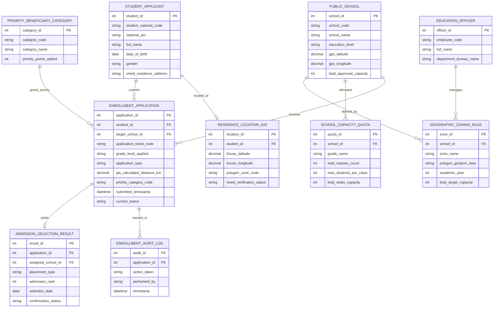

# Conceptual ERD — Public School Zoning & Enrollment System

## Mermaid Code

## Entity Description Table | Bảng mô tả Entity

| # | Entity Name | Vietnamese Name | Description | Key Attributes | Main Relationships |
|---|-------------|-----------------|-------------|----------------|-------------------|
| 1 | STUDENT_APPLICANT | Học sinh Đăng ký Tuyển sinh | Thông tin nhân thân, mã định danh và ngày sinh của học sinh mầm non/phổ thông | student_id, student_national_code, full_name, vneid_residence_address | Submits APPLICATION, located at RESIDENCE_LOCATION_GIS |
| 2 | ENROLLMENT_APPLICATION | Hồ sơ Đăng ký Tuyển sinh | Đơn đăng ký tuyển sinh đầu cấp trực tuyến kèm khoảng cách GIS và nguyện vọng | application_id, application_ticket_code, grade_level_applied, current_status | Belongs to STUDENT, SCHOOL, yields ADMISSION_RESULT |
| 3 | GEOGRAPHIC_ZONING_RULE | Quy định Phân tuyến Địa lý | Ranh giới đa giác địa lý (GIS Polygon) phân tuyến tuyển sinh cho từng trường | zone_id, zone_name, polygon_geojson_data, total_target_capacity | Defined by PUBLIC_SCHOOL, managed by OFFICER |
| 4 | PUBLIC_SCHOOL | Trường Phổ thông Công lập | Thông tin trường mầm non, tiểu học, THCS, THPT công lập và vị trí GPS | school_id, school_code, school_name, education_level, total_approved_capacity | Defined by ZONING_RULE, allocated QUOTA |
| 5 | RESIDENCE_LOCATION_GIS | Tọa độ Cư trú GIS | Tọa độ GPS nơi ở thực tế của học sinh trích xuất từ CSDL Dân cư VNeID | location_id, house_latitude, house_longitude, vneid_verification_status | Belongs to STUDENT_APPLICANT |
| 6 | ADMISSION_SELECTION_RESULT | Kết quả Trúng tuyển | Kết quả phân bổ trường học trúng tuyển và trạng thái xác nhận nhập học | result_id, placement_type, admission_rank, confirmation_status | Belongs to ENROLLMENT_APPLICATION, PUBLIC_SCHOOL |
| 7 | SCHOOL_CAPACITY_QUOTA | Chỉ tiêu Tuyển sinh Trường | Quản lý chỉ tiêu số lớp và số lượng học sinh/lớp của từng trường công lập | quota_id, grade_name, total_classes_count, total_seats_capacity | Belongs to PUBLIC_SCHOOL |
| 8 | PRIORITY_BENEFICIARY_CATEGORY | Danh mục Đối tượng Ưu tiên | Quy định điểm ưu tiên cho con liệt sĩ, thương binh, hộ nghèo, học sinh giỏi | category_id, category_code, priority_points_added | Grants priority to ENROLLMENT_APPLICATION |
| 9 | EDUCATION_OFFICER | Cán bộ Giáo dục | Cán bộ tuyển sinh nhà trường hoặc chuyên viên Phòng/Sở Giáo dục | officer_id, employee_code, full_name, department_bureau_name | Manages GEOGRAPHIC_ZONING_RULE |
| 10 | ENROLLMENT_AUDIT_LOG | Nhật ký Kiểm toán Tuyển sinh | Lưu toàn bộ vết nộp hồ sơ, tính khoảng cách GIS, phân bổ và xác nhận nhập học | audit_id, action_taken, performed_by, timestamp | Belongs to ENROLLMENT_APPLICATION |

## Relationship Description | Mô tả Quan hệ

| # | From Entity | Cardinality | To Entity | Relationship Label | Business Explanation |
|---|-------------|-------------|-----------|-------------------|----------------------|
| 1 | STUDENT_APPLICANT | one-to-many | ENROLLMENT_APPLICATION | submits | Một học sinh nộp hồ sơ tuyển sinh đầu cấp vào các trường công lập |
| 2 | STUDENT_APPLICANT | one-to-one | RESIDENCE_LOCATION_GIS | located_at | Mỗi học sinh được gắn với duy nhất một tọa độ GPS cư trú từ VNeID |
| 3 | PUBLIC_SCHOOL | one-to-many | GEOGRAPHIC_ZONING_RULE | defined_by | Một trường công lập được định nghĩa ranh giới phân tuyến địa lý hàng năm |
| 4 | PUBLIC_SCHOOL | one-to-many | SCHOOL_CAPACITY_QUOTA | allocated | Một trường học được duyệt chỉ tiêu tuyển sinh cho từng khối lớp |
| 5 | PUBLIC_SCHOOL | one-to-many | ENROLLMENT_APPLICATION | receives | Một trường công lập tiếp nhận nhiều hồ sơ đăng ký tuyển sinh đúng tuyến |
| 6 | ENROLLMENT_APPLICATION | one-to-one | ADMISSION_SELECTION_RESULT | yields | Mỗi hồ sơ tuyển sinh cho ra duy nhất một Kết quả trúng tuyển phân tuyến |
| 7 | PRIORITY_BENEFICIARY_CATEGORY | one-to-many | ENROLLMENT_APPLICATION | grants_priority | Một danh mục ưu tiên áp dụng điểm ưu tiên cho nhiều hồ sơ học sinh |
| 8 | EDUCATION_OFFICER | one-to-many | GEOGRAPHIC_ZONING_RULE | manages | Một cán bộ Phòng Giáo dục quản lý và vẽ bản đồ ranh giới phân tuyến |
| 9 | ENROLLMENT_APPLICATION | one-to-many | ENROLLMENT_AUDIT_LOG | tracked_in | Mọi thao tác trên hồ sơ tuyển sinh được ghi lại nhật ký kiểm toán minh bạch |
